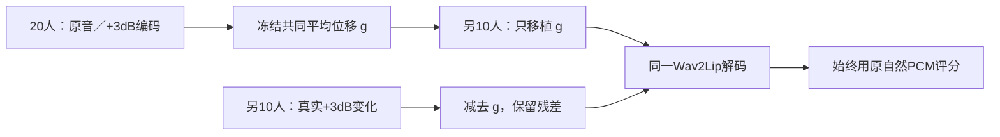

# 增益共同方向与残差的留出说话人生成验证

> 路径说明：`${USER_HOME}`代指原记录对应的个人主目录，不表示接收者已有该文件。定位归档时继续核对资产映射与原运行凭据；示例中的相对仓库路径从仓库根解释。

## 结论

**从20位说话人估出的固定增益共同位移，可以在另外10位说话人上独立产生正向Sync-C响应，但未完整复制真实+3dB增益，也未证实它优于剩余分量。** 非负输入控制仍有正向C响应，但其距离曲线分解不同；这不是视觉质量改善的证据。

## 问题与设计

用户要求：仅移植增益共同方向，与剩余方向分量比较，在未参与共同方向估计的说话人上验证，并注意GPU占用。

拟合组为报告46的20人（10M/10F），每人一句；验证组固定为旧CAL的S0052–S0061共10位男性，每人按ID取第一句。两组说话人严格不重叠。验证队列曾参与其它分析，属于轴拟合留出，不能称全新未见科学确认。

每帧u=z/||z||；拟合组每句先取u_plus3−u_raw均值，再按人等权得到固定g。验证人的COMMON=||z_raw||×unit(u_raw+g)，不读取该人的增益编码，不调剂量。RESIDUAL使用r=u_plus3−u_raw−g，再按相同规则解码；这是相对训练平均变化的残差，**不是正交投影分解**，也是需要真实增益编码的机制对照。g+r在输入方向空间准确重建完整增益方向，输出评分不假定线性相加。

所有纯方向臂保留逐帧原编码长度。新增COMMON_NONNEG和RESIDUAL_NONNEG，先将合成方向目标中的负坐标置零再单位化，显式检查编码器非负范围约束；不静默裁剪主分析。各人8臂共80视频：BASE、BASE_REPEAT、GAIN_P3、FULL_DIRECTION、COMMON、RESIDUAL及两NONNEG。

固定同一历史primary face、生成框和评分框；重新执行编码、生成与评分。评价音频始终为该句原自然PCM。主分析为共享guard20查询范围，完整31偏移距离曲线；固定偏移取BASE最佳位置，全部处理臂复用。次要FULL支持独立报告。按10人配对bootstrap 20000次、seed20261018，区间为未作多重比较校正的95%探索性区间。

## 主结果

所有Δ均相对BASE，主guard20。

| 操作 | ΔSync-C | 95%区间 | 正向人数 |
|---|---:|---|---:|
| 实际音频+3dB | +0.122 | [+0.060,+0.188] | 9/10 |
| 完整增益方向，保留原范数 | +0.100 | [+0.030,+0.167] | 8/10 |
| 仅固定共同位移 | +0.055 | [+0.008,+0.104] | 7/10 |
| 仅剩余位移 | +0.044 | [−0.015,+0.106] | 7/10 |
| 共同位移＋非负控制 | +0.069 | [+0.026,+0.118] | 9/10 |
| 剩余位移＋非负控制 | +0.027 | [−0.021,+0.073] | 6/10 |

| 直接配对比较 | ΔSync-C | 95%区间 |
|---|---:|---|
| 共同−真实增益 | −0.067 | [−0.120,−0.009] |
| 共同−完整方向 | −0.045 | [−0.094,+0.004] |
| 共同−残差 | +0.011 | [−0.040,+0.069] |
| 非负共同−真实增益 | −0.053 | [−0.097,−0.008] |
| 非负共同−非负残差 | +0.042 | [−0.001,+0.082] |

运行前冻结的“完整复制”要求：真实增益和共同臂相对BASE的95%下界均正，且共同对真实增益、共同对完整方向的95%区间均落入±0.05 C，并与非负控制相容。**正向响应门通过，等效门未通过。** 不能用“共同对完整方向差异不显著”替代等效证明；也不能用残差区间跨零证明残差无贡献。

## 分数为何变化

| 操作 | Δ背景距离B | Δ最佳距离Dmin | Δ零偏移距离D0 |
|---|---:|---:|---:|
| 真实+3dB | −0.011 | −0.132 | −0.029 |
| 完整方向 | −0.012 | −0.112 | −0.027 |
| 共同 | −0.000 | −0.056 | −0.018 |
| 残差 | −0.000 | −0.045 | −0.024 |
| 非负共同 | +0.049 | −0.020 | +0.029 |
| 非负残差 | +0.011 | −0.017 | −0.003 |

真实+3dB的Dmin 95%区间[−0.200,−0.061]；共同Dmin[−0.123,+0.003]。非负共同的B[+0.011,+0.094]，Dmin[−0.080,+0.043]，D0[−0.013,+0.078]。因此非负版保留C增量，不等于复制真实增益的完整评分机制。各处理的最佳偏移均与各自BASE相同（9人−3帧、1人−2帧），所以Cfixed的变化与C一致；没有靠重新选最佳时滞获得额外优势。

FULL支持的C增量按主表顺序为+0.115/+0.102/+0.051/+0.038/+0.040/+0.024；不替换主guard20。

## 干预幅度与范围

| 操作 | 平均方向角变化 | 负坐标比例 |
|---|---:|---:|
| 真实增益／完整方向 | 4.052° | 0 |
| 共同 | 1.603° | 14.17% |
| 残差 | 3.678° | 32.86% |
| 非负共同 | 1.451° | 0 |
| 非负残差 | 3.570° | 0 |

原始共同／残差臂有明显负坐标，属于内部干预，不能直接称可部署音频处理。非负版本是对这一风险的敏感性控制，不等于已保证位于训练分布内。共同与残差角度不同，本次检验真实分解分量，不是等剂量方向优劣竞争。也不计算“共同解释了多少百分比增益”；非线性解码、单位化及评分相互作用仍存在。

## 工程核验与资源

- 拟合40个编码文件逐一匹配历史manifest；10个验证音频原SHA一致；人名单无交集。Wav2Lip、SyncNet权重SHA与历史一致。
- 本机RTX4060／PyTorch2.5.1cu121，TF32关闭；batch4，allocator上限40%。4项拟合组fresh编码桥接最大绝对误差2.444e-6、相对L2≤8.395e-7，优于冻结1e-4阈值。
- 全10人原生forward与直接decoder浮点输出最大差0；BASE/BASE_REPEAT像素与视觉特征／距离矩阵10/10逐位一致。
- 80视频及评分完整；独立消费者不导入producer core，从保存视听特征重建全部距离矩阵，最大差3.815e-6；标量端点误差0，干预向量重建差0，保范数相对误差≤1.407e-8。
- 本机PyTorch峰值allocated约299MiB、reserved386MiB。运行后GPU进程退出，实查空闲5576MiB。Ubuntu单V100当时在训练、根盘738MiB和SHM230MiB；本实验未占用其GPU或写入实验产物，只读复制现有权重/源码。
- attempt01因TF32桥接偏差在留出生成前停止；attempt02因Windows结果清单原子替换短暂占用，生成11条件后停止。原件保留；关闭TF32及增加写入重试后，attempt03全80条件完成。未放宽科学阈值或按结果改样本。

## 证据与复现

代码：`scripts/experiments/gain_shared_direction_20261018/{core,prepare,run,analyze}.py`；合同测试：`tests/experiments/test_gain_shared_direction_20261018.py`。

权威完整产物：`${USER_HOME}/.codex/tts-exp-artifacts/gain-common-direction-20261018/run_attempt03/`，约50.0MB，包含80个MP4、全部latent、音频／视觉特征、距离矩阵、输入清单、运行receipt、analysis和independent_qa。同级environment.txt记录独立环境，worker_attempt03.log记录执行。两个早期失败目录保留。

仓库轻量镜像：`runs/gain_shared_direction_20261018/`保存路径指针、协议、分析、QA、receipt、成员SHA索引及本报告；不把外部C盘完整产物误称已上传云端。再次执行需新输出目录并显式设GAIN_RUN_DIR，不能覆盖原run。

## Observations

- [status] CONCLUDED_DESCRIPTIVE_PILOT；20人拟合、10位轴拟合留出男性、80视频及独立数值重建完成。
- [conclusion] 固定共同位移产生+0.055 C、95%[+0.008,+0.104]的生成端响应；真实+3dB为+0.122，不能声明完整复制。
- [result] 非负共同仍+0.069 C、95%[+0.026,+0.118]，但主要表现为背景距离上升；非负控制不支持直接感知质量主张。
- [limitation] 共同与残差差异区间跨零；不能据单臂显著性认定共同主导，残差也不是正交分解。
- [next_step] 若继续确认，应在新队列复核固定非负共同干预，并明确独立视觉目标；本次不自动追加调参或新队列。

## Relations

- follows [[纯增益编码方向的跨说话人共性补算]]
- follows [[TTS 编码方向共性与电平混淆的配对音素补算]]
- relates_to [[句级音量在编码器中的方向与范数响应]]
- relates_to [[研究交接总览]]