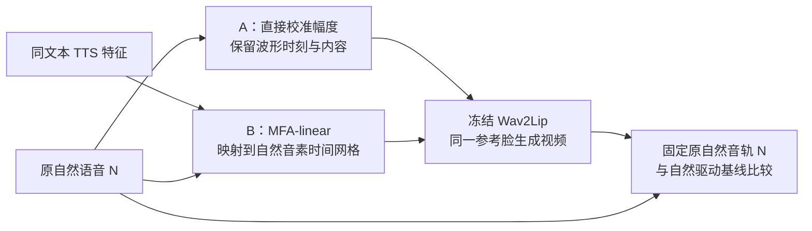

# 从 TTS 高分到可控驱动

**唇形生成的输入机制与迁移边界**  

> **核心问题：TTS 的原生评分优势，能否转化为保留自然音轨的生成收益？**

**已完成的回答：定位幅度通路，修复一类重合成停顿错误，并测出修复后仍存在的差距。**

---

## 1. Abstract｜研究概览

| 环节 | 核心信息 |
|---|---|
| 背景 | 数字人需要让嘴部运动匹配交付音轨；保留原声时，改善驱动输入具有实际价值。 |
| 现有方法 | 同步监督、语义表征与音频前端比较已推动生成研究。[1–4] |
| 问题 | TTS 原生高分同时包含声音、时刻和视频的变化，尚不能给出保留自然音轨的有效改造方案。 |
| 方法 | 冻结生成器、固定原自然音轨，分别检验直接幅度校准与按音素时刻重合成；对响应做内部干预与错误定位。 |
| 结果 | 旧40人幅度编码方向干预使 Sync-C **+0.161**。新20人固定自然音轨验证中，固定RMS **+0.049、14/20人提升，95%区间跨零**；预定+3dB **+0.067、15/20人提升，四剂量同时区间为正**。MFA-linear的6条缺失停顿样本修复后均改善，全部17条仍低于自然基线 **0.674**。[E4,E10,E16] |
| 贡献 | 给出一条已定位的生成端响应路径，以及一类有对照、有后续复核的重合成缺陷与修复边界。 |

TTS＝文本转语音；TFG＝音频驱动说话人脸生成。**本文定位：现象与机制的实证研究。**

---

## 2. Method｜把原生优势转成可检验的生成问题

### 2.1 领域进展与研究缺口

| 已有进展 | 代表工作 | 本文关注的具体缺口 |
|---|---|---|
| 用同步专家监督生成 | Wav2Lip、LatentSync [1,2] | 冻结模型后，输入改动通过什么路径影响输出？ |
| 用语义信息改善音频特征 | Wav2Sem，3D面部动画 [3] | 在现有冻结生成器中，哪些实际输入操作产生收益？ |
| 比较自然／合成语音及前端 | Comparative Analysis [4] | 原生输入比较如何转化为保留自然音轨的干预？ |
| 多维评价同步与视频质量 | THEval、PVSync [5,6] | 分开报告评分响应、口部运动和感知同步。 |

**本文检验两条具体路线：直接校准自然输入，以及把 TTS 特征重合成为自然时刻上的驱动音频。**

### 2.2 三个递进问题

| 问题 | 可检验假设 | 判别实验 |
|---|---|---|
| Q1：原生优势能否复现？ | TTS 在多个数据／模型条件下有较高原生 Sync-C | 各自生成、各自音轨评分 |
| Q2：tts的怎样的特征导致了优势 | 自然音频幅度经前端改变生成器的编码与输出 | 固定自然音轨，拆分频谱坐标及编码方向／长度 |
| Q3：按自然时刻搬入 TTS 特征，障碍在哪里？ | 未匹配停顿的错误回退是 MFA-linear 失分的一项可修复原因 | 停顿位置对照、修复复核、自然特征重建基线 |

**Q2定位一个有效操作；Q3检验一条迁移路线。二者不构成对全部 TTS 优势的分解。**

### 2.3 生成与评分框架

**原生比较使用各自音轨；所有生成端干预使用同一原自然音轨。**

幅度收益的明确分母是`S(G(gN),N)−S(G(N),N)`：第二项为自然音频自驱动、自评价。报告45固定视频的局部clock恢复比较`S(V,R_local)−S(V,R_affine)`，属于评价端异实例匹配，不能当作超过自然self基线。其可执行覆盖只有5/24（来自2人）、完整来源0/4，必须与合格子集5/5提升一起报告。[E16]

| 路线 | 实际操作 | 关键对照 |
|---|---|---|
| 幅度校准 | 整段乘以固定规则计算的增益；RMS＝波形的均方根幅度 | 原自然驱动；频谱分区；编码方向／长度分离 |
| MFA-linear | 按音素对应关系插值 TTS 的 WavLM 特征，再由 HiFi-GAN 合成波形 | 原自然驱动；自然特征经同一后端重建 |
| 停顿修复 | 修复未匹配停顿的映射，或仅将缺失停顿置静音 | 等时长发声位置置静音；不同说话人复核 |

MFA＝根据给定文本估计音素时刻的强制对齐器；**构造时使用自然时间网格，不代表合成后的实际发音时刻已完全一致。**

---

## 3. Experiments｜原生现象 → 有效通路 → 迁移障碍

### 3.1 原生现象：跨生成器、跨 TTS、跨数据集的评分响应

**研究起点不是单个模型案例：已有多生成器、多 TTS 和多数据集实验。**

原生比较＝自然／TTS分别驱动视频，并分别使用自身音轨评分；以下差值均为 TTS−自然。

**表 1b｜固定 Wav2Lip，改变 TTS：英文 LRS3 四种来源**

| TTS 来源 | 配对数 | ΔSync-C ↑ | 95%区间 | ΔSync-D ↓ |
|---|---:|---:|---|---:|
| Qwen cloud | 18 | +0.736 | [+0.365,+1.144] | −0.237 |
| Qwen local | 18 | +0.408 | [−0.035,+0.857] | −0.228 |
| IndexTTS-2 | 18 | +0.400 | [+0.187,+0.599] | +0.059 |
| CosyVoice2 | 18 | +0.613 | [+0.097,+1.052] | −0.258 |

**四种来源的点估计均正；Qwen local 区间跨零。** 共72配对／36来源组，各TTS的18条子集不同，不能据此排列TTS优劣；区间为逐项、未作多重校正。[E3]

中文 Ditto 的早期多 TTS 结果也为正：Qwen **+1.246**（9对）、IndexTTS2 **+1.040**（13对）、GSV **+0.600**（13对）；不同支持集单列，不与英文合并。[E15]

**表 1c｜扩大样本与数据域：100条中文及五数据集复核**

| 数据／协议 | 生成器 | 配对数 | ΔSync-C ↑ | ΔSync-D ↓ |
|---|---|---:|---:|---:|
| AISHELL-1，历史协议 | Ditto | 100 | +1.022 | −0.069 |
| 五数据集，历史协议 | Ditto | 250 | +0.980 | +0.117 |
| 同一母队列 | LeapTalk | 248 | +1.256 | −0.338 |

五数据集＝MEAD／VFHQ／TalkVid／LRS3／GRID；同一母队列不重复计为独立样本。[E1,E2]

> **结论：TTS 原生高分不局限于单一生成器、TTS来源或数据集；效应依赖具体组合，不能直接推成保留自然音轨的增强收益。**

Sync-C＝匹配位置相对错位位置的突出程度；Sync-D＝最佳匹配位置的特征距离。**二者并非总是同时改善；上述覆盖不是完整的“TFG×TTS×数据集”全组合实验。**

---

### 3.2 有效通路：幅度变化会改变编码方向

**问题：保持同一发声，只改幅度，生成器内部哪里产生了有效变化？**

log-mel＝随时间变化的对数频谱；编码方向＝特征分量的相对组合；编码长度＝向量总体大小。

**波形层起点：** 80条、40位说话人，固定原自然音轨，句级幅度校准使主脸 Sync-C **+0.192**、第二参考脸 **+0.135**，99%区间均高于零。[E11]

**表 2｜同一幅度变化的内部因素分离：40位说话人，Wav2Lip**

| 只保留哪一部分变化 | ΔSync-C | 99%置信区间 |
|---|---:|---|
| 未被数值截断的频谱坐标 | +0.171 | [+0.101,+0.245] |
| 触及截断边界的频谱坐标 | −0.009 | [−0.037,+0.019] |
| 编码方向 | +0.161 | [+0.094,+0.232] |
| 编码长度 | +0.020 | [−0.006,+0.046] |

固定原自然评分音频；各自分解对照与共同有效窗口。[E4]

> **结论：在该幅度操作下，编码方向的效应比编码长度高 0.142，99%区间 [+0.077,+0.212]。**

---

### 3.3 迁移诊断：修复停顿错误，仍未追平自然驱动

**问题：把 TTS 特征映射到自然音素时间网格后，为什么仍有失分？**

**表 3｜发现队列：只修正确位置，还是任意静音都有效？**

| 操作 | 受影响样本 | 相对原 MFA-linear 的平均 ΔSync-C |
|---|---:|---:|
| 仅将缺失停顿置静音 | 5条／5位说话人 | +0.375；5/5提高 |
| 等时长发声位置置静音 | 同5条 | −0.297；1/5提高 |

10条发现队列中5条有缺失长停顿；两臂基于同一原波形、同长度与淡入淡出，均配原自然音轨。[E9]

> **结论：这项局部修复依赖位置；正确停顿处理比发声位置对照高 0.672 Sync-C。**

**表 4｜后续复核：17条、5位未进入发现队列的说话人**

| 驱动输入 | 原自然音轨下 Sync-C ↑ | Sync-D ↓ |
|---|---:|---:|
| N：原自然语音 | 5.576 | 6.966 |
| M：原 MFA-linear | 4.764 | 8.202 |
| F：停顿修复版 | 4.902 | 7.892 |
| R：自然特征经同一后端重建 | 5.447 | 7.257 |

**有缺失停顿的6条：F−M＝+0.337，6/6提高；全部17条：F−M＝+0.139，N−F＝+0.674。** [E10]

> **结论：局部缺陷可以修复，但该重合成方案仍未获得相对自然驱动的平均收益。**

**同后端的自然重建 R 比修复版 F 高 0.545：差距不宜全部归给共同重建流程。** 特征来源、映射与实际发音变化仍未分离。[E10]

F包含整套停顿处理，部分停顿外采样也改变；其效果不等同于表3的纯局部置静音。

### 3.4 关键图表规格

| 图 | 横轴 | 纵轴／分组 | 回答什么 |
|---|---|---|---|
| 图1：原生优势 | TFG／TTS／数据集，三个面板 | 原生C或ΔSync-C；有区间则展示，各批次单列 | 现象能跨哪些条件复现，哪些条件未复现？ |
| 图2：幅度机制 | ΔSync-C及99%区间 | 表2四项干预 | 响应落在哪个内部因素？ |
| 图3：停顿位置对照 | 正确停顿／发声位置 | 配对ΔSync-C；5条连线 | 修复是否具有位置针对性？ |
| 图4：修复与剩余差距 | N／M／F／R | 原自然音轨Sync-C；按说话人分面 | 修复解决多少实际差距？ |

以上为**已完成结果的作图规格**；展示版使用流程图与表格，逐样本图需恢复对应产物后绘制。

---

## 4. Contributions｜已完成的贡献

| 贡献 | 实证答案 | 研究用途 |
|---|---|---|
| **定位输入幅度的生成端通路与边界** | 内部干预定位频谱坐标和编码方向；新20人剂量实验复现口部运动变化及预定+3dB评分响应，固定RMS主区间跨零 | 给出冻结Wav2Lip的作用位置、完整受益分母和剂量／支持／个体边界 |
| **定位并修复重合成中的一类错误** | 缺失停顿的正确位置处理优于发声位置对照；后续队列修复仍有正向响应 | 为同类音素映射重合成提供具体修复对象，并明确修复后仍有剩余问题 |

> **论文记忆点：TTS 原生高分只是起点；本文将其推进到一个可定位的输入通路和一个可修复的迁移障碍。**

**当前尚未建立通用增强方法，也未证明上述评分收益等同于人类感知改善。**

---

## 5. 补充实验｜幅度六环已完成，停顿单操作独立待办

**优先复核已有正向路径；不新增训练，不用更多失败方案充实主文。**

| 优先级／实验 | 最小设计与成本 | 补上哪一环 | 判定与已有依据 |
|---|---|---|---|
| **P0：幅度已有结果复核，已完成** | 旧40人内部因子及15人native电平四格，0次新生成 | 已形成内部通路／完整曲线／native gap图 | 实际原数组关键复核通过；旧证据不计新独立复现；MFA资产分支仍待办 |
| **P1：新20人幅度验证，已完成** | 原音／FIXED各两重复80视频；四非零档另80；160/160全部完成 | 直接比较自然self基线并公布全部人效应 | FIXED主+0.049，14/20正，CI跨零；预定+3dB+0.067，15/20正，同时CI为正；口部／支持分开解释 |
| **P2：停顿修复单操作，独立待办** | 既有6条；原M／仅停顿置零／等时长发声置零，未来18视频 | 将整套修复的收益与单纯停顿操作分开 | 尚无本轮新结果；原M和8段标注尚待完整冻结；不从F反推M |

**P1有40人幅度证据支持；P2有发现队列的位置对照支持。已有依据提高可行性，不保证正向结果。**

P1先核查来源独立性；P2属于已见样本的机制复核。RMS规则、随机种子、排除条件和分析在评分前固定；未复现则收窄主张，保留全部预定样本。

**当前状态：** 幅度六环的实际输入、160视频、原数组、口部、区间与图已读回并复核，见报告46。P2与MFA资产恢复作为独立待办；跨模型扩展、人工盲评与增强头训练均未因本次结果自动恢复。

---

## 文献

1. **Wav2Lip** · ACM MM 2020 · 以同步专家监督唇形生成。[论文](https://arxiv.org/abs/2008.10010)
2. **LatentSync** · 2024／修订2025 · 扩散模型中的同步监督。[论文](https://arxiv.org/abs/2412.09262)
3. **Wav2Sem** · CVPR 2025 · 用语义信息解耦3D语音驱动动画的音频特征。[正式论文](https://openaccess.thecvf.com/content/CVPR2025/html/Li_Wav2Sem_Plug-and-Play_Audio_Semantic_Decoupling_for_3D_Speech-Driven_Facial_Animation_CVPR_2025_paper.html)
4. **Comparative Analysis of Audio Feature Extraction** · 2024／正式版2025 · 自然／合成语音与音频前端比较。[论文](https://arxiv.org/html/2411.13209v1) · [正式版](https://www.mdpi.com/2504-2289/9/3/59)
5. **THEval** · 2025／v4 2026 · 多维评价与编码敏感性。[论文](https://arxiv.org/html/2511.04520v4)
6. **PVSync** · 2026预印本 · 时间偏移与发音口型评价。[论文](https://arxiv.org/abs/2610.09223)

---

附录 A｜评分处理控制：为什么核心实验固定评价音频

**同一组视频，仅交换自然／TTS两组各自音频的编码处理路径，就能改变原生分差的方向。**

| 评分音频处理 | TTS−自然 ΔSync-C | 95%区间 |
|---|---:|---|
| 自然走16k默认编码，TTS走24k默认编码 | +1.308 | [+0.989,+1.616] |
| 自然走24k默认编码，TTS走16k默认编码 | −0.418 | [−0.787,−0.073] |
| 两组均使用源PCM | +0.287 | [−0.090,+0.648] |

47对固定视频；交换的是处理路径，各视频始终配自己的发声。[E5]

- 16k路径：16kHz PCM→默认24kbps MP3→解码为16kHz。
- 24k路径：同一PCM上采样至24kHz→默认32kbps MP3→解码为16kHz。
- 上采样不增加原始信息；这组路径差异包含码率差，不能解释为采样率的纯效应。
- 同为64kbps时，TTS−自然分差为+0.285，接近源PCM条件。

**作用：确定主实验必须统一评分音频处理；不把“损伤音频会降分”作为独立创新。**

另一组 Wav2Lip／云Qwen 在源PCM下仍有+0.935，说明上述编码控制不能解释全部队列。[E6]

附录 B｜为何不直接把自然／TTS的可分类差异当成增强目标

**74对、13位来源说话人留出验证：声学条件分类 AUC＝0.972，但七类特征的逐句分差预测未优于均值基线。**

| 分差预测器 | 样本外 R² ↑ | MAE ↓ |
|---|---:|---:|
| 训练折均值 | −0.006 | 0.743 |
| 七类特征＋岭回归 | −0.140 | 0.850 |
| 冻结浅树 | −0.314 | 0.812 |

AUC＝区分自然／TTS的能力；R²＝预测解释度；MAE＝平均绝对预测误差。同一说话人全部条件共折。[E7]

**作用：支持采用直接干预检验候选因素；当前预测器失败不证明不存在可预测机制。**

附录 C｜候选机制筛查：探索性证据

| 候选因素 | 已完成检验 | 结果与适用范围 |
|---|---|---|
| 音素分离度／稳定性／局部特征长度 | 两位复用说话人、三生成器、三个因素；实际因素操纵并保留指定非目标量 | 18个端点中4个单项通过，0/9个“模型×因素”组合两人同时通过；不作总体无效性推断。[E8] |
| 波形平均谱形 | 同两人×三模型，把TTS平均谱形施加到自然波形 | 0/6通过；仅限该操作与剂量。[E8] |
| 音素内谱形联合移植 | 40位说话人；保留受体时刻、音高、能量；与自身重建比较 | TTS→自然 Δ固定时滞C＝−0.197，同时99%区间[−0.381,−0.013]。[E4] |
| ASR错误定位与局部替换 | 自然语音错误区与低同步区关联；13个发现来源的TTS局部替换 | 弱相关，替换ΔSync-C中位数−0.034；未证明替换改善可懂度，不能推断“可懂度无用”。[E12] |

原生筛查通过标准为C提高且最佳、零偏移距离均不恶化；特征长度不是音量。谱形＝各频带相对能量分布；固定时滞C使用预先固定的音视频偏移。

这些结果记录已测试路线，**不作为“幅度是唯一原因”或“表征改进普遍无效”的证据**。

统计、比较范围与补实验细节

- **研究范围：** 机制及停顿修复主文集中于中文、Wav2Lip；原生现象跨模型不等于机制已跨模型确认。
- **原生比较：** 同时改变驱动、视频和评分音轨；其效应不与固定音轨干预相加，不计算总TTS优势解释比例。
- **英语证据：** 表1四TTS各18来源、子集不同，共36来源组；组等权ΔC的95%区间[+0.309,+0.782]。LibriSpeech排除主推断，其他公共语料也不自动视为无训练污染。
- **幅度完整操作：** 原自然波形乘以句级增益，既有RMS目标为0.0376838172675746；编码方向与长度使用RAW和FIXED的实际编码端点。未截断／边界坐标分区与方向／长度分解是两种实验，不合并成唯一中介比例。[E4,E13]
- **幅度区间：** 原波形校准主脸+0.192的99%区间[+0.111,+0.276]，第二脸+0.135的区间[+0.071,+0.207]；表2用各自raw几何、guard20共同支持。直接比较未截断−边界为+0.180 [+0.109,+0.253]。[E4,E11]
- **视觉范围：** 40人幅度校准的自然口部开度增加0.002899 [0.001844,0.003940]，开度速度增加0.022588 [0.014555,0.030767]/秒，均为99%区间；开度以双眼距离归一化，不代表构音准确或时间更准。[E4]
- **MFA基线：** N是自然驱动；M是原MFA-linear；F是停顿回退与缺失停顿修复版；R是自然特征经同一WavLM-L6／HiFi-GAN重建。全部使用同一自然音轨与相应共同协议。[E9,E10]
- **发现与复核：** 表3的P/C是只改对应窗口的波形操作，5个受影响样本均来自10人发现队列；表4的F是整套修复，在17条、5位新于发现队列的说话人上评估。两套操作的收益不合并。
- **剩余差距：** 表4 N高于F为14/17条，5位说话人的组内平均同向；R高于F为15/17条。不能将R−F唯一归给TTS来源，仍包含映射与声学变化。[E10]
- **小样本统计：** 表3–4列原报告描述均值与完整分母，未补造置信区间。逐条图按说话人标记；后续区间按来源说话人聚类，不把帧数当独立样本数。
- **P0：** 先读现有评分分解，固定同一支持下区分C变化、匹配距离和错位背景；不把旧结论再算一次新发现。视频只展示预定全体或按音频属性选例，避免按最高得分挑例。
- **P1（完成）：** 20人（10M/10F）独立于本项目幅度调参与既有机制分析，每人1句；RAW/FIXED各2次80视频，加四非零档80，共160。每人先平均重复；全部20人保留。主95%配对区间、四剂量max-|t|同时95%区间与其他pointwise描述区间分开。RAW/FIXED重复绝对差均值0.004593/0.001094，最大0.042947；14人两重复均正、6人均负。公共语料不自动称预训练无污染。[E16]
- **P1输入资格：** 沿用原目标RMS，不做本批最优增益搜索。先检查静音、削波、长度和来源重叠，公布未通过数；不临时加限幅器或改目标。不满足独立来源条件时只称重复验证。只有波形层独立复现，不能称内部四格机制也独立复现。
- **P2：** 用表4的6个已见缺失停顿样本与原M音频，冻结其8段标注；P仅在停顿置零并沿用20ms边缘，C按固定种子在发声区等时长处理、远离真停顿。3臂同批渲染，共18视频；验证非目标波形采样不变、总时长一致，记录整体RMS变化，不额外全局归一化。
- **P2端点：** 整句原自然音轨ΔC为主；逐帧口部运动与目标窗口时间重叠另报，短停顿不硬配一个音素级Sync-C。6条为机制复核而非新泛化队列，不凭6条下普遍结论。
- **幅度产物可用性：** 新160视频/原自然PCM绑定/A-V与encoder数组/口部landmarks/receipts已本地读回。主数组与曲线/公式、实际WAV和口部轨迹关键QA通过；full尾部上下文与mouth join实现错误均create-only修复，原错误产物保留，0模型重跑。canonical分析为`analysis_results_attempt02`；源路径与hash见报告46。两组MFA/P2资产未完整冻结，不在本轮补造结果。[E16]

附录 E｜多模型原生评分明细与协议边界

**早期9种TFG：同一TTS来源、AISHELL-1历史13条母样本。** 下表保留评分汇总中的两臂均值，不将其差值补写成统一完整配对效应。[E14]

| 生成器 | 自然 Sync-C | TTS Sync-C |
|---|---:|---:|
| Wav2Lip | 7.393 | 8.922 |
| IMTalker | 6.235 | 7.369 |
| V-Express | 5.975 | 6.506 |
| MuseTalk 1.5 | 5.789 | 6.326 |
| Ditto | 5.670 | 6.819 |
| JoyVASA | 4.936 | 5.591 |
| EchoMimic V2 | 2.980 | 3.165 |
| Hallo2 | 5.916 | 5.846 |
| LatentSync | 4.653 | 4.581 |

- 13条为输入母样本数，不是每行已核验的有效配对数；早期报告存在配对支持与版本差异。正文仅据此报告方向覆盖，不将上表当统一性能榜。
- Hallo2关闭了官方默认人声分离；EchoMimic V2使用合成静态姿态。两项结果仅适用于所测配置。
- 早期另一份完整案例分析中，Wav2Lip／MuseTalk／JoyVASA／LatentSync的ΔC为+1.515／+0.572／+0.329／−0.063；Ditto的9对为+1.246。它们不替换本表两臂均值，也不与后续批次混算。[E15]

**后续5种TFG：保留各批次有效配对与原报告差值。** [E14]

| 生成器 | 配对数 | ΔSync-C ↑ | ΔSync-D ↓ | 协议说明 |
|---|---:|---:|---:|---|
| SoulX-FlashHead Pro | 12/13 | +0.739 | −0.594 | 1条TTS视频过短、人脸轨迹为空 |
| LeapTalk | 13/13 | +0.999 | −0.868 | 26/26视频评分成功 |
| AVTR-1 | 13/13 | +0.327 | −0.198 | 26/26视频评分成功 |
| AvatarForcing | 13/13 | −0.110 | +0.498 | 26/26视频评分成功 |
| StableAvatar | 13/13 | −0.024 | +0.268 | 最短人脸轨迹阈值改为25帧，单列 |

**另有两种补充协议，不计入上述中文14模型。** [E14]

| 生成器／数据 | 配对数 | ΔSync-C ↑ | ΔSync-D ↓ | 解释 |
|---|---:|---:|---:|---|
| Hallo3／五数据集各5条 | 24/25 | +0.540 | +0.354 | ΔC的95%区间[−0.098,+1.177]，未确认稳定优势 |
| Seedance 2.0／LRS3英文、动漫参考脸 | 6 | +0.005 | −0.155 | ΔC检验p=0.992；不支持该小队列的正向优势 |

**多TTS证据边界：** 中文F5-TTS在所引早期对比中仅完成音素特征分析，ChatTTS仅完成生成／部署，均不计为该批下游TFG验证。中文旧文档曾把Qwen记作“Qwen3-VC”；此处沿用数值来源，不将其与英文cloud/local配置视为同一条件。[E15]

**英文四TTS汇总：** 先平均每个来源的两种TTS增益，再对36来源等权，ΔC＝+0.539，95%区间[+0.309,+0.782]；ΔD＝−0.166。属于既有数据的探索性复算，不是新增独立队列。LRS3存在来源复用及训练来源风险；LibriSpeech按既有资格决定排除，不纳入英文支持证据。[E3]

实验来源 E1–E16

- **E1｜中文原生复现：** [报告15](../docs/experiments/15-tfg-link.md)。
- **E2｜五数据集：** [multiset实验](<../Experiments/跨数据集 TFG 测评（5×50 multiset）.md>)。
- **E3｜英文四TTS：** [论文证据汇总](<论文实验数据整理与写作主线.md>)。
- **E4｜幅度通路、视觉测量与谱形移植：** [机制报告25](../docs/experiments/25-tts-tfg-mechanism.md)。
- **E5｜固定视频的编码路径控制：** [原始配对审计](../../runs/tts_clock_cross_20260926/report.md)。
- **E6｜无损后的剩余优势：** [统一PCM与迁移审计](<../Experiments/统一无损音轨后的跨模型剩余优势与自然音频替换审计 2026-09-26.md>)。
- **E7｜条件分类与增益预测：** [报告43](../docs/experiments/43-processing-chain-predictive-audit.md)。
- **E8｜原生因素与真实波形谱形筛查：** [报告39](../docs/experiments/39-native-input-factor-mechanism-screen.md)。
- **E9｜停顿位置对照与诊断：** [报告33](../docs/experiments/33-mfa-linear-content-pause-prosody-mapping.md)。
- **E10｜17条、5位新说话人复核：** [报告36](../docs/experiments/36-mfa-linear-heldout-speech-residual.md)。
- **E11｜幅度波形干预与双参考脸：** [机制确认](<../Experiments/TTS 来源方向与声学机制确认.md>)；旧来源方向阴性与幅度阳性按不同操作解释。
- **E12｜ASR辅助证据：** [相关性](<../docs/experiments/LRS3 ASR 错误与局部同步低分相关性实验.md>)、[局部替换](<../docs/experiments/ASR-targeted local replacement prototype.md>)。
- **E13｜幅度编码分解与冻结RMS参数：** [句级音量的方向与范数](../Experiments/句级音量在编码器中的方向与范数响应.md)。
- **E14｜多TFG原生评分与后续补充：** [评分汇总](../docs/results/SYNC-C-SCORES.md)；[早期9模型报告](../docs/experiments/02-tfg-cross-model.md)。
- **E15｜早期配对支持与中文多TTS：** [多TFG详细报告](../docs/experiments/tfg_model_comparison_summary.md)、[原始跨TFG配对汇总](../../data/wav2sem_analysis/metrics/cross_tfg_validation.json)、[多TTS特征对比与下游覆盖](../docs/experiments/multimodel_tts_comparison.md)。
- **E16｜纯幅度六环与新20人验证：** [报告46](../docs/experiments/46-amplitude-gain-independent-validation.md)，含160完整分母、四剂量同时区间、距离／口部读数、旧40内部路径与旧15电平四格复核，以及报告45比较基线澄清。

