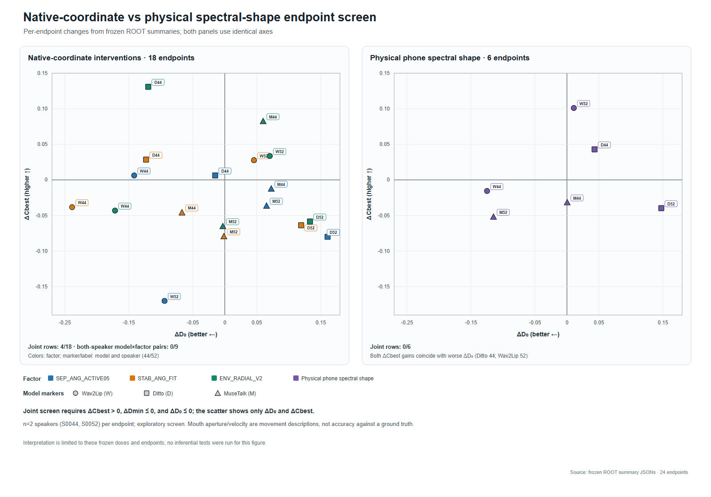

# 39-native-input-factor-mechanism-screen

固定RMS与自然时钟的三TFG原生因子干预及物理谱形筛查。

## 结论

**共同的可复制原生坐标已经建立；单独提高音素分离度、提高片段稳定性或改变局部原生半径，在本轮冻结剂量下均未形成双样本可复现增强。** 三模型×三因素共9格、18个因子端点，4/18单行通过，0/9格在两位说话人上同时通过。随后真实波形中的phone均值谱形候选6行，0/6通过，等模型/说话人平均ΔSync-C=+0.001；本候选停止扩展。

Sync-C的两处物理谱形增益均伴随原时钟距离D0恶化。独立嘴部开合/速度确实改变，方向混合；这些是运动描述，没有真人口形准确度标签。当前结果支持把后续问题推进到任务相关的表示结构与波形可实现性，而不扩大已失败的角度/剂量矩阵。通用增强头尚未成为可部署成果，项目的model-aware routing/RMS fallback状态保持由对应方法记录管理。

## 历史问题与本轮估计量

[03 因果机制](03-causal-mechanism.md)记录单一声学因素解释不足及驱动/评分交互；[15 表征关联](15-tfg-link.md)记录原生TTS评分优势与逐样本可分性预测之间的缺口；[38 局部谱修补](38-local-tts-spectral-repair.md)未确认目标修补优于sham。本轮在已有线索上，把三个方向写成原生输入可执行坐标，并直接检查下游运动。

本轮每个比较为：

`SyncNet(TFG(face,candidate), original_N) − SyncNet(TFG(face,RMS(N)), original_N)`。

生成输入固定内容/自然样本时钟与全局RMS；最终换回原自然PCM。历史原生TTS配对评分使用各自音轨，是另一个估计量，本报告不将二者的数值相减解释为机制贡献比例。

## 冻结设计与控制

- ✅ Wav2Lip、MuseTalk、Ditto三种已资格的原生前端；目标为BAC009S0044W0266和BAC009S0052W0386，两位说话人反复使用的小探索筛查，未作为确认队列。
- FIT模板/锚点只使用S0053–S0061的9位说话人、18对自然/TTS音频。target与下游分数不进入模板，不按响应选样本或调剂量。
- 16kHz mono，生成RMS=0.0376838172675746；自然原样本数分别59135/65855。最终评分/交付mux使用未修改自然PCM。
- 同模型内portrait、seed、batch、25fps和资格过的CPU编码→native注入profile保持一致；复用6个已有no-op及其分数/嘴部轨迹，无新baseline渲染。
- Wav/Muse/Ditto目标native帧数分别89/100、92/102、93/103。每个candidate与自己的no-op保持相同原时钟与支持；跨模型native窗口长度各按既有前端合同。Wav评分84/95 queries，Muse和Ditto87/97；Ditto的额外context帧不扩充自然音频评分支持。
- 预设逐行joint门：ΔCbest>0、ΔDmin≤0、ΔD0≤0。每模型/因子须两人通过；物理screen扩展还要求至少2模型双人通过且这些行meanΔC≥0.050。此次均未达扩展门。
- 实验单位是说话人；token/frame仅说明支持。n=2不作确认性p值或显著性结论。

## 1. 可复制的原生坐标

将每个原生frame/chunk展平为 `x_t=r_t u_t`，其中`u_t`为单位方向。

| 因子 | 操作 | 保持的主要坐标 |
|---|---|---|
| SEP_ANG_ACTIVE05 | 每token共用正交旋转，提高相对实际最近其他音素锚点的余弦margin | 每frame半径r、token内角Gram矩阵 |
| STAB_ANG_FIT | 向token单位中心方向收缩角离散，再共用旋转恢复中心方向 | 每frame半径r、单位中心的prototype方向 |
| ENV_RADIAL_V2 | 只改变局部半径轨迹，补偿token总r² | 每frame单位方向u、token总平方范数 |

STAB允许单位中心均值的模长改变。原始欧氏均值、方差和能量满足 `E||x||²=||Ex||²+tr(Cov(x))`，因此不同时要求降低欧氏方差、保持原始中心和能量三个互不相容条件。边界跃迁和其他collateral另行记录；“纯度”指上述冻结不变量。

原生半径不等于物理声学功率。重叠mel chunks和contextual embeddings的独立编辑存在分布外/波形不可实现边界。Ditto增加稳定性的操作与其观测TTS稳定性方向相反，是明确的counterfactual测试。

### 结果

| 因子 | Wav2Lip ΔC 44/52 | MuseTalk ΔC 44/52 | Ditto ΔC 44/52 | 双人通过 |
|---|---:|---:|---:|---|
| SEP_ANG_ACTIVE05 | +0.006 / -0.170 | -0.012 / -0.036 | +0.006 / -0.080 | 三模型均无 |
| STAB_ANG_FIT | -0.038 / +0.028 | -0.046 / -0.079 | +0.029 / -0.064 | 三模型均无 |
| ENV_RADIAL_V2 | -0.043 / +0.034 | +0.083 / -0.065 | +0.131 / -0.058 | 三模型均无 |

完整joint门还包括Dmin/D0，因此不能仅凭上表C判断通过。4条单行通过为Wav44 SEP和Ditto44 SEP/STAB/ENV；全部集中在S0044，S0052未复现。实际raw矩阵与嘴部轨迹已ROOT复核。逐行全部C/D/运动数据见[24行CSV](assets/39-native-input-factor-screen/native_physical_endpoint_rows.csv)。

## 2. 可实现的物理phone谱形

复用36条已有FIT WAV/MFA，16k、STFT1024/hop256，2ms cepstral lifter提取平滑log谱形并消除framepower。按token→utterance→speaker等权估计paired TTS−N，取speaker median的一半并clip±3dB；57/83phone达到至少3位FIT说话人支持。

在自然complex STFT上施加phone谱修正，补偿edited framepower，OLA恢复原N，再固定全局RMS，写FLOAT32 WAV。两目标RMS相对误差≤3.71e−10，零剂量重建误差≤1.32e−17。原相位用于构造；OLA重分析edited phase均值约0.01969/0.01575rad，edited局部功率median绝对漂移约0.01597/0.01619dB。因此记录了小相位/局部功率collateral，不称严格不变。

六个波形→原生CPU编码通过实际NPY核验；Wav生成模型实际forward输入与相应CPU candidate逐值一致。原自然全PCM和评分窗口PCM前缀均核验。该物理变换造成的native margin/stability方向仍混合，未按这些诊断筛选目标或调dose。

| 模型/说话人 | ΔC | ΔDmin | ΔD0 | Δ开合中位数 | Δ速度RMS | joint |
|---|---:|---:|---:|---:|---:|---|
| Wav2Lip/S0044 | -0.016 | -0.091 | -0.125 | -0.006248 | -0.023528 | fail |
| Wav2Lip/S0052 | +0.101 | -0.131 | +0.011 | -0.002804 | -0.071681 | fail |
| MuseTalk/S0044 | -0.032 | +0.064 | +0.000454 | -0.002176 | +0.021950 | fail |
| MuseTalk/S0052 | -0.052 | +0.018 | -0.115 | -0.001097 | -0.003985 | fail |
| Ditto/S0044 | +0.043 | +0.043 | +0.043 | +0.000488 | -0.007623 | fail |
| Ditto/S0052 | -0.040 | +0.147 | +0.147 | +0.001183 | -0.016357 | fail |

开合单位为IPD，速度为IPD/s。表格采用ROOT独立实际summary；其float64复算与canonical float32指标差<5e−6，所有门判定一致。小于0.001的D0保留6位以免隐藏正负号；Sync-C统一3位。

### 分数分解

`Cbest = median_lag(distance) − min_lag(distance) = B − Dmin`。

- Ditto/S0044：ΔC≈+0.043，同时ΔD0=ΔDmin≈+0.043；背景B增加约+0.086。C的增加包含背景几何变化。
- Wav/S0052：ΔC≈+0.101、Dmin改善约−0.131，最佳lag仍为+3帧；D0恶化约+0.011。
- Wav/S0044和Muse/S0052则D0改善而C下降，进一步显示两个端点的含义不同。

六行0joint、三模型0双人复现，固定phone均值谱形候选关闭，不扩说话人/剂量或重开旧训练。

## 3. 独立口部运动

所有候选都有实际MediaPipe嘴部轨迹，按同一25fps时钟计算归一化开合和速度；tracking完整，速度从实际开合差分独立核验。物理六行运动数据如上表，原生18行也在CSV中。开合增大或变快没有统一的质量排序。

补充的a/i/u中央20–80%token开合contrast，使用12条已有轨迹与冻结MFA。S0044唯一a的中央区间无frame，标UNMEASURABLE；S0052仅一个中央a frame。S0052 MuseSEP contrast增加约+0.006714而C下降−0.036；Wav ENV contrast下降约−0.011890而C增加+0.034且D0恶化。这是支持受限的描述性解耦，不是口形准确度或新准入门。

左上区域仅表示C增加且D0不恶化，完整joint仍需Dmin条件。SVG/CSV及绘图源保存在同一assets目录；ROOT目检图面、坐标、标签和计数合格，未重新评分或检验。

## 4. 证据与可靠性成本

本轮采用一次科学产物复核并复用已验baseline。source-schema/preflight错误保存后另attempt修复；已有效的音频/视频/评分均不为元数据重跑。缺失controller OS return code保留null，科学终局由worker rc、完整产物和真实进程终止共同确认。没有运行实现测试。

- `.codex/scratch/native_axis_model_factor_scope_render_20261014_attempt02/root_complete_native_coordinate_grid_summary.json` — `9e03f9c50dee1bb5300952572a3b88f9ac84fe97b7fc6c9679fa5bcb6449cc4f`
- `.codex/scratch/physical_phone_spectral_shape_fit_20261014_attempt04/root_physical_six_endpoint_summary.json` — `46fc88944e09af05ef0b73b733fda0e09c79efa1db34034b68e8edc3d0cadf12`
- `.codex/scratch/physical_phone_spectral_shape_render_20261014_attempt01/root_musetalk_physical_raw_endpoint_summary.json` — `6e5c7529ccee4c506428e76e3bdb43fc98a050d15911be1790431e0fdd525c06`
- `.codex/scratch/physical_phone_spectral_shape_render_20261014_attempt03/root_ditto_physical_raw_endpoint_summary.json` — `12b05d7470ba0fa737c6deae01d6e1bc8d346bc911a5d7b02181c2a7b9768c66`
- `.codex/scratch/physical_phone_spectral_shape_wav2lip_attempt02/root_wav2lip_physical_raw_endpoint_summary.json` — `c3d6aabe1abdbea4d04327a6c888fffe6bb77bf78b4b202971c1347403c9e56c`

两份汇总的同hash副本也保存在本报告assets/inputs；图和CSV只复制其已计算数值。[图源与产物receipt](assets/39-native-input-factor-screen/figure_receipt.json)给出输入/输出hash；更细的原数组、PCM、时钟和执行来源从上述ROOT summary继续追踪。紧凑readback不是服务器灾备。

## 实践决定与下一问题

当前数据将“有共同观察线索”和“单独操纵即可稳定增强”分开。可复制native坐标已经解决了操作定义，所测因素/剂量的下游充分性未成立；物理谱形并未转成可用通用增强器。后续只做独立、低成本的任务相关构音proxy CPU诊断，按active Task冻结映射/支持；该后续不改变本报告的门或结果。

## Observations

- [result] 原生3模型×3因子×2人18端点，4单行joint、0/9双人格；共同坐标可执行但本剂量不构成稳定增强。
- [result] 物理phone均值谱形6行0joint、meanΔC+0.001；两处C增益均D0恶化。
- [result] 独立mouth开合/速度改变方向混合，C增加不等同于原时钟同步或口型准确度提升。
- [decision] 当前native剂量和physical candidate停止GPU扩展；后续任务相关坐标须独立设计与证据。

## Relations

- relates_to [[研究主线与证据地图]]
- supported_by [[tts-exp/experiments/native-axis-factor-pilot-20261013]]
- relates_to [[tts-exp/tasks/native-axis-factor-pilot-20261013]]
- relates_to [[开发跨 TFG 的自然音频增强头]]