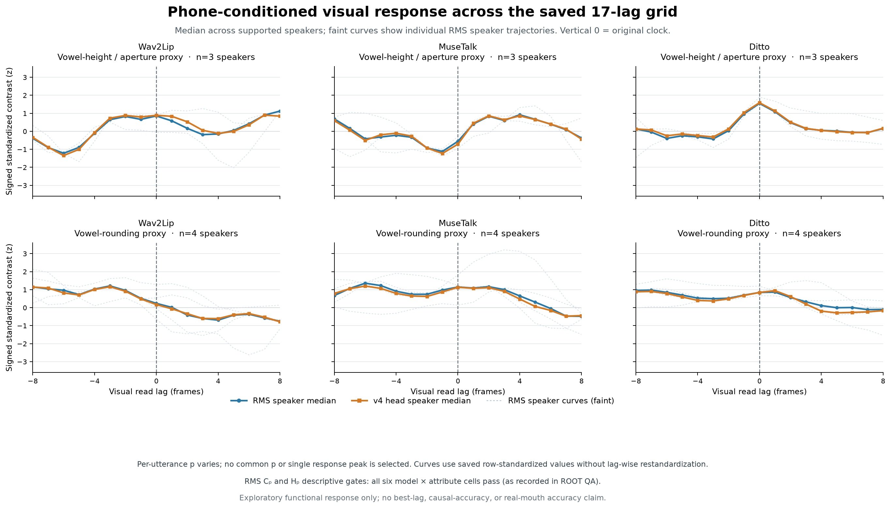

# 40-functional-response-coordinate

## 构音类别与模型响应时间：可复制的输出功能坐标候选

在原有144条生成口部轨迹上，先固定自然对齐/支持和端点，再检验原时刻与完整17点时间响应。使用**既有RMS基线评分给出的参考偏移p**后，Wav2Lip、MuseTalk、Ditto的高度/开度与宽度类别对比Cp、时间specificity Hp六格全部通过预定描述门。原时刻MuseTalk的开度对比全3人反向，读到参考偏移位置后全3人正向。结果支持把“构音类别×接收模型的响应时间”作为共同输出功能测量坐标候选。

旧v4增强头在这个坐标下仍无共同收益。这里没有训练新head、改变音轨/时间轴或增加GPU渲染。该结果是已见DEV的机制诊断，不是自然音频增强有效性或真人口型准确度确认。

## 为什么做这一步

报告39中原生SEP/STAB/径向ENV的18因子端点无model-factor格双人复现；物理phone均值谱形6端点无joint通过。随后9FIT构音表示诊断也没有三个TFG共同的TTS正向属性。继续扩大同类候选成本高，因此转向已经生成的视频：先确认可见口部能否在正确自然时刻区分构音类别，再研究输入控制。

## 数据和控制

- 既有540轨迹为20句×3TFG×identity/RMS/v4head×3seeds。按ID冻结first4 speakers S0005/S0022/S0024/S0037、2句/人，只取RMS/head、seed20261003/4/5，共144轨迹；identity因RMS不同排除。
- 原自然WAV/官方文本、16k sample clock和最终natural PCM不变。生成RMS目标0.0376838172675746；144canonical metadata中RMS/head最大绝对误差约1.22e-9/3.24e-9。本轮复用该元数据绑定，未重新测所有generation WAV。
- 8句MFA2.2.17 CPU对齐，4个speaker命令单次完成rc0，8实际TextGrid读回42085B。未知/复合phone不做fallback，仅去IPA tone marks。
- phone central20–80%半开核心，至少2个两臂×3seed共有valid 25fps中心。Height=a versus i/y/u，3人/4个a tokens/9帧；rounding为unrounded versus rounded宽度proxy，4人/high10tokens27帧、low15tokens33帧。Bilabial只有1人两类，UNSUPPORTED且未估效果。
- aperture为eye-normalized landmarks13/14距离；width为mouth bbox宽度，非真实唇轮廓圆度。无真人GT。

## 端点和时间坐标

每个trajectory用两臂三seed共有valid、原自然duration内全部帧的mean/popSD标准化，另报原单位；不随lag重新标准化。token等权→basephone等权→class，3seeds先在句内平均，再句子在人内等权；speaker是单位。

原clock C0是高度high−low或宽度low−high的几何对比；H0用同支持±4帧（160ms）构成零时对比−两时移平均。它们不是Sync-C。

原clock结果显示模型差异后，另冻完整lag诊断：全部l∈[-8,8]共17点；C(l)在原phone时间j/25读取video_(j+l)。S17要求全部17偏移和全部6rows共有valid/原duration、每token仍至少2原core中心。所有132个model/attribute token记录均保留，S0→S17零损失；height总19tokens47帧包含不进高度汇总的S0005低类，原支持3人不变。宽度25tokens60帧/4人不变。

参考p逐句取3个RMS full official AV offset的整数median，head借用相同RMS p，不按口部曲线峰值挑选。已使用句子的p：Wav−1/0，Muse3/4，Ditto2/3帧。官方距离比较video_i与audio_(i+lag)，official offset=−lag，因此用video_(j+p)作基线分数预测的响应坐标。逐句/类先算Cp和Hp=C(p)−mean(C(p±4))，再按原层级归约。该坐标不修改生成视频、原自然音轨、正式评分时钟或头的时间轴。

描述门：至少3人，至少ceil(2n/3)人为正，median为正。没有p值、frame/seed伪重复、最佳functional lag选择或模型池化。

## 结果

### RMS基线：参考时间坐标后的共同响应

表内为标准化构音几何的人级median；Cp/Hp六格均过描述门。

| 模型 | 高度C0 | 高度Cp | 高度Hp | 宽度C0 | 宽度Cp | 宽度Hp |
|---|---:|---:|---:|---:|---:|---:|
| Wav2Lip | +0.853 | +0.663 | +0.878 | +0.236 | +0.516 | +0.354 |
| MuseTalk | −0.558 | +0.917 | +1.254 | +1.144 | +0.711 | +0.703 |
| Ditto | +1.548 | +0.481 | +0.734 | +0.842 | +0.563 | +0.467 |

Muse的反向开度在参考位置转正，说明直接把同一原clock类别均值当跨模型同一功能坐标会混入响应时序。Ditto的原clock开度比参考位置更强，完整曲线也保留这一差异；没有声称SyncNet参考p就是最佳视觉位置或严格固定物理延迟。

### 旧head：未沿共同功能目标稳定改善

以下为head−RMS标准化指标的人级**均值**，与上表median区分。表中正值只代表该proxy方向增加，不代表真人准确度。

| 模型 | 高度ΔCp | 高度ΔHp | 宽度ΔCp | 宽度ΔHp |
|---|---:|---:|---:|---:|
| Wav2Lip | +0.057 | +0.099 | −0.019 | −0.004 |
| MuseTalk | −0.057 | −0.052 | −0.085 | −0.073 |
| Ditto | +0.020 | −0.060 | −0.128 | +0.029 |

旧head的速度/原单位、全17曲线和人级值都已保存，没有只选正向项。在高度支持5句/3人的旧head−RMS full Sync-C为Wav−0.007、Muse−0.039、Ditto−0.117；宽度支持7句/4人为−0.047、−0.055、−0.127。D0/Dmin/B、guard20、完整8句描述表保留在zero-clock effect；没有重新计算SyncNet。Head输入效应不能由功能坐标存在直接推导。

## 解释与下一步

共同坐标候选是**输出端的构音类别响应与模型时间参考**。它给出一个比全局表示分离度更贴近口部功能的目标；它尚未提供共同的可复制输入干预。参考时间来自同一已见数据的RMS评分，独立口部几何验证了对应的语义响应，但不构成未见数据确认。

已读到的MuseTalk frontend/adapter配方为25fps逐row映射，Whisper取原50Hz feature_[2j−4,2j+6)，均值时间约+10ms；没有显式4帧shift。该旧attempt14状态包缺成功render报告，不能据此绑定全部144历史rows或认定代码延迟来源。停止扩大这项源码追溯，把实际响应曲线保留为证据。

下一限定实验见 [[构音方向的原生输入响应探针]]：只按time/label支持取两句，以natural-only构音anchor作native ±小旋转，保留r、token内部Gram和clock，检验输入方向到Cp/Hp的因果响应。当前仅source/资产准备；没有新GPU或head效果。此类nativehook还需后续waveform reachability，不能叫通用波形增强头。

## 实际执行与核验

原Luna消费者03单次CPU rc0，UTC18:06:06–18:06:09Z。ROOT一次从144实际geometry数组核验288normalizers、6678token-metric observations、3717数值比较，所有raw/z/层级/H/速度与canonical支持子集/full8一致，maxerror0。

Lag消费者01源码一次数学审阅后，S17 support rc0（18:22:00–18:22:01Z），effects rc0（18:23:21–18:23:23Z），stderr均空。ROOT一次144原geometry/clock数组重建132个S17 token、全部17点raw/z人级曲线、RMS参考offset与Cp/Hp、7926数值比较，maxerror0。输入Grid/body/runtime审计复用，不重做环境检查或baseline。原consumer01/02字段与receipt pin修复均在执行前完成、旧件保留，不是科学阴性；未运行实现测试。

## 可复用产物

原始科学root：`.codex/scratch/phone_conditioned_visual_response_20261015_attempt03/` 与 `.codex/scratch/functional_lag_response_20261015_attempt01/`。

- zero-clock effect SHA7c66fbe592c53888196a6862b3a3354b3707ae04a80f2dc994938a86cec6cdae；ROOT QA9debfb496f4cbe4b1ec208690294df7e1814e10921088e3f418e963f43c25443。
- lag effect SHA3055e950cd51820288e04f9f4607256333cf128dca95af18b802543b819ddc22；ROOT QA4dd93b5e56a24c7b4998904aeeebf5d1e59534a11d38dbfc54702286610e894c。
- [端点CSV](assets/40-functional-response-coordinate/endpoint_summary.csv)、[17点curve CSV](assets/40-functional-response-coordinate/lag_response_curves.csv)、[人级RMS curve CSV](assets/40-functional-response-coordinate/lag_response_speaker_rms.csv)、[SVG](assets/40-functional-response-coordinate/functional_lag_response.svg)及`make_figure.py`。
- `assets/40-functional-response-coordinate/inputs/`保留7份protocol/support/effect/ROOT QA的exact body副本；`report_inputs_receipt.json`与`asset_receipt.json`记录路径、hash与bytes。原媒体/完整NPZ缓存仍在原run位置，紧凑报告资产不称完整灾备或云同步完成。

## Observations

- [result] 同144旧轨迹的六格RMS Cp/Hp全部过描述门，获得构音×模型响应时间的共同输出功能坐标候选。
- [result] 旧head在参考功能坐标下仍无共同收益，对应支持句的三模型full Sync-C均下降。
- [decision] 不把参考p称最佳视觉时移，不修改原clock/PCM；不扩旧head或把seenDEV诊断当确认。
- [verification] 原时钟与lag两个独立实际readback均逐值一致；没有新GPU、SyncNet评分或实现测试。

## Relations

- documents [[自然时钟构音与生成口部功能响应]]
- follows [[39-native-input-factor-mechanism-screen]]
- follows [[构音属性与口部功能坐标诊断]]
- motivates [[构音方向的原生输入响应探针]]
- relates_to [[研究主线与证据地图]]
- part_of [[开发跨 TFG 的自然音频增强头]]