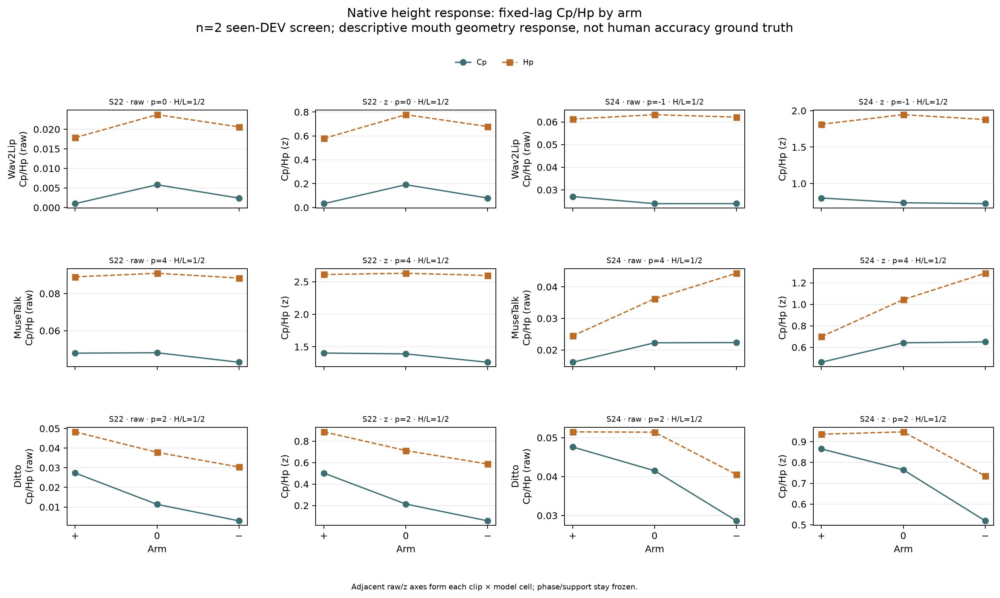
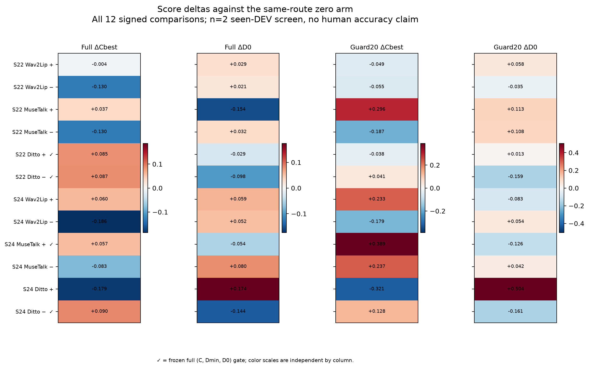

# 41-native-articulatory-response

## 同一构音方向能否成为三个TFG的输入控制坐标？

18个受控短视频已完成：两句×Wav2Lip/MuseTalk/Ditto×同路线zero/正/负。三模型的自然原生表示都成功沿预设高度方向移动，逐帧norm、音素core内部Gram、生成RMS、内容和时钟受控；独立口部功能zero控制六格全部通过。**完整双向口部响应仅1/6格通过，0/3模型在两句均通过。** 当前global height anchor轴停止GPU/剂量/队列扩展；后续发现Muse直接作用域未覆盖固定Cp端点（见紧随补充），该部分机制解释需先修正坐标映射。

这一步明确区分了三个环节：原生输入方向可以复制，基线输出功能可以测量，但二者之间没有形成跨模型、跨句稳定的单调控制关系。SyncNet收益与这个独立功能指标也发生了直接分离：MuseTalk正方向两句Sync-C均提高而Hp均降低；Ditto负方向两句Sync-C均提高而Cp/Hp均降低。这里的功能指标是构音条件开合对比，未使用真人口型准确度真值。

## 后续发现：输入行与输出事件的直接作用域尚未对齐

**这项修正收窄上述解释，不改变任何冻结数值或门。** 接收端forward源码备忘指出MuseTalk按prompt row逐帧UNet/VAE生成。原干预改MFA core行j，端点却在j+p、p=4读取；ROOT从实际rotation receipt与effect支持重建：两句Cp读取的7+7个输出帧与全部已修改prompt行交集均为0。Hp的p−4控制点反而包含直接修改行。因此，当前screen同时混入“输入干预作用到哪里”和“在固定参考时间读多少增益”两个问题，不能将Muse这部分失败直接归因于decoder缺少构音方向。

原angular Luna已确认实际UNet2D/batch1/同静态latent逐prompt行输出；MediaPipe使用IMAGE逐帧detect，**不存在VIDEO tracker state**。预编码PNG在finally删除，仅留H.264 MP4；因此未直接修改prompt的帧的解码/landmark变化还需区分codec影响，不能归因UNet时域传播。Wav按16-column mel chunk覆盖Cp帧为两句7/7；Ditto同索引1/7但有80-frame/10-overlap状态模型，不能用同索引交集代表其因果范围。边界备忘`temporal_ownership_boundary_attempt01.md` SHA6f69b668…保存来源。权威快照`root_musetalk_direct_exposure_snapshot.json`保留14个端点帧和实际mask。

下一共同坐标应显式包含“自然音素事件→conditioning输入所有者→输出帧”，保持原p、PCM、视频时钟不变，先资格化直接作用域，再另行冻结output-owned干预mask。不是按新结果挑phase，也不立即扩大GPU。详见 [[接收端局部构音响应坐标]]。

## 研究历史与假设

[[39-native-input-factor-mechanism-screen]] 已完成分离度、稳定性、局部半径和物理phone谱形的小筛查，没有稳定双人跨模型收益。[[40-functional-response-coordinate]] 随后复用旧144轨迹，得到构音类别×模型参考时间的共同输出功能坐标候选。本实验检验对应的输入因果假设：自然语音原生空间中，朝正确高度类别方向的小旋转是否增强开合类别对比，反向是否减弱。

这是一项seen-DEV机制screen。两句只按MFA/time-label支持选择：BAC009S0022W0123与BAC009S0024W0122，每人一句，seed20261003。没有按分数、口部幅度或响应选择样本，没有p值、确认集或跨模型池化推断。ROOT维护理论、预先读出规则、BM和一次实际产物QA；原GPT-6 Luna/max负责代码和执行。

## 输入操作与控制

- 原verified fixed-RMS自然驱动：16k mono FLOAT32，N=51376/56561，RMS约0.037683816；三臂使用同一份驱动。最终评分/换轨使用原自然PCM，视频保持j/25，未进行音频或视频时移。
- 自然9FIT数据定义balanced anchors；token→basephone→class/utterance→speaker等权，target speaker排除，每类至少3其他speaker。IPA只移除tone marks，a为高开度类，i/y/u为低开度类。
- 每个phone中央20–80% core施加同一低秩正交平面旋转。目标轴为unit(anchor_a−anchor_i/y/u)，匹配正负角度上限0.05rad并限制到目标角距离的一半；保持每帧半径、core内部Gram、原clock和非core值。零范数/退化不可测，无clipping或fallback。
- Wav原生80-D/j80 raw mel，Muse19200-D/j25，Ditto1024-D/j25，各自按原实际时间点操作；不把native norm称为声能。Muse不构造19200²矩阵。
- 六个新zero与正负共用CPU编码featurehook、dtypecast、decoder、portrait与seed。旧RMS只作背景，不能代替同路线zero。不同core间过渡、其他语义投影及重叠上下文仍可能变化，这是操作边界。

ROOT从六组实际NPZ、自然FIT/MFA恢复全部anchors与42个token-arm操作；公式最大误差0，最大float32 norm相对误差4.324e-9、Gram误差2.314e-9，zero/noncore/clock逐字节一致。Wav有极少值越过归一化域，最大0.08660，保留并报告，未裁剪或改剂量。

## 冻结的视觉端点

读出规则在GPU响应前冻结：原S17中心，绝对17个lag[-8,8]，全部3臂和17位置共同tracking-valid且在原自然duration；每token至少2共同中心，两类各至少1token。任何损失显式报告，不能替换token。两句在所有模型都保留3个token，high=1/low=2；S22为a[24,25]、i[40,41]、u[53,54,55]，S24为u[27,28]、y[38,39]、a[49,50,51]。原S17零损失，18轨迹tracking均100%。

Aperture为眼间尺度归一化的口部开度。每臂在相同三臂commonvalid原duration mask上使用自己的mean/population SD，另保留原单位。token帧均值→同basephone等token权→class等phone权，得到high−low曲线C(l)。参考p借用旧RMS三seed的official offset整数median：Wav0/−1、Muse4/4、Ditto2/2，不从新曲线选峰、不改输出时钟。Cp=C(p)，Hp=C(p)−mean(C(p−4),C(p+4))。

新zero的full official offset相对上述旧p在六格均少2帧（Wav−2/−3、Muse2/2、Ditto0/0）；这是实际读出路线差异的描述，未把p解释成确定物理延迟，也未据此重选相位。冻结p下全部zero的raw/z Cp/Hp仍为正，功能控制通过。

扩展门要求两句、三模型的raw/z Cp和Hp全部满足plus>zero>minus，数值比较容差1e-9。速度和宽度仅描述性；无真人准确度推断。

## 结果一：独立功能响应

表内为标准化z端点，候选Δ均相对**新同路线zero**。原单位、所有三臂和17点曲线一并保留在CSV/JSON。

| 模型 | 句子 | 固定p | zero Cp / Hp | plus ΔCp / ΔHp | minus ΔCp / ΔHp | 完整raw/z双向门 |
|---|---|---:|---:|---:|---:|---|
| wav2lip | S0022W0123 | +0 | 0.191209 / 0.777993 | -0.158832 / -0.199140 | -0.111666 / -0.099436 | fail |
| wav2lip | S0024W0122 | -1 | 0.736038 / 1.946036 | +0.065220 / -0.131265 | -0.012381 / -0.066880 | fail |
| musetalk | S0022W0123 | +4 | 1.391344 / 2.630996 | +0.013067 / -0.019124 | -0.128877 / -0.034019 | fail |
| musetalk | S0024W0122 | +4 | 0.641749 / 1.043661 | -0.180922 / -0.344190 | +0.008366 / +0.245424 | fail |
| ditto | S0022W0123 | +2 | 0.213802 / 0.712589 | +0.288126 / +0.174296 | -0.156823 / -0.125705 | pass |
| ditto | S0024W0122 | +2 | 0.764862 / 0.947170 | +0.100346 / -0.011415 | -0.245653 / -0.212152 | fail |

Ditto S22是唯一完整通过格。Ditto S24的原单位plus ΔHp仅+0.0000818，标准化后−0.011415，完整门未通过；不能事后删除z端点。Muse S24的plus开合对比和时间specificity均降低，而minus提高。Wav的Hp在两句的正负两方向均降低，说明变化不是简单有符号增益。全局类别margin移动不能直接充当decoder的功能增益。

### 口部速度：实际动作变化的独立描述

原clock相邻valid帧的aperture差分/秒计算全轨迹速度RMS，单位为眼间尺度/秒；三臂共同帧数一致、tracking均100%。正负方向改变了实际口部速度，方向依模型和句子而异。速度更大本身没有“更准确”的含义，不代替构音条件Cp/Hp。

| 模型 | 句子 | zero速度RMS | plus Δ速度RMS | minus Δ速度RMS |
|---|---|---:|---:|---:|
| wav2lip | S0022W0123 | 0.541063 | +0.022951 | -0.008375 |
| wav2lip | S0024W0122 | 0.453047 | +0.004411 | +0.018262 |
| musetalk | S0022W0123 | 0.462784 | -0.006951 | -0.015682 |
| musetalk | S0024W0122 | 0.477318 | +0.013669 | -0.008040 |
| ditto | S0022W0123 | 0.455737 | +0.011047 | -0.029411 |
| ditto | S0024W0122 | 0.536799 | +0.040535 | -0.001593 |

## 结果二：SyncNet与功能响应分离

保留full原query[0:N)与guard20 query[20:N−20)、31个lag原float32矩阵。Cbest=B−Dmin，B是lag距离曲线median，D0固定lag0；没有选择评分音轨、时移mux或按分数调参数。下表完整列出12对；full joint沿用ΔC>0、ΔDmin≤0、ΔD0≤0，仅作分数描述，不能代替视觉门。

| 模型 | 句子 | 方向 | full ΔSync-C | full ΔDmin | full ΔD0 | guard20 ΔSync-C | guard20 ΔD0 | full joint |
|---|---|---|---:|---:|---:|---:|---:|---|
| wav2lip | S0022W0123 | + | -0.004 | +0.091 | +0.029 | -0.049 | +0.058 | fail |
| wav2lip | S0022W0123 | − | -0.130 | +0.091 | +0.021 | -0.055 | -0.035 | fail |
| wav2lip | S0024W0122 | + | +0.060 | -0.158 | +0.059 | +0.233 | -0.083 | fail |
| wav2lip | S0024W0122 | − | -0.186 | +0.004 | +0.052 | -0.179 | +0.054 | fail |
| musetalk | S0022W0123 | + | +0.037 | +0.089 | -0.154 | +0.296 | +0.113 | fail |
| musetalk | S0022W0123 | − | -0.130 | +0.125 | +0.032 | -0.187 | +0.108 | fail |
| musetalk | S0024W0122 | + | +0.057 | -0.030 | -0.054 | +0.389 | -0.126 | pass |
| musetalk | S0024W0122 | − | -0.083 | +0.060 | +0.080 | +0.237 | +0.042 | fail |
| ditto | S0022W0123 | + | +0.085 | -0.029 | -0.029 | -0.038 | +0.013 | pass |
| ditto | S0022W0123 | − | +0.087 | -0.098 | -0.098 | +0.041 | -0.159 | pass |
| ditto | S0024W0122 | + | -0.179 | +0.174 | +0.174 | -0.321 | +0.504 | fail |
| ditto | S0024W0122 | − | +0.090 | -0.144 | -0.144 | +0.128 | -0.161 | pass |

最清晰的分离例子：

- MuseTalk plus：两句full ΔSync-C为+0.037/+0.057，guard20为+0.296/+0.389；标准化Hp却分别−0.019124/−0.344190，S24的原单位Cp/Hp也降低。评分提高没有对应预设的构音功能增强。
- Ditto minus：两句full ΔSync-C为+0.087/+0.090，D0为−0.098/−0.144；标准化Cp/Hp两句都降低。即使原clock距离同时改善，也不能据此认定该构音对比变强。
- Ditto plus S22：功能完整门通过、full ΔSync-C+0.085，但guard20 ΔSync-C−0.038；S24的full ΔSync-C−0.179。局部单格成功没有跨句稳定性。

## 结论与后续预算

**共同的输出功能坐标已经能在当前两句、三种同路线zero上测到；共同的全局输入控制轴仍未形成。** 本实验不是“找不到任何方向”：输入语义margin有受控变化，Ditto一格表现出完整因果响应；但稳定可用方法还需要解释接收模型和局部语境如何把该方向变成可见动作。

当前高度旋转不扩GPU、样本、seed或剂量，不继续训练/Confirm，也不事后翻符号。后续已仅复用现有数组完成[[原生构音干预的局部支持与奇偶响应诊断]]：拆分有符号odd响应与正负共有的even变形，并检验旋转是否远离同phone的自然局部支持。这是posthoc CPU探索，实际结果不支持统一远离自然支持的解释（见补充节），下一转向decoder局部响应坐标；不继续为弱候选支付大规模验证成本。长期自然音频增强头目标保持active。

## 补充：局部自然支持与正负奇偶分解（posthoc CPU）

在主屏筛结束后，另明确提出并用现有数组检查一个解释：功能响应失败是否来自“沿全局高度轴移动时普遍远离同phone自然局部支持”？复用自然9FIT原数组/原MFA，按原≥2core帧定义得到Wav110、Muse40、Ditto40个参考token。对21个实际被旋转token的三臂单位方向，求每个FIT speaker中同basephone的最小cosine distance，再取speaker等权median；全部token至少3人支持。171条原phone记录全部保留，未按结果选择。

表内距离Δ是**逐token候选−zero的配对差的median**，不能用三臂各自的距离median相减。负值表示更近这一自然局部参考。口部odd=(plus−minus)/2，even=(plus+minus)/2−zero，以下给标准化Hp；全raw/z Cp/Hp保留在原JSON。没有新成功阈值或GPU准入。

| 模型 | 句子 | rotated tokens | plus距离配对Δ median | minus距离配对Δ median | z Hp odd | z Hp even |
|---|---|---:|---:|---:|---:|---:|
| wav2lip | S0022W0123 | 5 | -0.000528 | +0.002888 | -0.049852 | -0.149288 |
| wav2lip | S0024W0122 | 4 | +0.002254 | +0.000091 | -0.032192 | -0.099073 |
| musetalk | S0022W0123 | 3 | -0.006335 | +0.007757 | +0.007447 | -0.026571 |
| musetalk | S0024W0122 | 3 | -0.005425 | +0.006941 | -0.294807 | -0.049383 |
| ditto | S0022W0123 | 3 | -0.002771 | +0.005548 | +0.150001 | +0.024295 |
| ditto | S0024W0122 | 3 | -0.006851 | +0.009084 | +0.100369 | -0.111784 |

Muse plus的全部6个token都更靠近同phone自然参考，功能Hp却不稳定并在S24降低。因此，**当前nearest-cosine尺度下的“统一离开自然支持”解释与实际结果相反**。该尺度并不是真实高维流形距离，不能排除其他分布变化；但没有理由据此投入新的“回到自然流形”大训练。

Ditto两句Hp odd均正，而S24 even为负、足以抵消正向变化；Wav两句Hp odd与even均负，Muse的odd在人间换符号。对当前扰动，固定坐标上的局部观测响应与global anchor margin不一致。后续直接作用域检查进一步指出Muse输入行/输出事件映射缺口，暂不把其观测比值解释为decoder内在增益；joint多token干预也未识别隔离Jacobian。

原Luna CPU唯一执行PID101560，UTC20:41:13–20:41:15Z rc0；source d245b9ab…、output88b69ec1…。ROOT从实际原生数组、独立MFA parser和natural token方向重建每speaker最近距离/median及odd/even，603比较maxerror6.66e-16，QA1a6139ed…。无新编码/渲染/API/实现测试。

后续 [[接收端局部构音响应坐标]] 已仅用现有JSON拆出18token并ROOT144公式检查一致：Ditto6/6 class-signed odd raw/z正；Wav a两句正、i/y负、u换符号；Muse a/u随句换符号。Ditto有积极的局部有符号响应线索，但even/时间specificity和评分一致性仍是限制。当前只做forward接口SOURCE_ONLY可行性，不按两句后验gain训练或翻号。

## 实际执行和一次核验

有效renderer controller2534565/startticks49267493，UTC2026-10-14T19:57:49–20:06:01Z rc0、18PASS；前两次前置错误0视频，原件保留。两句W/M/D视频分别77/80/81与85/88/89帧。ROOT对18实际silent媒体逐帧PTS及全部mux音轨完整解码：j/25、起点、原自然float32 PCM SHA/N全部匹配，不只相信元数据。

唯一有效readout05 worker2542617/startticks49386476，20:17:39–20:20:38Z rc0，18PASS；原04错误pin在静态阶段0处理。完整152个选定科学/控制文件903740B读回，缺失/哈希差异0。当前及子进程均已终止，终态GPU0%/5MiB/空compute owners。

Geometry consumer03在一次额外--admission命令行错误0分析后，正确CLI唯一科学执行PID99852，20:31:30–20:31:31Z rc0。ROOT一次独立重建36实际矩阵、18口部数组/时钟、全部支持/normalizer/token曲线/层级/Cp/Hp和候选差，7146几何数值比较maxerror0；独立float64列均值对官方float32曲线最大舍入差2.746e-6，已核验的float32曲线重建B/Dmin/D0/C字段完全相同。未运行实现测试、依赖安装、API、重编码或额外模型作业。

## 可复用产物

权威scratch：`.codex/scratch/native_attribute_response_probe_20261015_attempt01/`；完整测量readback：`.codex/scratch/native_attribute_response_probe_20261015_readout_attempt02_readback/`。它们仍是未提交machine-local资料，不能称完整灾备。

- 冻结readout `response_readout_protocol.json` SHA9b4c3f4150e0a4275925304a3a542230896de3dff82ecdb38dd6d89ecdcfe0d9。
- `geometry_effect_attempt03.json` SHA1b88218d53f88a73575e3acfbd413fd8870b843748c872b6016a38cc174473b4。
- `root_actual_response_qa.json` SHA72ef059b13a3a0cfd4f398b2f203224ec104a2072e18635fa5f124a26ad2e538。
- 完整18行readout manifest SHA34fa8b879a11d69c04d9a0a7faf4c370334edbcbebec8b72097e8fbe6482e97e；本地readback manifest SHAb00635c6a03dba039070533b53bbd21bb5147487b3140851ae961661af03ccf6。
- ROOT图面QA已接受source03的三组PNG/SVG，legend/footer清晰；最新plot receipt为`plot_receipt_attempt03.json` SHAdd6011da8469ca3052b503db408b1b24e0e6503fdbeddc6b32bc34526ddc1feb，三CSV保持原bytes。
- [18臂功能端点CSV](assets/41-native-articulatory-response/response_endpoints_18arm.csv)、[12对分数差CSV](assets/41-native-articulatory-response/score_deltas_12pair.csv)、[完整17lag CSV](assets/41-native-articulatory-response/geometry_all17lag_curves.csv)及对应SVG/PNG，不筛选格或重算分数。

## Observations

- [result] 同路线zero六格raw/z Cp/Hp全正，S17零损失；全局高度轴完整双向门仅1/6格、0/3模型双人通过。
- [result] SyncNet增益与预设开合功能对比增强直接分离；Muse plus和Ditto minus提供同一小屏筛内的具体对照。
- [decision] 当前native高度旋转方向停止GPU扩展，下一步只读已有数组探索局部支持/odd-even，不把nativehook当可实现波形head。
- [result] Muse plus全部6tokens更近同phone自然参考，当前局部距离尺度不能解释其功能失败；接收端响应成为下一定位问题。
- [limitation] Muse固定Cp端点14帧与实际改动prompt行交集0，机制解释必须先资格化input→output直接作用域。
- [limitation] n=2 seen-DEV、固定portrait/seed/剂量，无真人准确度或未见数据确认。

## Relations

- extends [[40-functional-response-coordinate]]
- relates_to [[39-native-input-factor-mechanism-screen]]
- concludes [[构音方向的原生输入响应探针]]
- motivates [[原生构音干预的局部支持与奇偶响应诊断]]
- motivates [[接收端局部构音响应坐标]]
- relates_to [[研究主线与证据地图]]
- relates_to [[native-axis-factor-pilot-20261013]]
