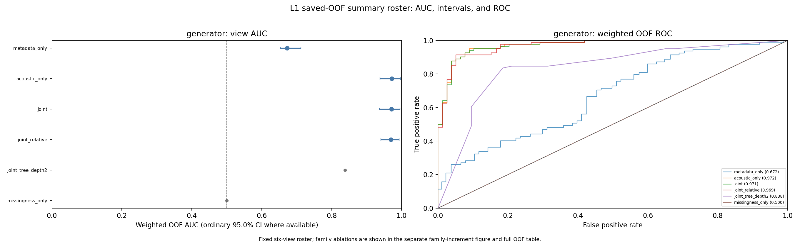
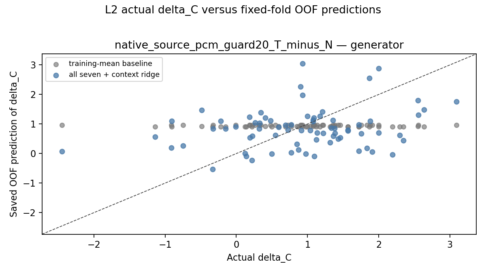
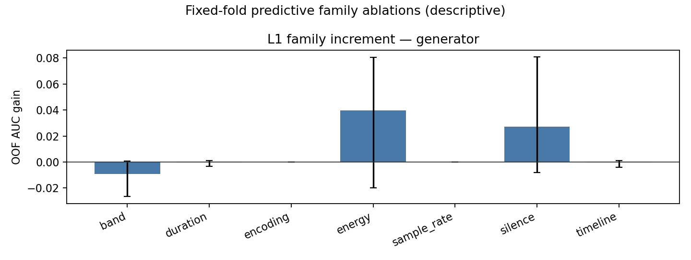

# 43-processing-chain-predictive-audit

TTS/自然条件的处理链可辨识性与 SyncNet 分差预测审计（2026-10-15）

本轮仅使用既有资产提取物理特征和进行 CPU 统计分析。跨 TFG 自然音频增强头研究保持暂停；没有新增 TTS、ASR、TFG、SyncNet 前向、增强头训练或因果干预。

## 证据资格修正（2026-10-15）

用户指出 **LibriSpeech存在数据泄漏**。本报告据此将该队列从主结论、英语效果/机制判断、独立样本外确认、跨域泛化及proposal支持证据中排除。其原始计算与16/24k等文件属性仅作处理链诊断存档；计算QA通过不代表队列满足独立证据资格。

本轮未重新核验具体泄漏组件、checkpoint或样本重叠，不把用户信息扩写为已确认某个特定模型见过全部样本。按说话人共折能约束本轮划分，不能自行排除上游预训练污染。中文与legacy保留原有历史队列边界，也没有因此被认证为完全无泄漏。

## 1. 核心结论

**在主队列中，TTS 与自然音频容易区分，但这七类因素没有形成可靠的逐句 Sync-C 增益预测器。** 74 对、13 位实际音频说话人的来源分组样本外验证中，声学特征条件分类 AUC 为 **0.972**；七族联合预测配对分差的 R² 为 **−0.140**、MAE 为 **0.850**，训练折均值基线为 **−0.006 / 0.743**。七个特征族均未通过冻结的校正正增量标准。结论适用于该历史队列、评分合同和固定简单模型，不是所有潜在机制均无效的结论。

已有原始评分曲线还表明：源 PCM 条件下的平均 ΔC 为 **+0.935**，固定零时滞距离的变化区间却跨零；旧压缩链的 ΔC 为 **+1.032**，零时滞距离反而变差。因此不能把条件分类方向直接当增强目标，也不能把 C 上升直接称为口部同步改善。

LibriSpeech仅作排除后的诊断存档，不参与以上主结论。Legacy合同有有限整体分差预测信号（R²+0.095、relative+0.175），但13组区间较宽、无稳定单族增量；不与主PCM结果合并。

## 2. 为什么参照这篇论文

ROOT 阅读了 Smeu 等 CVPR 2025 正式版的 §3.2–3.3、§4.3–4.5 和讨论。论文以首个幅度超过 0.0005 的样本测量起始静音：简单静音指标在两个伪造数据集上的 AUC 为 98.4%/98.2%；同步裁掉起始静音后降到 54.8%/50.6%。其跨域监督模型也会受此处理影响，说明跨域成功仍可能携带共享制作捷径。这是论文中的真假分类和干预证据，不能直接移作本项目的 TTS 原因。本项目主队列TTS起始静音更短，方向也不同。[正式原文](https://openaccess.thecvf.com/content/CVPR2025/papers/Smeu_Circumventing_Shortcuts_in_Audio-visual_Deepfake_Detection_Datasets_with_Unsupervised_Learning_CVPR_2025_paper.pdf)

本轮借鉴“简单非目标特征 → 评价结果关联 → 干预与跨域边界”的证据组织方式，仅执行观察性预测的前两步。AVH-Align 没有复现或训练。PDF 文件及完整映射保存在本 run 的 `literature/`，正式 PDF SHA256 为 `cb7e50974b89af70cf6dccadd45ec3a57aa1b80d02abe15a9d2012898648059b`。

| 论文方法 | 本项目实现 | 已有证据 | 仍缺证据 |
|---|---|---|---|
| 简单静音指标识别真假 | L1：七族特征分 metadata/acoustic/joint，按真实来源共折 | 主队列声学 AUC 0.972；分布、OOF、null 均已保存 | 条件可辨识不等于发音、质量或真实同步可辨识 |
| 检查检测器是否利用捷径 | L2：同合同配对 ΔC 的来源分组回归及族消融 | 七族联合未优于均值，校正正增量门均未过 | 预测关系不直接证明 SyncNet 对某因素的因果依赖 |
| 去静音再评价 | 本轮引用/复核项目已有编码、频带、电平、时钟干预 | 编码交换、统一 PCM、电平与查询数诊断等历史结果 | 未新增删静音干预；历史结果不是本轮新独立确认 |
| 去捷径及跨域验证 | 来源层/合同分开；只有兼容且足量支持才做 LODO | 本轮完成限定覆盖检查 | 无合格同层多域配对支持，LODO 未测；共享链标记仍可跨域迁移 |

## 3. 历史证据如何接入

这是已知历史队列上的新预测审计。冻结协议早于本轮建模，不早于历史结果暴露，不能称未知结果的预注册或独立确认。以下历史因果或关联证据没有重新执行模型前向。

| 已有结论及范围 | 可复用产物/本轮用途 | 解释边界 |
|---|---|---|
| Ditto 编码审计：47 对历史 FULL 分差 +1.131，统一源 PCM 后 +0.054；编码路径交换可反转均值 | `tts_clock_cross_20260926` 与 `syncnet_codec_mechanism_20260926` 的既有报告/receipt | 编码确实影响特定评分链；本轮 row47 来源映射未闭合，不能用假定 speaker 做分组预测 |
| Wav2Lip 云 Qwen：无损 74 对/13 人原生 guard20 +0.935；自然时钟 M 视频换自然音轨 −0.762 | `tts_pcm_residual_20260926`，本轮主 source-PCM 与独立 legacy 合同 | M 是 MFA 重合成，不能标为 native TTS；原生优势不能迁移为自然换轨收益 |
| 匹配查询数：71 对/15 人 RAW/LEVEL 变化约 −0.000343/−0.000675，区间跨零 | 查询数报告及原表 | 查询数是评分协议诊断，不是音频预测因素；不把 71/15 与 74/13 合并 |
| 报告15：Ditto 100 对原生 +1.022，104 唯一表征/prosody 指标无 FDR 后关联 | `15-tfg-link.md` 及实际 100 行分数 | 旧关联和行 bootstrap 不是本轮来源分组样本外验证；本轮源-评分体连接不合格 |
| multiset：五数据集各 50；Ditto 250 对、LeapTalk 248 对 | 实际 manifest/source groups 与标量分数 | 有评分不等于仍有两臂原始 WAV；不同队列和共享来源不伪增样 |
| 静音修补：报告34故障发现同批 n9 的 M 路径约 +0.257，仍未超自然 | 既有报告及后续 held-out 边界 | 不是 native N/T 起始静音的独立因果结果 |

完整“已有结论—可复用产物—本次缺口”表在 `history/evidence_inventory.md`。原生 N/T、统一 PCM、自然音轨 replacement 和真实视觉/感知证据始终分开。

## 4. 队列、来源层与覆盖

| 分析/候选 | 合格资产与独立来源 | 来源层/合同 | 本轮状态 |
|---|---|---|---|
| 主 Wav2Lip/Qwen 74 对 | 148 个 WAV；13 AISHELL-1 实际说话人 | 两臂均为实际 generator 输入；`native_source_pcm_guard20_T_minus_N` | L1/L2 完成；历史100中缺26对，选样依资产/合同资格 |
| Legacy 同74对 | 148 个 crop-AVI 派生 legacy WAV；同13人 | 实际 scorer 输入；`legacy_mux_audio_guard20` | L1/L2及独立QA完成 |
| LibriSpeech 13 对 | 26 个 original WAV；13实际speaker | 自然16k、provider-native TTS24k；不是缺失的canonical generator WAV | EXCLUDED：用户指出泄漏，L1仅诊断存档；L2连接不合格 |
| codec47 | 既有固定视频编码干预资料 | 不与主合同混合 | 来源组 UNKNOWN，分组预测 UNAVAILABLE；不再称已确认单speaker |
| multiset Ditto | manifest250条、139源组；500标量分数 | 五数据集 | 选定缓存250份TTS WAV及tts_meta缺失，配对预测 UNAVAILABLE |
| LeapTalk | 248对/496标量分数，来源分组未在本轮绑定 | 独立历史合同 | 仅score表合格，无本轮两臂音频连接，UNAVAILABLE |
| 报告15 | 100对/15speaker的manifest/score | Ditto历史合同 | 400个引用路径中10个natural_original_source WAV与声明SHA匹配、390个缺失；无完整N/T源-评分连接，UNQUALIFIED |
| MFA M replacement | 既有历史均值与合同 | TTS派生的自然时钟重合成/自然换轨 | 不标为native TTS；没有合格两臂本轮预测表 |

主配对表存储合同名为`native_source_pcm_guard20_T_minus_N`，后缀标明T−N响应，coverage旧简称不表示另一合同。主队列两臂均16 kHz/mono/PCM16 WAV；74条 provider-native24k TTS 原件缺失，不能由16k generator WAV补作原件。共享参考是固定同一个动态参考 MP4，历史标签含 S0765 不代表音频均属于 S0765，也不代表静态肖像。主来源组为 S0764/65/66/68、S0901/02/05/06/07/08、S0914/15/16；每组3–7对。

multiset 的来源成员按实际视频键恢复：LRS3父视频45、VFHQ yt_id46、TalkVid原视频key46、MEAD speaker1、GRID speaker1，总139；不把250条误算250独立人，也不把整个multiset误写45组。缺失结论限于指定清单、缓存和一次有界查找，未声称整个网盘不存在数据。

## 5. 特征、模型与统计定义

原件 file SHA 与统一解码 PCM SHA 分开。使用既有 ffmpeg 的第一音频流，固定 mono16k float32LE、swr、禁dither，不做归一化、裁静音或时间重映射。频带只在实际源/中间 Nyquist 支持内计算，缺失不填零。

| 族 | 冻结定义/单位 | 主要边界 |
|---|---|---|
| 能量 | 句级与阈值活动段 RMS，20log10，dBFS | 活动段不是ASR/VAD真值；未另算不存在的LUFS |
| 静音 | 10ms真实样本块、RMS≤−50dBFS，首/尾秒数与样本加权占比；首幅度>.0005及前30ms峰值 | 预设相对门为0.1×句级RMS，联动活动RMS/时长；不从结果选阈值 |
| 采样率 | 源/生成器/mux/scorer实际Hz | 未绑定阶段保留缺失，不能从provider名称推断 |
| 编码 | codec/container/真实码率与合格中间链 | 最终PCM不能证明上游未压缩；编码因素共线不单独归因 |
| 频带 | Welch400点周期Hann、hop160、FFT512、constant detrend/mean/density；4个0–3.5k比例、5.5–7.5k比例、250–3500Hz log谱斜率 | 端点包含规则冻结；不越实际Nyquist/补造高频 |
| 时长 | 解码样本数/16000、活动段秒数；L2物理正量log比 | 无MFA局部对应，不作音素级时间结论 |
| 独立时间轴 | 已绑定PTS/起点/音视频长度差/采样数与时间基/视频帧数与时钟 | 大部分视频测量缺失；最佳offset禁用；查询数仅诊断 |

英文新增24k分支在拟合前发现 sample-count/timebase 单位混用：旧计数来自16k解码，时间基来自24k原件。本轮保留旧CSV/cache/receipt，另派生仅13个TTS原生计数字段和两个非预测解码计数列；源采样数×源时间基的误差≤8.9e−16秒。其他科学特征和PCM SHA完全不变。主队列/legacy的16k分支不因此重跑。

L1去重键为来源组/条件/统一PCM，来源组与条件等权。L2同层同合同使用特征 T−N、两臂均值及正物理量log比，dataset/TFG/provider仅作上下文；每来源组等权，重复不增权。两臂、同一人的语句和派生版本共折；13组固定GroupKFold5折。训练折拟合中位数插补、缺失指标、缩放、one-hot，测试未知类别不泄漏到训练。缺失/常数列逐折记录。

主seed固定20261015，各派生null/bootstrap seed由协议与analysis记录。固定 logistic C=1/liblinear；ridge α=10/截距；唯一非线性敏感性为depth2、min_leaf5浅树，不调参、不搜索更大模型。七族删除消融和relative静音版本事先冻结。文件名、目录、条件、run/ID/hash、来源身份不入X；C/B/D/最佳offset也不入X。

2000次来源组bootstrap基于固定OOF预测；普通95%区间与七族校正99.2857%区间并存。后者下限>0且relative版本同向才标稳定正增量，不能写成跨域稳定。区间条件于已拟合模型/固定折，不包含完整重训练不确定性。L1另做199次组级N/T互换并重新拟合；L2只在dataset/TFG/provider/合同及块大小一致的源组间置换完整y块，不随机拆句。主L2可动12组/71行/92.31%权重，余S0908保留；p采用plus-one。LODO因没有兼容同层多域支持而NOT_TESTED。

## 6. 主队列 L1：条件确实可辨识

| 视图 | 组平衡OOF AUC | 普通95%区间 | Balanced accuracy |
|---|---:|---|---:|
| 处理链 metadata | 0.672 | [0.653,0.712] | 0.620 |
| 声学 acoustic | 0.972 | [0.938,0.996] | 0.918 |
| 联合 joint | 0.971 | [0.936,0.995] | 0.925 |
| 联合 relative静音 | 0.969 | 见完整JSON | 见完整JSON |
| 冻结浅树 | 0.838 | 敏感性，不用于择优 | 见完整JSON |
| 仅缺失模式 | 0.500 | 诊断 | 见完整JSON |

三个主视图的199次来源组互换 p 均为0.005。主metadata中的采样率、codec、bitrate均常数，可变预测信息主要来自采样数，即时长代理；不能将AUC0.672称独立采样率或时钟效应。声学高AUC也不是“质量分类器”。

| 代表特征 | Natural组等权均值 | TTS组等权均值 | 配对T−N效应 | 两臂观察范围 |
|---|---:|---:|---:|---|
| RMS dBFS | −33.952 | −27.076 | +6.876dB；组均值SD4.637 | 交集[−33.809,−25.518] |
| 绝对首段静音 s | 0.165 | 0.033 | −0.132s；SD0.115 | 交集[0,0.290] |
| 相对首段静音 s | 0.115 | 0.044 | −0.071s | 有交叠 |
| 时长 s | 5.376 | 4.296 | −1.080s；SD0.512 | 交集[2.775,9.440] |
| 5.5–7.5k能量比例 | 0.007323 | 0.006148 | −0.001175；SD0.002636 | 有大范围交叠 |
| 源/生成器采样率 Hz | 16000 | 16000 | 0，常数 | 完全相同 |
| codec/stream bitrate | pcm_s16le/256000 | 同左 | 常数 | 完全相同 |

数值效应是来源组内配对差再等组平均；“范围交叠”仅是min/max区间交集，不是分布密度重叠率。所有频带/能量/静音/时长的分布、缺失、类别计数和组差SD见analysis.json的feature_diagnostics。PTS/视频起点/fps/帧数等大部分字段完全缺失；不能把缺失写成零变化。

## 7. 主队列 L2：没有稳定预测增益

| 模型/视图 | 样本外R² | MAE | 相对训练均值MAE变化 |
|---|---:|---:|---:|
| 训练折均值 | −0.006 | 0.743 | 0 |
| 仅可用context | −0.006 | 0.743 | 0；本队列context常数 |
| metadata+context | +0.013 | 0.753 | +0.010，更差 |
| acoustic+context | −0.124 | 0.843 | +0.101，更差 |
| 七族+context | −0.140 | 0.850 | +0.107，更差 |
| 七族relative+context | −0.308 | 0.903 | +0.161，更差 |
| 唯一浅树敏感性 | −0.314 | 0.812 | +0.069，更差 |

七族联合R²普通95%区间[−0.546,+0.093]，MAE[0.702,1.014]；均值基线R²[−0.113,+0.005]，MAE[0.595,0.891]。L2组块null p=0.245。metadata的微小正R²和更差MAE不足以形成可靠正预测证据；不选择这个数字作为“已解释增益”。

| 族 | L1 AUC增量 [校正区间] | L2 MAE改善 [校正区间] | 判定 |
|---|---|---|---|
| 能量 | +0.040 [−0.020,+0.080] | −0.066 [−0.175,+0.025] | 无稳定正增量 |
| 静音 | +0.027 [−0.008,+0.081] | −0.051 [−0.105,+0.007] | 同上 |
| 采样率 | 0 [0,0] | 约0 [浮点误差] | 常数/不可独立识别 |
| 编码 | 0 [0,0] | 约0 [浮点误差] | 常数/不可独立识别 |
| 频带 | −0.009 [−0.027,+0.001] | −0.030 [−0.104,+0.049] | 无稳定正增量 |
| 时长 | −0.0002 [−0.0034,+0.0011] | −0.033 [−0.063,−0.004] | 固定模型中加入后更差 |
| 时间轴 | −0.0003 [−0.0041,+0.0013] | −0.006 [−0.013,−0.001] | 可测部分与时长共线 |

L1增量=full AUC−drop AUC；L2改善=drop MAE−full MAE，正值才是改善。不是所有区间“跨零”：时长/时间轴L2校正区间为负，采样率/编码退化为零。负增量说明在此有限样本、固定正则模型里加入信息没有帮助或有冗余，不是物理因素必然有负因果作用。固定16k时采样数=时长×16000，删一个族仍保留另一代理，不能用这种消融排名独立原因。

## 8. 合格扩展与未测跨域

| 来源层/合同 | 独立组/对 | metadata / acoustic / joint AUC | 七族L2 R² / MAE | 基线R² / MAE |
|---|---|---|---|---|
| 主generator/source-PCM | 13/74 | 0.672 / 0.972 / 0.971 | −0.140 / 0.850 | −0.006 / 0.743 |
| legacy scorer | 同13/74 | 0.672 / 0.967 / 0.967 | +0.095 / 0.776 | −0.034 / 0.837 |


Legacy在固定模型下有有限整体预测信号：七族MAE比均值少0.060，R²普通95%区间[−0.308,+0.299]，199组块null p=0.010；relative静音版本R²+0.175（95%[−0.177,+0.358]）、MAE0.719，比基线少0.118。metadata alone R²+0.092/MAE0.769，acoustic R²+0.104/MAE0.772，浅树R²−0.193/MAE0.852，没有用结果择优替换主ridge。

但legacy七族没有稳定的校正正增量：静音点改善+0.040，普通95%[−0.017,+0.086]、校正区间[−0.035,+0.102]；relative同向+0.093仍不足以通过主校正门。频带加入反而点改善−0.082，校正[−0.213,+0.015]。所有族/relative完整结果保存在最终analysis中，常数族退化为0而不称无因果作用。

LibriSpeech因用户指出的数据泄漏已排除，诊断数值移至附录A；它不构成独立英语或泛化验证。

这两个合同给出不同的预测结果；本轮没有对R²差值进行正式显著性检验，也没有将差值解释为编码因果效果。较接近生成前的source-PCM结果不稳，压缩/截取后的scorer链存在有限可预测性，符合先审查处理链的动机；其含义仍是特定评分响应，不是视觉收益。

主/legacy没有拼成总体R²或AUC，也没有把同74对算148独立对。LibriSpeech另作已排除的诊断存档；16/24k标记不支持英语发音、TFG效果或跨域泛化结论。其L2还缺canonical generator输入和评分来源连接。LODO未执行。

## 9. 原曲线辅助响应：C上升意味着什么

本轮从已保存74对两合同的31-lag原始数组派生B、Dmin、固定index15的D0；未运行新评分。13来源组等权、2000共享组bootstrap，原表/全部公式/组区间由ROOT独立复核。距离越低越好。

| 合同 | ΔC [95%CI] | ΔB [95%CI] | ΔDmin [95%CI] | ΔD0 [95%CI] |
|---|---|---|---|---|
| source PCM | +0.935 [0.686,1.187] | +0.784 [0.573,1.008] | −0.151 [−0.295,−0.027] | −0.072 [−0.243,+0.099] |
| legacy scorer链 | +1.032 [0.728,1.329] | +0.800 [0.571,1.046] | −0.231 [−0.402,−0.062] | +1.016 [0.694,1.321] |

C=B−Dmin只是评价器算术。B上升意味着lag曲线背景距离变化，不给出因果解释份额；最低点改善不保证原时钟零lag改善，更不替代独立口部视觉或人类判断。B/D/offset未用于本轮C回归。原主paired score表未改写，辅助端点单独保存于 `qa_C/paired_auxiliary_score_endpoints.csv`。

## 10. 六个研究问题的回答

1. **哪些因素能区分条件？** 主队列声学组合强可辨识，电平、首段静音和时长有明确分布差；条件范围仍重叠。联合高AUC不确定哪个单族有独立价值，校正族增量门没有通过。
2. **哪些能预测样本外分差？** 主七族联合没有优于训练均值；单metadata微小正R²不伴随MAE改善。Legacy合同有有限整体信号（R²+0.095、组块null p0.010），没有单族校正确认；LibriSpeech排除独立结论，且L2不可测。不从高分类AUC推断ΔC可预测。
3. **哪些仅反映处理链？** 源/阶段采样率、codec、码率和源时间基属于制作/输入链；已排除LibriSpeech的16k/24k只作文件级诊断。主metadata的采样数主要是时长代理，不是独立声画时钟发现。
4. **哪些无法辨识？** 主采样率/codec常数；samplecount与duration共线；PTS/fps等未测；codec47来源组未知；多域配对TTS及报告15精确来源缺失。分别标NON_IDENTIFIABLE、UNAVAILABLE或NOT_TESTED，不退回随机行拆分。
5. **哪些有历史因果证据？** 特定编码链交换/统一PCM/高频修补和电平干预已有直接响应，适用各自固定视频/合同。此次L1/L2是预测关联，不能替代依赖性干预，也不把既有历史复用包装成独立确认。
6. **对增强头有什么限制？下一步什么最有价值？** 分类器方向没有经过自然音轨下游因果验证，不作为head训练target。若以后恢复机制实验，最有信息价值的是新来源小队列上固定同一视频、同RMS/总长/原时钟，对预设前段静音/边界支持进行有限因果控制，并同时检查完整lag/D0与独立视觉端点；先区分评分链捷径和生成器响应，过小门再扩规模。该建议未执行，增强头继续暂停。

## 11. 可直接用于 proposal 的依据（LibriSpeech不作支持证据）

我们把TTS相对自然语音的同步评分优势拆分为“条件可辨识”和“逐句收益可预测”两个问题。在74对、13位真实说话人的历史Wav2Lip队列中，仅用少量电平、静音、频带及时间统计即可得到来源分组样本外AUC0.972；但七类因素联合预测配对Sync-C分差时R²为−0.140，MAE0.850，未优于训练均值基线0.743，且没有特征族达到预设校正正增量标准。已有曲线显示C增益不必伴随原时钟距离改善。旧scorer链出现有限预测信号（R²+0.095，relative+0.175），但没有稳定单族增量。两合同结果差异与原曲线共同支持先审查制作链标记、评分合同和独立同步端点，再提出局部表征或增强机制；不支持把可区分TTS的方向直接转成增强头监督。后续因果验证应采用来源隔离的小规模控制和分阶段扩展，避免仅优化评价器置信度。LibriSpeech因用户指出的数据泄漏从支持证据中排除，仅保留为处理链诊断存档。

## 12. 产物、验证、成本与复现

本轮权威run为 `runs/processing_chain_predictive_audit_20261015_attempt01/`。可复用CLI位于 `scripts/experiments/processing_chain_predictive_audit_20261015/`；固定特征核心SHA `c7100359a218cd566c678a22c92ac8df0051ffeddc6075a776ae966be0902f0e`，固定建模核心SHA `4c4db64a3909605e288a8c983218873d97f3da59b3e4b04782e5babaa279da13`。完整来源/输入/源码pins均由实际body生成。

| 主要交付 | 入口（run内） |
|---|---|
| 主冻结协议与绑定 | protocol_full_stage_v1.json / analysis_input_binding_full_primary_v1.json |
| English协议/元数据修正 | protocol_full_english_l1_v2.json / analysis_input_binding_full_english_v1.json |
| Legacy修正协议/绑定 | protocol_full_legacy_v2.json / analysis_input_binding_full_legacy_v2.json |
| 四层覆盖与资源 | coverage_final_v2.json/.csv（保留v1）；resource_summary_v1.json；model_resource_final_v1.json |
| 主 features/scores | feature_full_readback_attempt01/features.csv；inventory_A/paired_scores_attempt02.csv |
| English features | feature_english_original_metadata_attempt02/features.csv |
| Legacy features/scores | feature_legacy_scorer_readback_attempt01/output/features.csv；inventory_A/secondary_assets_attempt02/legacy_scorer_feature_extension_attempt05/paired_scores.csv |
| 主完整结果 | full_execution_attempt01/readback_attempt01/model_full_attempt01/（analysis、fold_map、l1/l2_oof、receipt） |
| English完整结果 | english_full_attempt01/readback_attempt01/model_full_english_attempt01/ |
| Legacy完整结果 | legacy_l2_patch_attempt01/readback_attempt01/（exact复用旧L1，新增单合同L2） |
| 独立验证 | qa_C/final_primary_oof_independent_qa_attempt01.json、final_english_l1_oof_stat_qa_attempt02.json、legacy_l1_oof_stat_qa_attempt01.json、legacy_l2_oof_stat_qa_attempt02.json |
| 原曲线辅助响应 | qa_C/paired_auxiliary_score_endpoints.csv、auxiliary_response_summary.json、root_auxiliary_summary_qa_v1.json |
| 实际命令 | reproduction_commands.json / reproduction_commands.md |

主OOF有3108条L1预测（21×148）和1702条L2预测（23×74）；这些是模型/消融行数，不是独立样本数。English L1有546行（21×26），L2为0。每个预测保留source group/outer fold/label或y/权重，身份列仅供追溯和防泄漏，不输入模型。

| 实测阶段 | 新解码WAV/缓存 | 源WAV字节 | float32 PCM字节 | worker wall秒 |
|---|---|---:|---:|---:|
| 主smoke | 24 | 3,299,664 | 6,595,584 | 4.841 |
| 主full增量 | 124新、复用24 | 19,426,940 | 38,834,536 | 24.500 |
| English原始层 | 26 | 6,585,586 | 10,508,160 | 5.861 |
| Legacy scorer层 | 148 | 22,534,424 | 45,045,760 | 29.156 |

特征worker合计64.358秒、源读取51,846,614字节、解码PCM100,984,040字节。322是按合格层内资产的处理行数，不是322独立来源；同74对两层仍只有13个独立来源组。已记录English WAV staging 6,585,586字节，English/legacy表与cache读回238,241/2,012,782字节；完整网络/历史inventory/QA重复读取总量没有统一计数，保持unknown，不把已知小计说成全部流量。

正式统计worker合计52.286秒：主21.835、English6.952、legacy首次分类10.171、仅L2修复13.328；最后一次wrapper wall14.344秒。它们包括固定消融/null/区间统计，不等于整个研究端到端用时。历史查找、实现、独立复核、整理和写报告用时另计，最终完成时刻与端到端elapsed记录在交付manifest；完整I/O总量未测，不作推算。

主要环境为既有LAN Python3.10.20、NumPy1.26.4、pandas2.3.3、sklearn1.2.2、SciPy1.15.2；CPU最多2线程，CUDA隐藏、offline，无安装。独立QA使用本机既有Python3.12.14/NumPy2.3.5，以原表重算而不是复制作者summary。现有cache可复用；以下命令是复现说明，不是恢复暂停研究或重复运行已完成任务的请求。

完整原始argv/cwd/env/pins见[复现命令](../../../runs/processing_chain_predictive_audit_20261015_attempt01/reproduction_commands.md)及JSON。这些stage路径是当前机器局部快照；重新建目录时按binding重建相对路径并核对源码/输入SHA，输出必须另用fresh目录。已有特征与OOF无需再次读音频或跑模型即可核算结果。

```bash
# 在原primary stage根目录；下面是已执行命令的参数结构
python -B -m scripts.experiments.processing_chain_predictive_audit_20261015.cli \
  --stage full \
  --schema runs/processing_chain_predictive_audit_20261015_attempt01/schema_design_v1.json \
  --addendum runs/processing_chain_predictive_audit_20261015_attempt01/schema_addendum_v1.json \
  --protocol runs/processing_chain_predictive_audit_20261015_attempt01/protocol_full_stage_v1.json \
  --input-binding runs/processing_chain_predictive_audit_20261015_attempt01/analysis_input_binding_full_primary_v1.json \
  --assets-json runs/processing_chain_predictive_audit_20261015_attempt01/inventory_A/asset_inventory_attempt02.json \
  --features-csv runs/processing_chain_predictive_audit_20261015_attempt01/feature_full_readback_attempt01/features.csv \
  --paired-scores-csv runs/processing_chain_predictive_audit_20261015_attempt01/inventory_A/paired_scores_attempt02.csv \
  --output-dir runs/processing_chain_predictive_audit_20261015_attempt01/model_full_attempt01
```







[七族代表特征分布](assets/43-processing-chain-predictive-audit/feature_distributions.png)。完整七族分差消融数值见第7节和analysis JSON，图中区间/表中多重校正标准不混用。


可靠性检查限于实际必要内容：原件/统一PCM身份、UID与配对合同、真实来源组共折、折内预处理、重复不增样、时间单位、OOF指标/完整分母、族区间/null、C/B/D算术。主独立QA21项零失败；从四原WAV独立重算96特征比较最大误差1.11e−16。完整OOF主要指标重算误差≤1.33e−15，2000组区间误差≤2.22e−16。

工程修复原件保留：smoke绘图None-CI失败后从保存结果重绘，无重fit；原legacy层标签在执行前纠正；English source-clock在fit前修复，无重decode。legacy最初把逐句querycount嵌进window_support指纹而误拆72小合同，未拟合任何L2；按原冻结定义把querycount留作诊断、合同身份固定guard20政策，保留旧输出并只补L2，L1全量缓存复用。主正式worker的OS wait rc未捕获，记录null，PASS receipt和独立产物QA不替代该未测字段。没有为补元数据重跑科学分析。全仓pytest/compileall与无关环境审计均未运行。

结论限制：主回归仅Wav2Lip、13来源组，跨TFG预测未测；历史资格选择而非未知独立队列；自克隆ref_audio设计耦合；有限七族和固定模型；未测同层LODO；未提供新视觉或人类同步证据；bootstrap条件于保存OOF模型。结果不外推为TTS无作用、所有非线性机制均不可能或增强研究已成功。


## 13. 最终状态与直接入口

✅ CONCLUDED。已执行的来源层/合同都已完成统计与一次独立复核；其余问题按来源缺失、分组未知或跨域未测结束，不继续部署/恢复/生成。主QA21项、LibriSpeech诊断计算QA18项、legacy L1 16项与L2 10项通过；LibriSpeech不计为独立科学验证。Legacy L2复核读回/哈希3,303,937字节、0.142秒；其JSON计数在追加32,772字节checker源码前为3,271,165，范围差异单独保留，不修改科学结果。所有模型和来源原件保持，旧失败输出可追溯。

- [完整产物与SHA索引](../../../runs/processing_chain_predictive_audit_20261015_attempt01/delivery_manifest_final_v2.json)
- [分层覆盖清单](../../../runs/processing_chain_predictive_audit_20261015_attempt01/coverage_final_v2.json)
- [主分析与全部消融](../../../runs/processing_chain_predictive_audit_20261015_attempt01/full_execution_attempt01/readback_attempt01/model_full_attempt01/analysis.json)
- [LibriSpeech诊断存档分析](../../../runs/processing_chain_predictive_audit_20261015_attempt01/english_full_attempt01/readback_attempt01/model_full_english_attempt01/analysis.json)
- [Legacy最终分析](../../../runs/processing_chain_predictive_audit_20261015_attempt01/legacy_l2_patch_attempt01/readback_attempt01/analysis.json)
- [主独立QA](../../../runs/processing_chain_predictive_audit_20261015_attempt01/qa_C/final_primary_oof_independent_qa_attempt01.json)
- [LibriSpeech计算QA（不代表独立性）](../../../runs/processing_chain_predictive_audit_20261015_attempt01/qa_C/final_english_l1_oof_stat_qa_attempt02.json)
- [Legacy独立L2 QA](../../../runs/processing_chain_predictive_audit_20261015_attempt01/qa_C/legacy_l2_oof_stat_qa_attempt02.json)
- [实际复现命令](../../../runs/processing_chain_predictive_audit_20261015_attempt01/reproduction_commands.md)

## 附录A：LibriSpeech处理链诊断存档（排除独立推断）

下列计算只描述这26个现有WAV，不能进入英语效果、TFG机制、独立验证或泛化主张。本轮L1使用手工物理统计和简单分类器，没有重新训练/调用SSL模型；这不赋予原队列独立资格。

英文的16k/24k、PCM码率256000/384000和源时间基1/16000与1/24000完全同条件共变；codec本身两臂均pcm_s16le。metadata/joint固定OOF bootstrap区间[1,1]只反映这13组保存预测全可分，不是所有英语或总体完美准确的保证。声学AUC95%[0.751,1.000]，relative声学AUC0.876；三个主组交换p均0.005。没有一族通过校正正增量门，单删一个标记族仍保留其他冗余代理。

具体排除范围与用户信息出处见[证据资格修正](../../../runs/processing_chain_predictive_audit_20261015_attempt01/amendment_librispeech_20261015_attempt01/evidence_eligibility.json)。原始分析、OOF、协议、QA及计算成本保持原件，不重算以追求另一结论。

## Relations

- completes [[processing-chain-predictive-audit-20261015]]
- relates_to [[研究主线与证据地图]]
- relates_to [[SyncNet 编码偏差的码率频谱与表征机制拆解 2026-09-26]]
- relates_to [[统一无损音轨后的跨模型剩余优势与自然音频替换审计 2026-09-26]]
- relates_to [[评分查询数量匹配的电平残余诊断 2026-09-27]]
- relates_to [[15-tfg-link]]

## Observations

- [result] 主74对/13组：acoustic条件AUC0.972，但七族联合分差R²−0.140/MAE0.850，没有胜过均值MAE0.743。
- [result] 同74对legacy评分链：七族R²+0.095/MAE0.776，relative+0.175/0.719，组块null p0.010；没有校正稳定正增量族。
- [exclusion] LibriSpeech按用户指出的数据泄漏排除独立推断，原计算仅处理链诊断存档。
- [decision] 条件标记、分差预测、历史因果干预与真实视觉同步证据分开；不将AUC/R²或B/D分解作为因果解释率。
- [status] concluded；跨TFG增强头保持暂停，审查到此结束。
