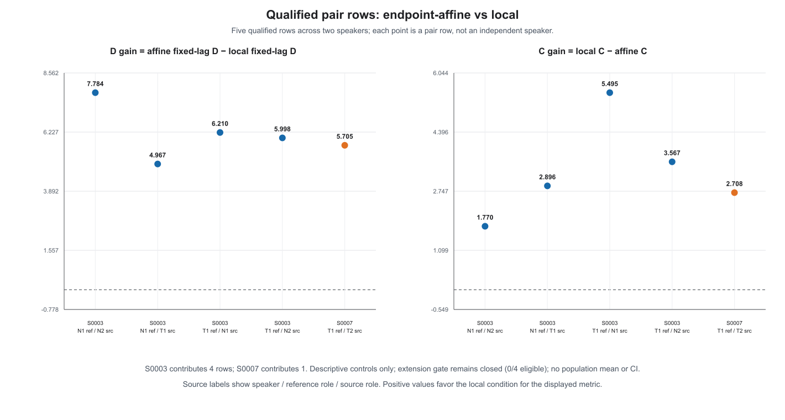

# 45-local-clock-crossover

固定视频的局部时钟正控与同文本交叉校正（2026-10-16）

## 结论

**在本次能执行并通过实际时钟控制的5个配对中，局部音素中心校正都提高了Sync-C（+1.770～+5.495），也都改善了预先冻结lag上的音视频距离（改善4.967～7.784）。** 配对包含自然→自然、TTS→TTS，以及自然/TTS双向交叉；视频像素和视频特征保持固定。该结果直接支持“评价音频的局部时钟校正操作能够恢复配对评分”。

这5对来自4人队列中的2人（S0003四对、S0007一对）。24个计划配对中，另19对的MFA中心映射要求超出冻结局部伸缩范围。没有说话人同时满足两个参考视频的类内与跨类覆盖门，故按预设规则停在4人，没有扩到8人。当前实现的覆盖率是5/24；全4人均衡效应没有填入均值或置信区间。

## 问题与冻结设计

报告44已经显示同文本的自然/自然和TTS/TTS异实例也会造成很大的非对角评分下降。本次用户授权小规模局部时钟检验：先4来源、复用视频、已知错位正控与sham，控制有效再考虑后4人。跨TFG增强头继续暂停。

- 固定首批S0003/S0006/S0007/S0008，复用报告44的N1/N2/T1/T2音频、原MFA和视频特征；主参考视频为V_N1与V_T1，每人6对、共24对。
- 相同RMS目标0.0376838172675746、mono/16k/PCM16；每个local与endpoint-affine配对精确同参考样本数，保持原音频内容顺序，使用整个波形PV而非拼接音素。
- endpoint-affine sham只统一总长；local按外部MFA的有序音素中心映射到参考时钟。未知标签计入coverage分母、不作锚点；两侧coverage>=.85，映射严格单调、局部斜率在[.25,4]。
- DSP为现有librosa1.0 STFT512/Hann/hop80/centered→任意t_out PV→精确长度ISTFT。身份sham走同一引擎。PV为近似保音高处理，局部渲染失真未与非校正映射逐剂量匹配；结果定义为MFA映射+PV渲染的条件效应。
- 使用实际输出WAV重新运行官方SyncNet音频编码器；复用同一V。每来源沿报告44原共同全31lag真实支持，不补嵌入、不选新窗口；主lag预先取对应原self cell的argmin_index。主端点是此固定lag距离，Sync-C及完整曲线为次要端点。
- 已知错位N1正控为输出→输入g(t)=t+0.240*sin(2*pi*t/D)，端点不变。实际错位音频再做MFA，依其中心估计修复图；已知逆映射只核对事件时刻，不拟合修复。D_sham和repair同为第二次PV；损失基线使用身份sham。
- 扩容只看控制和实际clock/coverage/支持门，不看主评分方向。完整方案见 [[固定视频的局部时钟错位正控与交叉校正 SPEC 2026-10-16]]；实际执行的v1.1 scratch spec SHA为`fa8f004f7b159410c961080b5ba053509480d7910f62e7c9982c36e35f30780d`。

## 已知错位与身份sham

16个身份条件相对原self基线的最大|Δ固定lag距离|/|ΔC|只有1.39e-6/1.80e-6。前三来源的已知时钟位移median为177.1/208.5/189.2ms；错位MFA对已知事件时刻的median误差为8.2/3.7/3.9ms，修复后对原时钟median误差10/5/5ms，MAE恢复91.3/97.9/97.2%。身份处理的错位sham保留原错位误差约100%。

| 来源 | 已知错位固定lag距离损失 | 修复恢复比例 | C身份 | C错位sham | C修复 | 时钟控制 |
|---|---:|---:|---:|---:|---:|---|
| S0003 | 5.638 | 85.1% | 7.023 | 2.540 | 6.045 | 通过 |
| S0006 | 4.166 | 98.9% | 6.036 | 2.697 | 5.704 | 通过 |
| S0007 | 4.458 | 96.0% | 5.091 | 3.201 | 4.917 | 通过 |
| S0008 | 6.234 | 101.7% | 5.835 | 2.602 | 5.680 | R TextGrid缺失，未计通过 |

S0008的修复音频存在且已评分，fresh-MFA R导出被磁盘ENOSPC中断，保留为时钟不可测，未补造或重跑。控制达到冻结的3/4门后才执行主比较。

## 主比较实际结果

下表比较同长度/RMS的endpoint-affine与local。ΔC=local−affine；固定lag距离改善=affine−local，正值为改善。MAE为实际输出MFA中心到参考中心的绝对误差。

| 来源 | 固定视频 | 评价实例 | 类别 | MAE affine→local(ms) | C affine→local | ΔC | 固定lag距离改善 |
|---|---|---|---|---:|---:|---:|---:|
| S0003 | N1 | N2 | 自然类内 | 241.8→13.9 | 4.388→6.159 | +1.770 | +7.784 |
| S0003 | N1 | T1 | 跨类 | 594.7→16.3 | 2.657→5.553 | +2.896 | +4.967 |
| S0003 | T1 | N1 | 跨类 | 497.1→16.1 | 1.362→6.857 | +5.495 | +6.210 |
| S0003 | T1 | N2 | 跨类 | 310.8→8.4 | 3.117→6.684 | +3.567 | +5.998 |
| S0007 | T1 | T2 | TTS类内 | 297.6→7.7 | 2.769→5.477 | +2.708 | +5.705 |

五对实际中心MAE降低94.2%～97.4%。来源是独立统计单位；四条S0003行不是四位独立说话人，不作n=5的显著性检验。19个未执行配对保留其原始对应、coverage、斜率和拒绝原因，不按得分清洗。

### 映射覆盖与浮点边界

首轮主比较保留24行，4行实际完成、20行因映射范围拒绝。ROOT检查几何后发现S0003 N1←N2的最大斜率为4.000000000000024，属于冻结上界4.0的浮点表示误差；仅补此前未执行的这一对，共2个forward，按1e-12数值精度处理边界，保留原拒绝记录及独立补充receipt。没有调大伸缩范围、改MFA、重跑已完成的8个forward或按结果选补样。

最终19对真实越界：2对仅端点区间越界、17对存在内部区间越界。这说明单纯处理前后静音仍不能覆盖整个问题；有序MFA中心之间的局部间隔差异需要更稳健的时钟坐标。范围上限同时保护PV处理免于过强局部伸缩，本次没有放宽它。

自然类内合格1/4，TTS类内1/4，跨类3/16；满足两个参考的完整类内+跨类条件的来源0/4。扩容门失败，未读取或执行后4人的新干预。

## 解释与论文主线

1. 报告44的“普通异实例也会大幅降分”获得了直接操作证据：本次合格自然类内与TTS类内配对都随局部时钟校正恢复C，跨类双向亦有恢复。
2. 同一视频的C随评价音频校正大幅变化，论文应明确驱动实例、评价实例、局部时钟和有效支持。原N/T四格强交互需要这些实例匹配参照。
3. 当前可复制方法的瓶颈集中在MFA中心到可执行波形映射的覆盖率。下一步优先在既有四来源上研究受速率约束的平滑/软时钟映射；该方向尚未执行，也不因此恢复增强头或扩大队列。

本实验固定所有视频，口部运动没有改变。结论针对评价端匹配与评分；MFA是估计边界，原ASR数字/专名歧义保留，AISHELL无正式重录标签或无预训练污染认证，LibriSpeech排除。操作结果覆盖5个预设资格通过配对，未形成完整4人均衡估计或跨TFG/感知改善结论。

## 执行、成本与复核

实际共38次音频forward（控制28+首轮主比较8+数值边界补充2），38段新WAV，21份实际TextGrid；0新TTS/ASR/TFG视频、0安装或实现tests。首轮主比较前台66.18s，边界补充只执行1次MFA和2次评分；完整时间见各receipt。

- attempt01因同时传rate与t_out，20render失败，0WAV/0MFA/0评分，保留原件；唯一DSP API修复只删除冲突rate参数。
- attempt02生成全部28控制WAV后根盘写满，parent9272/239317退出rc1，最后R MFA child13243/261862已退出，原RUNNING receipt不再当作活进程证据。7 MFA完成，S0008 R导出缺失。
- 在SHM对已有28WAV做score-only恢复，worker15951结构化PASS28/28，原数组全部本地读回；shell日志封装CRLF错误导致startticks缺失，如实保留，没有重跑科学评分。
- 仅本任务生成的MFA临时缓存390文件/963886811B移至SHM后核对，释放约755MB根盘；科学WAV、TextGrid、日志、来源与receipts保持不变。主比较与补充输出放SHM，实际产物已本地读回；不称网盘同步或全机器备份。
- ROOT控制实际QA：`runs/local_clock_crossover_20261016_attempt02/provenance/score_recovery/root_control_admission.json`，SHA`381bd121b8b3a8fd2a4016243084a651986437c729aa462df5da2bff5e55245c`；28WAV/84数组/实际MFA数学通过，距离重建max误差3.815e-6，曲线误差0。
- ROOT主比较+补充实际QA：`runs/local_clock_crossover_20261016_main_attempt01/root_actual_qa.json`，SHA`98e78a93046d90f96f7a52a9fe80513e78ef79687b82aa7cfaa828fd356f8ba5`；10forward/30数组及全部实际MFA通过，距离max误差3.815e-6，评分与clock误差0，RMS max误差7.18e-8。原报告44的128矩阵/数学没有重跑。

## 权威产物

- 控制原件：`runs/local_clock_crossover_20261016_attempt01/`（失败）、`runs/local_clock_crossover_20261016_attempt02/controls/`。
- 控制评分恢复：`runs/local_clock_crossover_20261016_attempt02/provenance/score_recovery/`。
- 首轮主比较：`runs/local_clock_crossover_20261016_main_attempt01/main/`，main_receipt SHA`58c74599cf3e45613b1257765f675434417a90b37328882315aea64c97e3026d`。
- 数值边界补充：`runs/local_clock_crossover_20261016_boundary_completion_attempt01/`，wrapper receipt SHA`7fcabc724e38c549b1688bb388089dff1e63404571828a982f96f7c98c78029e`，实际boundary main_receipt SHA`138102e2ddf7d45f8501f75e52ee9402cfa0a2852c70cd4e0cb27f4d27736e2f`。
- 派生24行合表、CSV与图（delivery_summary SHA c36c27967e78713ebcdc7411ddab23914e5e5d1ecea251db5e08ecdf0bc4753b；合格配对SVG92124ba31fc29e0af8f59d04b487b4a3d8dbb7a92ed452f114d1a7db54c08e4a，白底PNG已ROOT目视检查）：`runs/local_clock_crossover_20261016_main_attempt01/analysis_delivery_attempt01/`；保留原首轮拒绝与补充链，不改科学原件。
- 专用源码：`scripts/experiments/local_clock_crossover_20261016/`，5文件本地提交 `c6c1e7bd005abeaa4a2cc52991391ef2aaec5223`（未push/PR）。全部新实验进程已退出，后4人未运行，增强头继续暂停。

## Observations

- [status] concluded
- [conclusion] 5个资格通过配对的实际局部时钟校正均提高Sync-C（+1.770～+5.495），覆盖自然/TTS类内与跨类双向；19/24映射越界、完整来源资格0/4，按预算停在4人。
- [result] 已知错位正控3/4通过，前三来源固定lag损失恢复85.1～98.9%；第四R TextGrid因ENOSPC缺失，保留未测状态。
- [decision] 不按主分数方向扩样；未执行后4人、头/训练/中心/旧审计，不填完整队列均值或CI。
- [next_step] 后续若继续该机制，优先在原四来源上设计受速率约束的平滑/软时钟映射，另行冻结小方案。

## Relations

- follows [[44-repeated-take-crossover]]
- implements [[固定视频的局部时钟错位正控与交叉校正 SPEC 2026-10-16]]
- completed_by [[local-clock-crossover-20261016]]
- relates_to [[研究主线与证据地图]]