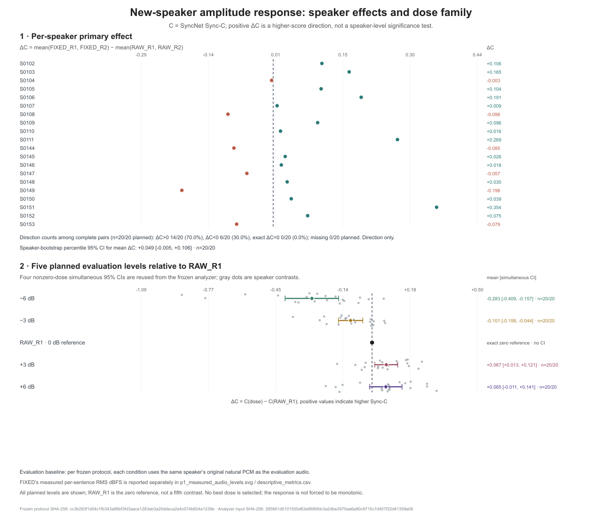
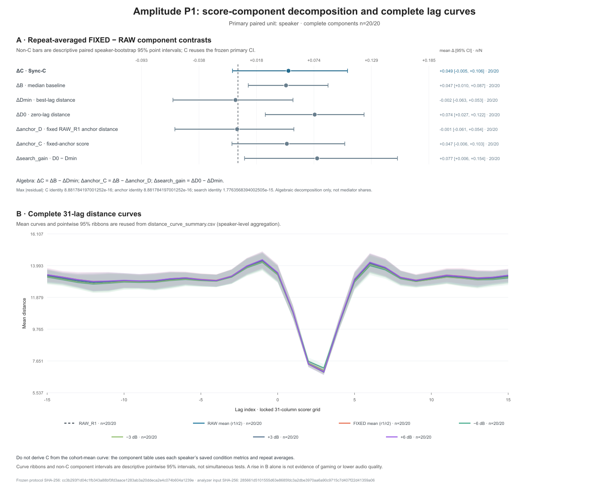
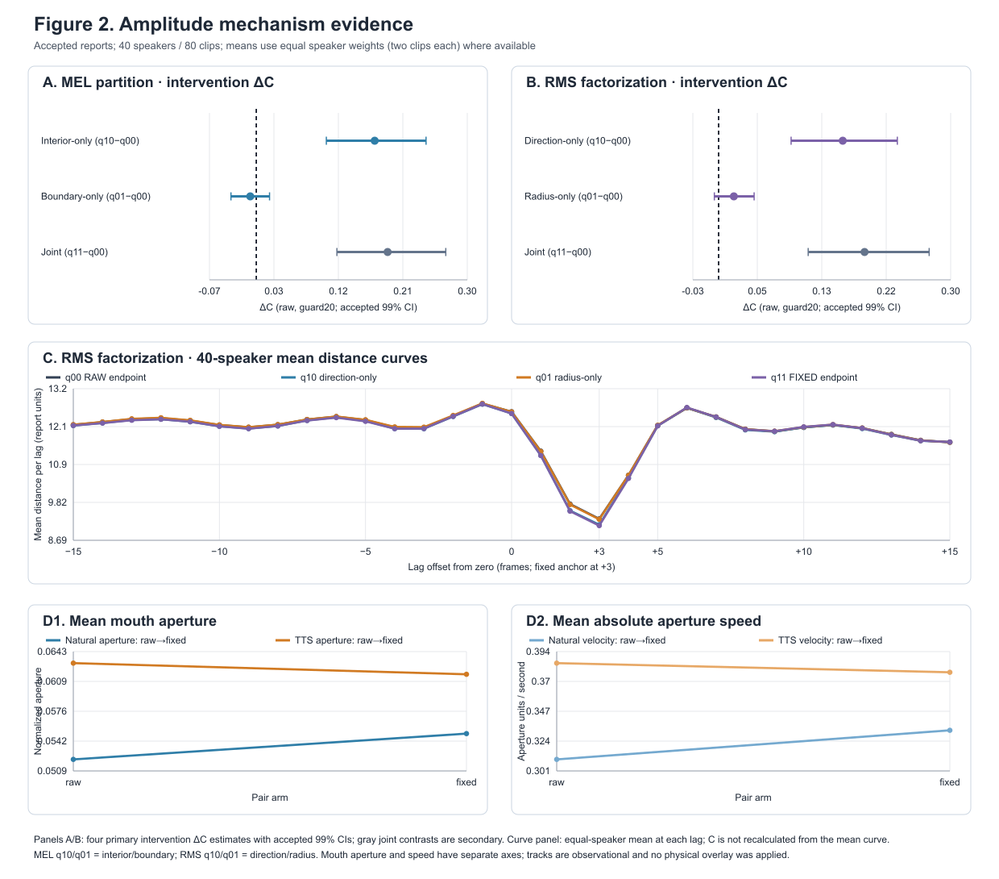
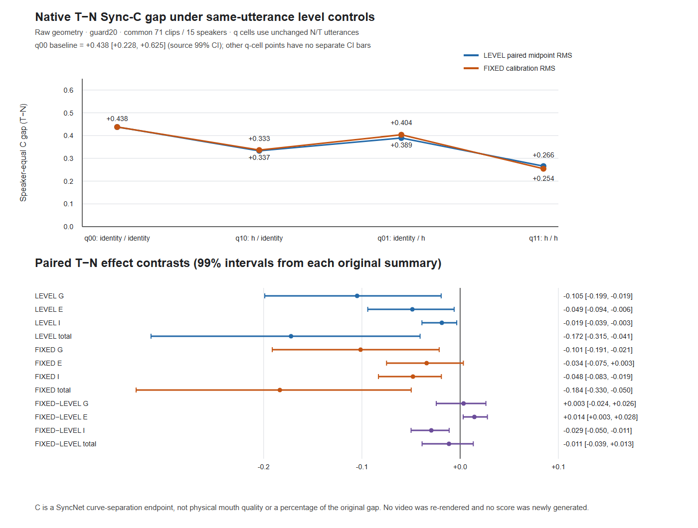

# 46-amplitude-gain-independent-validation

纯幅度通路、独立20人剂量响应与原生TTS电平差（2026-10-16）

## 结论

**纯幅度变化能改变冻结Wav2Lip的口部运动，并在预定的+3dB条件下提高固定原自然音轨的Sync-C；固定RMS规则的总体增益在新20人主支持集上仍有不确定性。** 这次完成160/160视频、160/160评分及全部口部测量，保留20/20说话人，没有按结果删样本或扩样。

| 预定比较 | 平均ΔSync-C | 95%区间 | 提升/下降/零/缺失 |
|---|---:|---|---|
| FIXED重复均值−RAW重复均值，主guard20 | +0.049 | [−0.005,+0.106]，配对speaker bootstrap | 14/6/0/0，计划20人 |
| −6dB−RAW_R1 | −0.283 | [−0.409,−0.157]，四剂量同时区间 | 1/19/0/0 |
| −3dB−RAW_R1 | −0.101 | [−0.158,−0.044]，四剂量同时区间 | 4/16/0/0 |
| +3dB−RAW_R1 | +0.067 | [+0.013,+0.121]，四剂量同时区间 | 15/5/0/0 |
| +6dB−RAW_R1 | +0.065 | [−0.011,+0.141]，四剂量同时区间 | 15/5/0/0 |

方向计数表示每位说话人的效应符号，**不是逐人显著性判定**。+3dB是评分前固定的四个非零剂量之一；不从这些结果挑选最优剂量。主FIXED区间跨零，不能改用阳性的full敏感性结果替换主分析。



## 1. 比较基线与研究范围

令`N`为原自然PCM，`G`为冻结生成器，`S`包含固定处理链、裁剪及有效支持。

| 问题 | 比较 | 解释范围 |
|---|---|---|
| 本报告自然音频幅度干预 | `S(G(gN),N) − S(G(N),N)` | 两臂使用完全相同的原自然评价音轨；相对自然自驱动、自评价 |
| 原生TTS评分差 | `S(G(T),T) − S(G(N),N)` | 驱动与评价音轨随来源同时改变 |
| 报告45局部时钟恢复 | `S(V,R_local) − S(V,R_affine)` | 同一固定视频，改变另一发声实例的评价音轨 |

报告45的+1.770～+5.495属于第三行：可执行覆盖5/24=20.8%，来自2人，完整来源资格0/4。它不等于超过自然self基线，也没有完整队列效应估计。本报告的160条幅度实验直接检验第一行。跨TFG增强头、训练、旧中心及Dev/Confirm仍暂停；P2停顿单操作仍为独立待办。

## 2. 冻结设计、输入与统计

- 新20人：S0102–S0111、S0144–S0153，各1句，10M/10F，均使用W0121。独立性指未用于本项目幅度规则调参或既有机制分析，不宣称上游模型训练无污染。LibriSpeech未使用。
- 复用已核验的AISHELL-1发布包与原转录，0新下载/TTS/ASR/MFA。20原音全部通过静音、峰值、长度和来源资格；0排除、0替补。
- `g>0`整段乘法；RAW为原PCM16，FIXED及四剂量保存为IEEE FLOAT32 WAV。无滤波、限幅器、动态压缩或重合成；原16kHz/mono/样本数及内容顺序保持。
- FIXED目标RMS为0.0376838172675746；实际逐句增益−3.102～+8.879dB。统一剂量为−6/−3/0/+3/+6dB，0复用RAW_R1。FIXED不是一个统一相对dB点，实际电平图独立保存。
- 每人RAW_R1/R2、FIXED_R1/R2、DOSE_M6/M3/P3/P6共8视频；6个唯一音频输入。R1及剂量seed2026101601，R2为2026101602；wrapper实际设置Python/NumPy/Torch/CUDA种子及cuDNN/CUBLAS规则。
- 固定Wav2Lip GAN、参考脸`3.png`、25fps、同ROI及SyncNet V2。评价端始终读取同句原自然PCM16，不读生成器复用音轨。
- 主支持`q=[20,L−20)`，`L=min(A,八臂V)`；full敏感支持`q=[15,min(minV,A−15))`。所有31lag均为真实上下文。每人固定anchor取RAW_R1主曲线argmin，其他臂不重新选anchor。
- 先在每人内平均两重复，再按20人等权。PCG64 seed20261016、B=20000、percentile95主区间；四非零剂量C用centered bootstrap mean/原样本SE的max-|t|同时95区间，临界值2.3103702044。其他组件、口部及曲线区间为pointwise描述区间。

协议在新评分前冻结：[[幅度六环与新说话人增益曲线 SPEC 2026-10-16]]。其SPEC_ONLY元数据是冻结时状态；实际执行与完成状态见本报告及Task，不修改已绑定的协议文件体。

## 3. 实际波形、重复与支持

ROOT独立读取20原PCM与100保存的增益WAV，全部逐采样等于`float32(float64(N)*g)`；归一化频谱形状、RMS、长度和有限性通过。全队列+6dB最大峰值约0.790664，无削波；FIXED也全部无削波。原文本与固定转录逐码点一致，console显示异常未造成真实替换符。

主RAW/FIXED各两次生成并不全部字节确定：40个臂内重复对中4对C差非零；RAW/FIXED绝对重复差平均0.004593/0.001094，中位数均0，最大0.042947。14人两个重复均为正，6人两个重复均为负，未出现重复间效应符号翻转。

修正full上下文后，FIXED−RAW的full敏感性为**+0.079，95%[+0.020,+0.141]**。它与主guard20的+0.049属于不同预定支持；保留两者，不以显著性重选端点。

## 4. 完整距离曲线与分解

每条曲线先在共同q上平均，再计算`B=median(curve31)`、`Dmin=min(curve31)`、`C=B−Dmin`；`D0=curve31[15]`。`Danchor`固定于该人RAW_R1的主argmin；`Canchor=B−Danchor`。不从跨人均值曲线重新计算队列C。

| FIXED−RAW，重复先平均 | 均值 | 95%描述区间（C为主区间） |
|---|---:|---|
| C | +0.049 | [−0.005,+0.106] |
| B | +0.047 | [+0.010,+0.087] |
| Dmin | −0.002 | [−0.063,+0.053] |
| D0 | +0.074 | [+0.027,+0.122] |
| Danchor | −0.001 | [−0.061,+0.054] |
| Canchor | +0.047 | [−0.006,+0.103] |

FIXED的均值分解主要体现B上升；最佳匹配/固定anchor距离变化接近零。+3dB的描述分解为ΔB=+0.020、ΔDmin=−0.047、ΔDanchor=−0.042，后两者pointwise95区间分别[−0.089,−0.007]/[−0.084,−0.003]；同时ΔD0=+0.052。因此输入尺度响应包括背景与匹配距离两部分，不能统称为原时钟更准，也不能把B升高直接称为gaming或质量下降。



所有四剂量的七组件均已报告，含下降档，见`runs/p1_gain_dose_response_20261016_derived_attempt01/component_decomposition_attempt01/dose_component_decomposition_summary.csv`。组件共享speaker bootstrap indices，只有C沿用四剂量同时区间；其余为描述区间。该代数分解不是中介份额。

## 5. 独立口部运动

已有MediaPipe FaceLandmarker逐帧读取160视频。开度为二维像素唇13–14距离/眼33–263距离；速度为原相邻帧`abs(Δopening)*25`，不跨缺帧。八条件共同mask、原PTS和25fps保持；20/20人、160/160条件合格，共17,240条件帧，覆盖均100%，最短相邻支持83条边。帧数不作为独立统计样本数。

| 比较 | Δ平均开度 | Δ平均绝对开度速度（/秒） |
|---|---|---|
| FIXED−RAW，重复均值 | +0.002261，95%[+0.000791,+0.003723]；16/20正 | +0.019768，95%[+0.006823,+0.033270]；14/20正 |
| +3dB−RAW_R1 | +0.001940，95%[+0.000929,+0.002889]；16/20正 | +0.010327，95%[+0.003482,+0.016890]；14/20正 |
| +6dB−RAW_R1 | +0.004019，95%[+0.003004,+0.004941]；19/20正 | +0.032626，95%[+0.023440,+0.043108]；19/20正 |

负增益两档的开度及平均绝对速度均值均下降，完整四档表保留。**视频确实发生了口部运动变化；运动幅度增加与Sync-C收益并不一一对应。** +6dB有更大的运动响应，其C区间仍跨零。上述指标描述开合与速度，不定义构音准确度或人类感知同步；本次没有新增盲评。

## 6. 旧40人内部路径复核（0新视频）

实际旧RAW→FIXED的RMS consumer07，与source_axis consumer08的来源方向操纵不同，二者不替代。统一读取40人/80句的2560个RMS格、2560个MEL格及320条运动记录；ROOT逐值核对无误，旧区间保留为99%。

| 内部干预，raw/guard20 | ΔC | 99%区间 |
|---|---:|---|
| 编码方向 | +0.161 | [+0.094,+0.232] |
| 编码半径 | +0.020 | [−0.006,+0.046] |
| 联合 | +0.190 | [+0.117,+0.274] |
| MEL interior | +0.171 | [+0.101,+0.245] |
| MEL boundary | −0.009 | [−0.037,+0.019] |



这是已有因子干预的复核；不称为新独立内部机制复现。MEL完整原31lag payload尚未本地恢复，表中格指标/旧区间与来源ledger可核对；图中完整曲线来自实际RMS数组。旧主波形+0.192、该内部joint+0.190、另一个40人waveform-only G+0.117、controls360等模型+0.152属于各自合同，不合并均值或解释百分比。

## 7. 旧15人原生TTS电平四格（0新视频）

两份2026-09-27实际run提供71合格配对/15人，3条guard排除保留。每个N/T实例内分别改变生成端G与评价端A电平；不把N/T音轨交叉替换。

| T−N原生gap | q00 identity/identity | q10 hG/identityA | q01 identityG/hA | q11 hG/hA |
|---|---:|---:|---:|---:|
| FIXED校准RMS | +0.438 | +0.337 | +0.404 | +0.254 |
| LEVEL配对几何中点 | +0.438 | +0.333 | +0.389 | +0.266 |

FIXED的G-only gap变化−0.101，99%[−0.191,−0.021]；总gap变化−0.184，[−0.330,−0.050]。LEVEL分别−0.105/[−0.199,−0.019]及−0.172/[−0.315,−0.041]。两种目标的定义不同，保持单列。旧148个评价视频曾按原策略不保留，当前结论来自实际数组/原曲线/身份记录，未重新生成这些视频。



## 8. 执行与关键修复

本轮新增160视频、120条件音频encoder提取、20原自然音频评分特征与160视频评分特征提取；160视频另做MediaPipe逐帧推理。0新TTS/ASR/MFA、0训练/新安装/广泛恢复；旧证据不重跑模型。

- attempt01缺log parent，在0renderer child时失败；attempt02首次encoder因远端缺既有helper在0forward时失败。修复后只恢复缺依赖并重试该stage，原视频不重生成。
- ROOT首8实际数组QA发现通用engine先截断A到min(A,V)再padding，违背新full真实支持合同。保留原件，用完整saved A/V单次数据修复160full数组、384个尾部cell，0TFG/SyncNet前向，primary重叠逐位不变。首overlay dtype契约失败0数组写出，修复float32 features/float64 distance读取后attempt02完成。
- 首mouth join修改了row副本，导致attempt01 analyzer没有口部数字。保留错误join/analysis/addendum；attempt02修正实际对象引用，数据分析重放一次。两次primary/dose结果exact一致，`speaker_primary.csv`字节一致；最终160行均含实际mouth数值。
- renderer续跑父PID未另捕获；每child PID/startticks/rc、输入hash与前台rc0完整，父身份缺口如实保留。未为元数据重启实验。
- 针对性fixtures由Luna代理实际执行：source/runner/analyzer17项、mouth8项、full-context4项、派生图工具各3项通过；无整库测试。ROOT实际20+100WAV、160视频body哈希、320主/修正full矩阵、160口部landmark轨迹及28组件区间已重建通过。

## 9. 权威产物与复现

- 冻结协议/输入：packet SHA `cc3b293f1d04c1fb343a88bf3fd3aace1283ab3a20ddeca2e4c074b604a1239e`；source manifest raw SHA `f3cc98a1598a22f0bd84af77d3e0bf802c5ad62ef3c76c5461e091e46b1535f7`。其内部canonical fingerprint是另一字段，不能当文件体SHA。
- 新科学闭包：`runs/p1_gain_dose_response_20261016_attempt02_readback/final/`，原score SHA `29865f15c7859cd601f8c2e417d06e41cace193856b20d790d8f79fe256f0769`。原视频、输入、A/V、distance、encoder、口部与receipts已本地读回；不是网盘同步或整机备份。
- canonical分析：`final/analysis_input_attempt02/` → `final/analysis_results_attempt02/`。输入SHA `5567f0393f40dc8ae77fc61fe66883b8d00431f9cf3f205b67169fe72e450509`；summary SHA `7b9ef0a1e8ce9c6efaa6c828168ba190a6df196b2c3a6dc453cfdc78e59d60c9`；冻结analyzer SHA `5ecd6c922d53180982d84a16bc52d24e351e07fb2f4e01cef62177f9fb2b6cf0`。
- ROOT QA：`.codex/scratch/proposal_amplitude_20261016/root_final_gain_actual_qa.json` SHA52a62bf9…；`root_final_mouth_actual_qa.json` SHA30f974e1…；`root_analysis_delivery_qa.json` SHA8ef77f6e…。独立距离max误差3.815e−6，curve/metrics/全部mouth公式/28组件均值与区间误差0。
- 图源与表：`runs/p1_gain_dose_response_20261016_derived_attempt01/`。图只消费attempt01的有效primary/curve（与attempt02相同）；mouth结论引用attempt02与独立overlay。layout02仅改文字坐标，未重算数值，PNG已ROOT目视检查。
- 旧40终局：`runs/recovered_20260930/independent_validation/amplitude_evidence_reconstruction_20261016_attempt03/`；旧15终局：`.codex/scratch/native_level_gap_audit_attempt01/derived_attempt09/`。

```bash
# 使用带NumPy的合格Python环境；输出目录必须不存在
python scripts/experiments/p1_gain_dose_response_20261016/analyze_p1_results.py \
  --input runs/p1_gain_dose_response_20261016_attempt02_readback/final/analysis_input_attempt02/score_results_joined_for_analysis.json \
  --output runs/p1_gain_analysis_replay_new
```

## Observations

- [status] concluded
- [result] 固定自然self评分下，新20人FIXED主ΔC+0.049、95%区间跨零、14/20正；预定+3dB ΔC+0.067、四剂量同时区间为正、15/20正。
- [conclusion] 纯幅度通路可复制地改变口部运动及部分预定评分端点；固定RMS规则、剂量和有效支持的迁移边界必须同时报告。
- [decision] 全20人/160条件保留；不按阳性剂量选方法、不用full敏感性替代主端点、不恢复跨TFG head。
- [next_step] 将报告46回填同一proposal和研究地图；P2停顿保持独立待办，后续扩大规模须另立明确问题与预算。

## Relations

- implements [[幅度六环与新说话人增益曲线 SPEC 2026-10-16]]
- extends [[25-tts-tfg-mechanism]]
- relates_to [[45-local-clock-crossover]]
- relates_to [[proposal-validation-p0-p1-p2-20261016]]
- relates_to [[研究主线与证据地图]]
- relates_to [[从 TTS 高分到可控驱动：唇形生成的输入机制与迁移边界]]