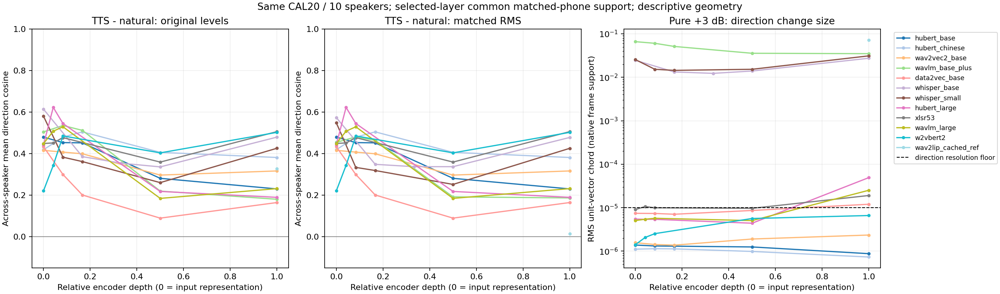
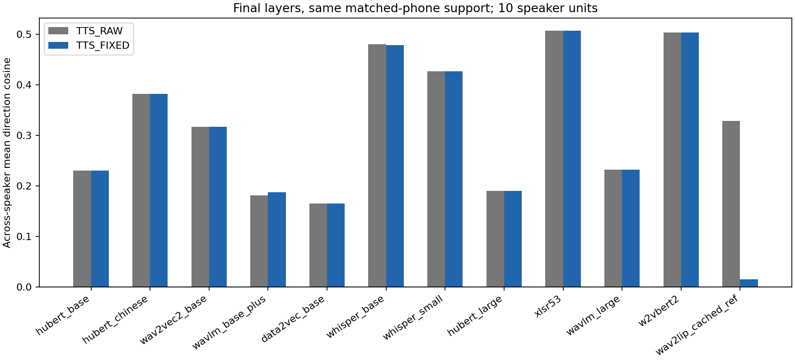

# 52 — 主流语音编码器的 TTS 与增益方向共性

## 问题与执行范围

用户要求把已有的编码方向共性分析扩展到主流编码器，并由ROOT直接执行。完成6个语音内容编码器家族的11个公开checkpoint，另在完全相同音素支持上重用Wav2Lip原生编码参照；不是穷举全部音频模型。
本次正式新编码前向 **1331** 次（11×[20句×6臂+1个RAW重复]），最终11/11完整结束、0缺模型。W2v-BERT首尝试另有2次在首句重复检查前完成的前向，因原生padding零向量停止；按实际attention mask修复后单独完成121前向，其他10模型没有重跑。总调用1333次，失败原件及精确调用路径推定依据保留。0新TFG/SyncNet前向、0训练。Wav2Lip参照只读取已验证缓存，新增前向为0。

## 设计与识别边界

- 固定同一CAL20：10位男性、每人2句，同文本自然/Qwen TTS，历史已暴露探索队列；新增模型数不等于新增独立说话人数。
- 所有编码器读取完全相同的原16k float32 PCM。TTS_RAW比较两侧原电平；TTS_FIXED双方RMS均0.0376838172675746；纯±3dB以自然FIXED为基线，严格保持其内容和原时钟。
- TTS和自然语音按已有MFA同音素分别取原生帧，不插值或重定时。该比较不是两个发声实例拥有相同局部时钟；没有独立自然重录，所以不能将TTS差异全部识别为合成特有因素。
- 保留官方原生前处理；wave模型按config的卷积感受野中心确定时间，Whisper为20ms编码步长/centered STFT，W2v-BERT为25ms fbank、10ms hop、两帧stack的17.5ms首中心。Whisper仅保留原时长内帧，30秒原生上下文仍保留。
- 跨模型主表使用12条路径共同的 **663对匹配音素**；中央50%敏感性为 **516对**，20/20句、10/10人保留。所有层原生支持结果另存；跨模型共同支持表固定0/1/2/middle/last层，末层统一展示，不选最佳层。
- 每帧单位化→音素内平均再单位化→目标减来源。音素、句、说话人依次等权；10人45对余弦不是45个独立实验。LOSO参考轴只由其他9人定义，另计算各音素改变量对该轴的局部余弦。
- 新编码器方向分辨率门：单位向量变化RMS≥1e-5且大于重复差异10倍。低于门时不解释共同方向余弦；该门不表示严格零响应。连续幅度照常报告，接近门的结果保留其数值边界。Wav2Lip缓存未新重复，不虚构重复值。
- 不同模型维数和坐标不同；只比较每个模型内部的几何统计，不将跨模型向量直接求cos。无最佳层、最佳剂量选择或总体显著性主张。

## 末层 TTS 方向：共同支持

| 编码器 | RAW跨人cos | FIXED跨人cos | FIXED留一人cos | FIXED局部音素cos |
|---|---:|---:|---:|---:|
| hubert_base | 0.230 | 0.230 | 0.415 | 0.090 |
| hubert_chinese | 0.382 | 0.382 | 0.576 | 0.125 |
| wav2vec2_base | 0.317 | 0.317 | 0.515 | 0.268 |
| wavlm_base_plus | 0.180 | 0.187 | 0.359 | 0.069 |
| data2vec_base | 0.165 | 0.165 | 0.327 | 0.068 |
| whisper_base | 0.480 | 0.478 | 0.659 | 0.131 |
| whisper_small | 0.426 | 0.426 | 0.613 | 0.124 |
| hubert_large | 0.190 | 0.190 | 0.363 | 0.081 |
| xlsr53 | 0.506 | 0.506 | 0.698 | 0.144 |
| wavlm_large | 0.232 | 0.232 | 0.413 | 0.092 |
| w2vbert2 | 0.503 | 0.503 | 0.674 | 0.144 |
| wav2lip_cached_ref | 0.329 | 0.015 | 0.035 | 0.006 |

“跨人cos”比较每人的平均改变量；“局部音素cos”先比较每个音素改变量与其他人的共同轴，再依次句/人等权。二者不能互换：平均轴共性不意味着每个音素受到同一种变化。

## 末层纯增益方向：同内容、同原时钟

| 编码器 | 官方wave归一化 | +3dB方向变化RMS | +3dB跨人cos | −3dB反向跨人cos |
|---|---|---:|---:|---:|
| hubert_base | 开启 | 8.765e-07 | 低于方向分辨率 | 低于方向分辨率 |
| hubert_chinese | 开启 | 7.339e-07 | 低于方向分辨率 | 低于方向分辨率 |
| wav2vec2_base | 开启 | 2.351e-06 | 低于方向分辨率 | 低于方向分辨率 |
| wavlm_base_plus | 关闭 | 3.497e-02 | 0.479 | 0.567 |
| data2vec_base | 开启 | 1.201e-05 | 0.033 | 0.062 |
| whisper_base | 原生log-mel | 2.745e-02 | 0.613 | 0.637 |
| whisper_small | 原生log-mel | 3.114e-02 | 0.577 | 0.605 |
| hubert_large | 开启 | 4.929e-05 | 0.016 | 0.051 |
| xlsr53 | 开启 | 1.909e-05 | 0.077 | -0.006 |
| wavlm_large | 开启 | 2.518e-05 | 0.271 | 0.514 |
| w2vbert2 | 原生mel-CMVN | 6.611e-06 | 低于方向分辨率 | 低于方向分辨率 |
| wav2lip_cached_ref | 关闭 | 7.210e-02 | 0.884 | 0.873 |

## 本次得到的具体结论

1. **固定RMS后，TTS的平均方向共性在11个预训练编码器中仍保留。** 末层跨人cos为0.165–0.506；例如中文HuBERT0.382、wav2vec2 base0.317、Whisper base0.478、XLS-R0.506、W2v-BERT0.503。相同663音素支持下，Wav2Lip从RAW0.329降至FIXED0.015。旧Wav2Lip结果得到同支持复现，同时其电平混淆程度应限定该接收编码器。
2. **纯增益的共享方向和变化量级依赖具体原生路径。** Wav2Lip、WavLM base-plus和Whisper base/small的+3dB方向变化RMS为0.0721/0.0350/0.0275/0.0311，跨人cos0.884/0.479/0.613/0.577；若干wave-normalized/CMVN路径的变化在1e-6–5e-5量级。HuBERT large、XLS-R、data2vec和WavLM large的部分值虽过预定1e-5门，仍须按连续的小幅度解释，不能与1e-2量级响应视为相同强度。WavLM base-plus关闭wave归一化、large开启；模型权重也不同，本实验不将两者差异全部单因归给归一化。
3. **平均方向比局部变化更一致。** 11个预训练编码器FIXED的句均LOSO为0.327–0.698，而各音素对LOSO轴的平均cos仅0.068–0.268。在这些表示中存在可复用的平均分量，但把它当作所有音素的同一局部改变量会丢失大量结构。
4. **原始TTS方向与增益轴高度重合具有编码器边界。** Wav2Lip的RAW总体轴cos0.933；WavLM base-plus、Whisper base/small分别0.146/0.177/0.105，统一RMS后为−0.184/0.081/0.022。下表完整列出预定分辨率门通过的末层路径，近门小信号须结合上表变化幅度阅读。

| 编码器 | RAW TTS轴 vs +3dB轴 | FIXED TTS轴 vs +3dB轴 |
|---|---:|---:|
| wavlm_base_plus | 0.146 | -0.184 |
| data2vec_base | 0.185 | 0.184 |
| whisper_base | 0.177 | 0.082 |
| whisper_small | 0.105 | 0.022 |
| hubert_large | -0.121 | -0.121 |
| xlsr53 | -0.940 | -0.940 |
| wavlm_large | -0.098 | -0.098 |
| wav2lip_cached_ref | 0.933 | 0.136 |

纯增益变化RMS在各模型真实帧支持上计算；其共同方向统计仍在共同音素支持上计算。“−3dB反向”指FIXED−MINUS3，统一为向更高电平的方向。完整输入前处理相对L2、各层半音素结果、范数响应和TTS对增益轴关系见实际receipt及结果JSON。

## 图与完整结果

同一encoder的固定层位置全部展示；原生全部层结果为`models/<id>/summary_native_support.json`，不要把其中不同帧支持的数值混入共同支持主表。

## 官方checkpoint与实际权重

| 路径 | 固定版本 | 权重SHA前16位（完整值见model_source） |
|---|---|---|
| hubert_base | [facebook/hubert-base-ls960@dba3bb02fda4](https://huggingface.co/facebook/hubert-base-ls960/tree/dba3bb02fda4248b6e082697eee756de8fe8aa8a) | 062249fffb353eab |
| hubert_chinese | [TencentGameMate/chinese-hubert-base@fce0375452b1](https://huggingface.co/TencentGameMate/chinese-hubert-base/tree/fce0375452b1dd6c080ac3248d423d4d037bc831) | 2fefccd26c2794a5 |
| wav2vec2_base | [facebook/wav2vec2-base@0b5b8e868dd8](https://huggingface.co/facebook/wav2vec2-base/tree/0b5b8e868dd84f03fd87d01f9c4ff0f080fecfe8) | 3249fe98bfc62fcb |
| wavlm_base_plus | [microsoft/wavlm-base-plus@4c66d4806a42](https://huggingface.co/microsoft/wavlm-base-plus/tree/4c66d4806a428f2e922ccfa1a962776e232d487b) | 3bb273a6ace99408 |
| data2vec_base | [facebook/data2vec-audio-base@1f5a6404ec3d](https://huggingface.co/facebook/data2vec-audio-base/tree/1f5a6404ec3d696d09d505c66b828124b70d50c8) | 4fd2317db95a7d67 |
| whisper_base | [openai/whisper-base@e37978b90ca9](https://huggingface.co/openai/whisper-base/tree/e37978b90ca9030d5170a5c07aadb050351a65bb) | 07cadb9f25677c8d |
| whisper_small | [openai/whisper-small@973afd24965f](https://huggingface.co/openai/whisper-small/tree/973afd24965f72e36ca33b3055d56a652f456b4d) | 1d7734884874f1a1 |
| hubert_large | [facebook/hubert-large-ll60k@ff022d095678](https://huggingface.co/facebook/hubert-large-ll60k/tree/ff022d095678a2995f3c49bab18a96a9e553f782) | 45a299050945479a |
| xlsr53 | [facebook/wav2vec2-large-xlsr-53@c3f9d884181a](https://huggingface.co/facebook/wav2vec2-large-xlsr-53/tree/c3f9d884181a224a6ac87bf8885c84d1cff3384f) | 314340227371a608 |
| wavlm_large | [microsoft/wavlm-large@c1423ed94bb0](https://huggingface.co/microsoft/wavlm-large/tree/c1423ed94bb01d80a3f5ce5bc39f6026a0f4828c) | fdee460e529396dd |
| w2vbert2 | [facebook/w2v-bert-2.0@da985ba0987f](https://huggingface.co/facebook/w2v-bert-2.0/tree/da985ba0987f70aaeb84a80f2851cfac8c697a7b) | eb890c9660ed6e34 |

## 验证、成本与复现

- 11个官方revision/权重body经实际SHA核对；可用LFS SHA均匹配，实际encoder没有missing/mismatched参数。首句RAW重复控制记录在每模型receipt。
- 一次数据-only消费者核验 **240个实际NPZ**、**448组共同支持统计**，单位方向范数最大误差2.895e-08，跨人/LOSO/局部音素统计重建最大误差4.441e-16；0模型前向。
- 本机RTX4060、FP32、TF32关闭、batch1、最多50%PyTorch allocator，逐模型退出释放资源；未占Ubuntu其他会话的训练GPU。前四模型使用原producer，其后增加low_cpu_mem_usage以减小加载内存，forward数学与科学协议未改，两个实际源码正文均封存。
- W2v-BERT attention mask修复只排除原生无效padding位置，原时钟/剂量/科学分辨率门不变；首句零向量控制失败的原receipt/log保留在failures/w2vbert2_attempt01，修复版执行正文另存run_native_mask.py。旧batch_status的rc1不被篡改，最终成功见recovery_status及新模型receipt。
- 公共模型权重成功后作为可重下载缓存回收，保留固定revision、配置和SHA。空间通过回收已验证的冗余May传输分片/打包副本、pip下载缓存和NTFS透明压缩解决；全部643 May科学成员重新SHA通过且保留，已独立云读回的分片保留。见[[编码器扩展的执行环境与资产存储]]。
- 持久实际根`F:/Datasets/tts-exp/encoder_survey_20261018`；仓库小型镜像`runs/encoder_survey_20261018/`含protocol/results/table/QA/图及成员索引。科学成员362个、2793366649 bytes；本轮新产物未声明云同步。
- 代码`scripts/experiments/encoder_survey_20261018/{prepare,run,cache_reference,analyze,verify,plot,report}.py`；精确执行正文在持久根execution_sources。原输出create-only，勿盲目重跑覆盖；重分析使用已有原始NPZ、新输出目录，协议源SHA以实际receipt为准。

## 意义与限制

本实验把“编码方向存在差异”“变化具有跨人共性”“能够迁移生成收益”分开。前两者可以在同一语料上随编码器、原生归一化和层深发生不同变化；本次没有新的生成干预，因此不新增Sync-C或感知质量收益结论。Wav2Lip既有共性和留出生成结论仍限定其模型与合同，不自动外推为通用编码轴。

CAL20只有10位已暴露男性，不能把模型覆盖扩展称作跨人口/语言确认；全部使用一个Qwen来源，没有独立自然重录或多个TTS来源因果分离。LibriSpeech音频未进入本次队列，模型自身预训练来源并不等于当前队列已通过污染审计。

下一有价值的生成验证只应针对具有可测、可复制局部响应且与接收TFG相接的路径；当前暂停的通用增强头不因几何结果自动恢复。

## Observations

- [status] concluded；11新编码器/1331正式前向，另2次失败前向，及1个缓存原生参照，共同支持几何核验完成。
- [decision] 保留每个编码器原生前处理，低于方向分辨率不解释cos；平均方向与局部音素方向分开。
- [limitation] 方向共性不是跨模型同一坐标，也不等于生成或感知收益。

## Relations

- follows [[TTS 编码方向共性与电平混淆的配对音素补算]]
- follows [[纯增益编码方向的跨说话人共性补算]]
- relates_to [[增益共同方向与残差的留出说话人生成验证]]
- relates_to [[主流语音编码器的方向共性扩展]]
- relates_to [[编码器扩展的执行环境与资产存储]]
- relates_to [[研究主线与证据地图]]