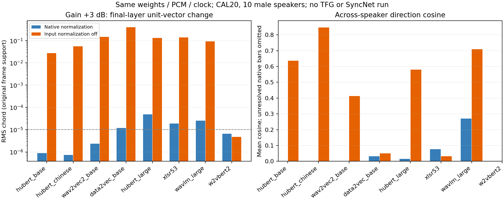

# 53 — 同权重关闭输入归一化后的增益方向响应

## 问题与范围

用户要求将报告52中有音频输入归一化的编码器关闭归一化，与原结果比较。ROOT直接执行，没有子代理。
同一checkpoint内只改变输入统计开关，因而消除了原调查中“不同权重同时配有不同前处理”的混杂。它回答增益敏感性，不评价移除归一化后的语义质量。

## 设计

- 沿用报告52同一CAL20：10位已暴露男性、每人2句，原16k float32自然FIXED PCM，RMS0.0376838172675746及同波形±3dB。没有新TTS或不同内容/时钟。
- 7个波形路径仅`do_normalize=False`；W2vBERT2仅`do_normalize_per_mel_bins=False`。内部已训练LN/GN等及全部模型权重、前端其他参数保持不变。
- 八个checkpoint：HuBERT base/中文/large、wav2vec2 base/XLSR53、data2vec base、WavLM large、W2vBERT2。复用原固定revision和权重/config完整SHA；不是重新选择最新权重。
- 每模型首句原生归一化三臂重放，之后20句×3臂off以及首句off重复：64次/模型，八模型512正式encoder forward。旧原生结果缓存复用，不重跑全部on。
- 每帧单位化→音素池化再单位化→改变量；同原663 full/516中央50%音素支持，句/人等权。全层统计，固定0/1/2/middle/last展示，末层为主表，不挑最佳层。
- 原信号门RMS≥1e-5且>10×重复底噪不变；跨人余弦只有10个说话人单位，不把45对当独立样本。−3dB方向按FIXED−MINUS3反号，统一为向高电平。

## 末层同权重比较

| 编码器 | 原归一化 +3dB RMS | 关闭后 +3dB RMS | 关闭后 −3dB RMS | 关闭后 +3dB 跨人cos | 关闭后 +3dB LOSO | 基线表示cos（off/on） |
|---|---:|---:|---:|---:|---:|---:|
| hubert_base | 8.76465e-07 | 0.0272704 | 0.035077 | 0.637 | 0.773 | 0.997 |
| hubert_chinese | 7.33881e-07 | 0.0557825 | 0.0741427 | 0.847 | 0.911 | 0.998 |
| wav2vec2_base | 2.35096e-06 | 0.147053 | 0.156024 | 0.413 | 0.604 | 0.969 |
| data2vec_base | 1.20105e-05 | 0.402606 | 0.481451 | 0.051 | 0.151 | 0.673 |
| hubert_large | 4.92851e-05 | 0.130251 | 0.154435 | 0.581 | 0.732 | 0.956 |
| xlsr53 | 1.90933e-05 | 0.137674 | 0.14482 | 0.032 | 0.228 | 0.996 |
| wavlm_large | 2.51842e-05 | 0.093792 | 0.0990965 | 0.710 | 0.824 | 0.951 |
| w2vbert2 | 6.61081e-06 | 4.74977e-06 | 3.25022e-06 | 低于分辨率 | 低于分辨率 | 0.959 |

RMS是实际原生帧支持上的单位编码向量变化，反映方向而非未单位化的向量长度；跨人cos比较每人的平均变化，不能和跨编码器同一轴或局部音素一致性互换。off/on基线cos是在未加增益的FIXED下比较两种前处理，说明移除归一化本身是否改变表示。

## 主要结论

同权重下，7/8模型的末层+3dB方向变化RMS增大；原生on范围7.33881e-07–4.92851e-05，其中恢复可测响应的7模型关闭后0.0272704–0.402606。这7模型的跨人平均方向cos范围0.032–0.847，局部音素LOSO范围0.017–0.583；W2vBERT不解释低于分辨率的cos。未加增益的基线off/on音素表示cos范围0.673–0.998。这些事实分别说明敏感性、平均共性与前处理本身的影响，不把三个量当同一效应。

## W2vBERT例外：增益在后续逐帧LayerNorm被消除

W2vBERT关闭逐Mel CMVN后，+3dB末层变化6.611e-6→4.750e-6，两者都低于分辨率，不能解释其共同方向余弦。实际安装源码`Wav2Vec2BertFeatureProjection`在Linear之前调用覆盖160维输入的LayerNorm（2×80 Mel stack）。纯增益g在log-power Mel中近似成为所有维度相同的加法常数2ln(g)；逐帧LayerNorm对这种常数平移不变，因此即使CMVN移除仍可保留电平不变性。这一不变关系不依赖后续学习到的gamma/beta值。

针对同20句/±3dB做60次CPU frontend重放，全部实际input_features/attention_mask的hash与科学worker一致，确认CMVN确实关闭。前端相对L2变化均值0.049201；仅执行无学习仿射的LayerNorm核心后，相对L2均值7.91202e-07，最大1.10671e-06；理想±0.6907755 log-power常数偏移的逐元素残差最大0.000106468。原features、LN核心结果与实际安装源码正文保存于`w2vbert_cpu_diagnostic/`。

没有删除内部LayerNorm做新encoder forward，也没有把不带仿射的operator residual误称为实际训练层输出；已完成的真实全encoder末层结果与该机制一致。data2vec/XLSR则是另一种边界：方向变化很大，但跨人平均轴cos仅约0.051/0.032，不能将“受音量影响”直接写成“共同方向已找到”。

## 实际控制与成本

八模型均完成64次/20句；全部24次原生三臂重放最大绝对误差0。关闭后末层+3dB通过原方向分辨率门7/8。一次独立数据消费者核查160个新NPZ；从末层原帧重建增益RMS最大误差0、音素方向重建最大差2.98e-08、方向单位范数最大误差2.84e-08；重算原on共同方向与新off统计。原663/516共同支持完整保留。结果SHA `6dbe5063e34f0daaaf5468149f047d287f8c35b4a2766dabdb0e0426d8c38df6`。

原main在XLSR config下载因HF resolver HTTP429结束，forward_count=0；recovery_attempt02镜像重定向同样429/0encoder，均保留。recovery_attempt03复用已验证小配置、使用官方public Git-LFS batch API取得同一body SHA，只运行剩余3模型；前5完全未重跑。临时签名URL只在下载内存，运输回执只存公开endpoint/bytes/body SHA。科学worker正文与protocol未改。

本机RTX4060、FP32、TF32关闭、batch1、allocator上限50%，一个checkpoint一个进程；没有占Ubuntu其他chat训练，没有新TFG/SyncNet/训练或实现tests。公共权重缓存逐模型回收，固定配置/源版本/body SHA、全部科学数组与实际失败保留。新产物未声明云同步。

## 解释与边界

1. 将输入统计开关关闭后产生的同权重变化，直接检验输入归一化对该编码器增益敏感性的作用。具体量级与跨人方向以表和完整结果为准；不能仅凭跨checkpoint相关性归因。
2. 不删除内部LN/GN，能响应增益不表示内部归一化不存在；内部norm也不普遍保证整编码器尺度不变。
3. norm-off同时可能改变未加增益时的表示、偏离预训练输入分布。因此响应更大不是编码质量更好，不应据此建议直接删除实际TFG前处理。
4. 只有同一个模型内部可以比较方向。高跨人cos不是不同维数编码器之间共享同一向量，也不是跨TFG生成收益。
5. 本实验没有生成视频或计算Sync-C，不能把编码方向响应当评分/嘴形/感知收益；暂停的增强头保持暂停。

## 复现与产物

固定根`F:/Datasets/tts-exp/encoder_normalization_ablation_20261019`；成功前5在`models/`、后3在`recovery_attempt03/models/`；旧失败与batch_status不覆盖。`analysis/results.json`含所有选定层、两剂量/两支持、on/off几何与基线表示cos，`qa.json`含实际数组核查，`last_table.json`为主表；`artifact_manifest.json`列全部成员bytes/SHA。仓库小镜像`runs/encoder_normalization_ablation_20261019/`；科学原件完整留F盘。

代码`scripts/experiments/encoder_survey_20261018/normalization_{ablation,recovery,analysis,report,w2vbert_diagnostic}.py`，实际worker/控制source在产物根与recovery/analysis内封存；旧run.py/prepare.py helper正文一起留存。额外CPU诊断实际60个frontend与60个无仿射LayerNorm操作，0模型权重/0encoder forward。

## Observations

- [status] concluded；8同权重输入开关，512encoder forward，CAL20/10男性，0新TFG/SyncNet/训练。
- [scope] 全部结论为模型内表示几何；不将输入归一化移除称为增强方法或感知收益。

## Relations

- follows [[52-encoder-direction-commonality]]
- relates_to [[同权重关闭输入归一化的编码器增益方向对照]]
- relates_to [[研究主线与证据地图]]
- relates_to [[已测TFG的音频归一化调用链]]
- relates_to [[音量与Sync-C文献及归一化动机]]