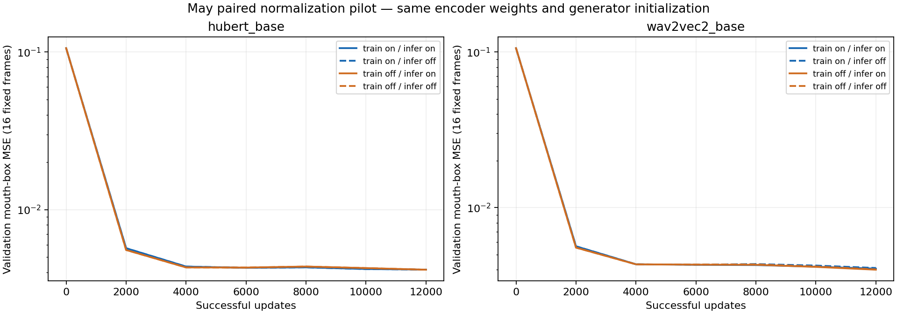
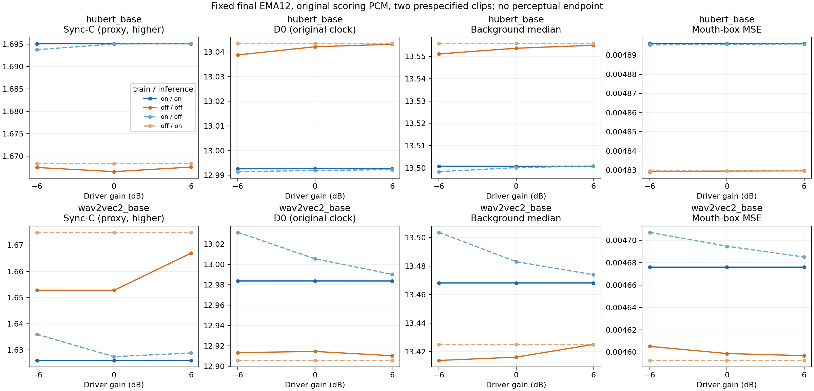
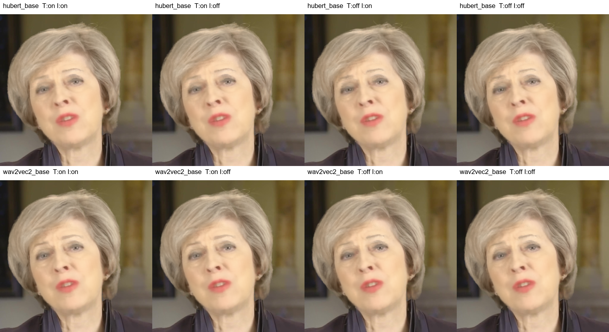

# 54-may-encoder-normalization-pilot

✅ 小规模实验完成：四臂各12000实际成功FP32更新、0跳步，24格/48矩阵/12000真实视频帧及原PCM/ROI/像素/距离独立QA通过。hubert_base匹配on/on−off/off：ΔC+0.029、ΔD0-0.049，mouth MSE相对+1.38%；wav2vec2_base匹配on/on−off/off：ΔC-0.027、ΔD0+0.069，mouth MSE相对+1.68%。这是训练/推理联合流程差异，条件内训练、推理和失配拆分见完整表。 单May/单seed/短预算，不作总体或感知结论；Patrick仍暂停。

四臂各12000次实际成功FP32更新，0跳步；同完整随机生成器initial、同帧/ray/LR，独立核验通过。每编码器的开/关只改输入归一化；全部内部norm和预训练权重不变。

这是一个已暴露英语身份、一个seed、两段相关10秒clip的短程先导。不能判定总体“有害/有益”、完整收敛或人类感知改善。未恢复Patrick。

## 本次能回答什么

整体换编码器会同时改变权重、表征、预训练与接口，不能识别归一化模块效应。本次主比较固定每个编码器权重，只切native输入归一化，保持各配对的模型结构、initial、数据、实际更新和采样相同；跨编码器或旧AVE只作描述参照。

四臂均完成12000次成功FP32更新，没有skip或非有限状态；这说明本预算可执行，不证明完整训练稳定性、总体有害/有益或收敛。匹配流程on/on−off/off在0dB下：

- hubert_base：ΔC=+0.029，ΔD0=-0.049，mouth MSE相对+1.38%。这是联合流程差异，单独训练/推理效应见后表。
- wav2vec2_base：ΔC=-0.027，ΔD0=+0.069，mouth MSE相对+1.68%。这是联合流程差异，单独训练/推理效应见后表。

推理归一化开启时，四个生成器在−6/0/+6dB的C极差均小于0.000015；关闭时约0.001–0.014。确认音量不敏感性传播到了生成与评分，但不敏感不等于质量更好。

本次新模型C约1.6，明显低于旧60k AVE同clip C约8–9；训练预算、表征与生成器音频入口同时不同，不能把该落差归因归一化。四臂均有相近重建误差，短程末端未做收敛资格或第二训练seed，未扩预算、未按test选模型。

原时钟保留，两测试clip最佳offset约−2/−3帧；不能用C提高掩盖原时钟误差。固定评分音频的SyncNet特征与旧May两clip逐位一致（historical_audio_feature_review.json），48媒体/12000帧ffprobe时钟误差0。

本次是native零均值/单位方差输入归一化，不是RMS0.1；全FP32而非旧Patrick FP16，不能据此裁定此前密度Inf是否由RMS训练轨迹引起。

## 固定0dB的四格

| 编码器 | train norm | inference norm | C | Dmin | D0 | B | mouth MSE |
|---|---|---|---:|---:|---:|---:|---:|
| hubert_base | True | True | 1.695 | 11.806 | 12.993 | 13.501 | 0.004896 |
| hubert_base | True | False | 1.695 | 11.805 | 12.992 | 13.500 | 0.004896 |
| hubert_base | False | True | 1.668 | 11.887 | 13.043 | 13.556 | 0.004830 |
| hubert_base | False | False | 1.667 | 11.887 | 13.042 | 13.554 | 0.004830 |
| wav2vec2_base | True | True | 1.626 | 11.842 | 12.984 | 13.468 | 0.004676 |
| wav2vec2_base | True | False | 1.627 | 11.856 | 13.005 | 13.483 | 0.004695 |
| wav2vec2_base | False | True | 1.675 | 11.750 | 12.906 | 13.425 | 0.004593 |
| wav2vec2_base | False | False | 1.653 | 11.763 | 12.914 | 13.416 | 0.004599 |

## 偏移与full边界敏感性

以下保留每个clip的最佳offset，不将最大置信度等同原时钟同步；full C只作敏感性分析，不替代guard20主端点。

| encoder | train norm | inference norm | driver dB | offsets (two clips) | guard20 C | full C |
|---|---|---|---:|---|---:|---:|
| hubert_base | True | True | -6 | -2,-3 | 1.695 | 1.611 |
| hubert_base | True | True | 0 | -2,-3 | 1.695 | 1.611 |
| hubert_base | True | True | 6 | -2,-3 | 1.695 | 1.611 |
| hubert_base | True | False | -6 | -2,-3 | 1.694 | 1.613 |
| hubert_base | True | False | 0 | -2,-3 | 1.695 | 1.612 |
| hubert_base | True | False | 6 | -2,-3 | 1.695 | 1.611 |
| hubert_base | False | True | -6 | -2,-3 | 1.668 | 1.599 |
| hubert_base | False | True | 0 | -2,-3 | 1.668 | 1.599 |
| hubert_base | False | True | 6 | -2,-3 | 1.668 | 1.599 |
| hubert_base | False | False | -6 | -2,-3 | 1.667 | 1.601 |
| hubert_base | False | False | 0 | -2,-3 | 1.667 | 1.599 |
| hubert_base | False | False | 6 | -2,-3 | 1.668 | 1.599 |
| wav2vec2_base | True | True | -6 | -2,-3 | 1.626 | 1.568 |
| wav2vec2_base | True | True | 0 | -2,-3 | 1.626 | 1.568 |
| wav2vec2_base | True | True | 6 | -2,-3 | 1.626 | 1.568 |
| wav2vec2_base | True | False | -6 | -2,-3 | 1.636 | 1.570 |
| wav2vec2_base | True | False | 0 | -2,-3 | 1.627 | 1.562 |
| wav2vec2_base | True | False | 6 | -2,-3 | 1.629 | 1.567 |
| wav2vec2_base | False | True | -6 | -2,-3 | 1.675 | 1.618 |
| wav2vec2_base | False | True | 0 | -2,-3 | 1.675 | 1.618 |
| wav2vec2_base | False | True | 6 | -2,-3 | 1.675 | 1.618 |
| wav2vec2_base | False | False | -6 | -2,-3 | 1.653 | 1.602 |
| wav2vec2_base | False | False | 0 | -2,-3 | 1.653 | 1.602 |
| wav2vec2_base | False | False | 6 | -2,-3 | 1.667 | 1.605 |

## 条件内差异

正ΔC只代表SyncNet置信度提高；正ΔD0或mouth MSE代表对应误差增加。on/on−off/off同时改变训练和推理处理，是匹配流程联合差异，不能叫单独训练效应。

| 编码器 | 0dB contrast | ΔC | ΔD0 | Δmouth MSE |
|---|---|---:|---:|---:|
| hubert_base | train_on_minus_off_given_test_on | +0.027 | -0.051 | +0.000066 |
| hubert_base | train_on_minus_off_given_test_off | +0.028 | -0.050 | +0.000066 |
| hubert_base | test_on_minus_off_given_train_on | +0.000 | +0.001 | +0.000000 |
| hubert_base | test_on_minus_off_given_train_off | +0.002 | +0.001 | +0.000000 |
| hubert_base | matched_on_on_minus_off_off_joint | +0.029 | -0.049 | +0.000066 |
| wav2vec2_base | train_on_minus_off_given_test_on | -0.049 | +0.078 | +0.000084 |
| wav2vec2_base | train_on_minus_off_given_test_off | -0.025 | +0.091 | +0.000096 |
| wav2vec2_base | test_on_minus_off_given_train_on | -0.001 | -0.022 | -0.000019 |
| wav2vec2_base | test_on_minus_off_given_train_off | +0.022 | -0.009 | -0.000006 |
| wav2vec2_base | matched_on_on_minus_off_off_joint | -0.027 | +0.069 | +0.000077 |

## 与旧May结果比较

以下重新聚合旧报告50相同test_00/test_03，避免用旧四clip均值对比新两clip。旧AVE为60000更新/不同特征与生成器入口，新两编码器为12000更新；因此只作描述性历史参照，不能把差值归因输入归一化。报告53原为几何消融，本次才新增下游训练与视频；方向变化本身不是改善。

| 旧AVE train dB | test dB | 两同clip C | D0 |
|---:|---:|---:|---:|
| 0 | -6 | 8.353 | 13.680 |
| 0 | 0 | 8.633 | 13.675 |
| 0 | 6 | 8.829 | 13.588 |
| -6 | -6 | 8.643 | 13.581 |
| -6 | 0 | 8.991 | 13.571 |
| -6 | 6 | 9.171 | 13.564 |
| 6 | -6 | 7.849 | 13.494 |
| 6 | 0 | 8.147 | 13.517 |
| 6 | 6 | 8.452 | 13.528 |

## 协议、控制和证据边界

沿用May4150/550/1100帧划分；归一化以实际HF零均值/单位方差公式施于完整支持段后20秒chunk，末层50Hz配对成25fps；不做RMS0.1、不删除内部LN/GN。两编码器相同768维AudioNet入口，每个norm对内架构/initial严格相同。

最终固定EMA12；三档驱动±6/0与两种推理norm形成24格，48矩阵，固定原自然PCM16与source-owned GT ROI。主guard20、full次；没有按test选断点、片段或最佳gain。CUDA原子梯度不承诺不同训练逐位复现，只有一个seed，不能排除训练随机性或预算依赖；重复控制只测推理重复性。

独立QA：12000个实际视频帧、RGB/原PCM/裁剪hash全核验；48矩阵、364560距离，float64重建最大误差3.79e-06。全state实际optimizer step=12000、EMA12与trace计数/采样/LR通过。

最初shell CRLF/路径部署错误发生在model构造前，0训练更新；原failure和尝试保留。修正只涉及运输/运行环境及资格重载顺序，没有训练重放或数学调参。

图像网格是固定帧的工程观看，非盲评；本chat已通过view_image实际检查三图，标签、条件顺序和显示范围合格，证据见visual_review.json。各格共同可见模糊/颈部接缝，不将单帧观看外推感知优劣。

## 复现与文件

protocol.json、qualification_independent_review.json、training_independent_review.json、analysis/qa.json、各job execution/source pins及F成员manifest为证据入口。cells.csv、contrasts.csv、historical_same_clips.csv含完整±6/0结果；learning_curves.png和crossed_conditions.png、matched_frame_grid.png供审阅。

评分传输收尾说明：原5个科学评测job均rc0；score tar的149成员完整复制后主机SSH未退出。先独立fresh全成员SHA通过，再只结束该主机传输进程；原host workflow/postprocess failure永久保留，score_transfer_close_repair_v1记录独立读回与收口。0训练/视频/评分重放，原controller源未改。

## Observations
- [status] concluded；工程先导，固定预算全部完成。
- [result] hubert_base匹配on/on−off/off：ΔC+0.029、ΔD0-0.049，mouth MSE相对+1.38%；wav2vec2_base匹配on/on−off/off：ΔC-0.027、ΔD0+0.069，mouth MSE相对+1.68%。这是训练/推理联合流程差异，条件内训练、推理和失配拆分见完整表。
- [limitation] 同权重模块对照；跨encoder/旧AVE仅描述参照；短预算和一个训练seed不排除训练随机性，不等于完整稳定性或感知获益。

## Relations
- follows [[53-encoder-input-normalization-ablation]]
- relates_to [[50-synctalk-may-gain-training-pilot]]
- supports [[May同权重编码器归一化训练与推理小规模对照]]
- relates_to [[研究主线与证据地图]]
