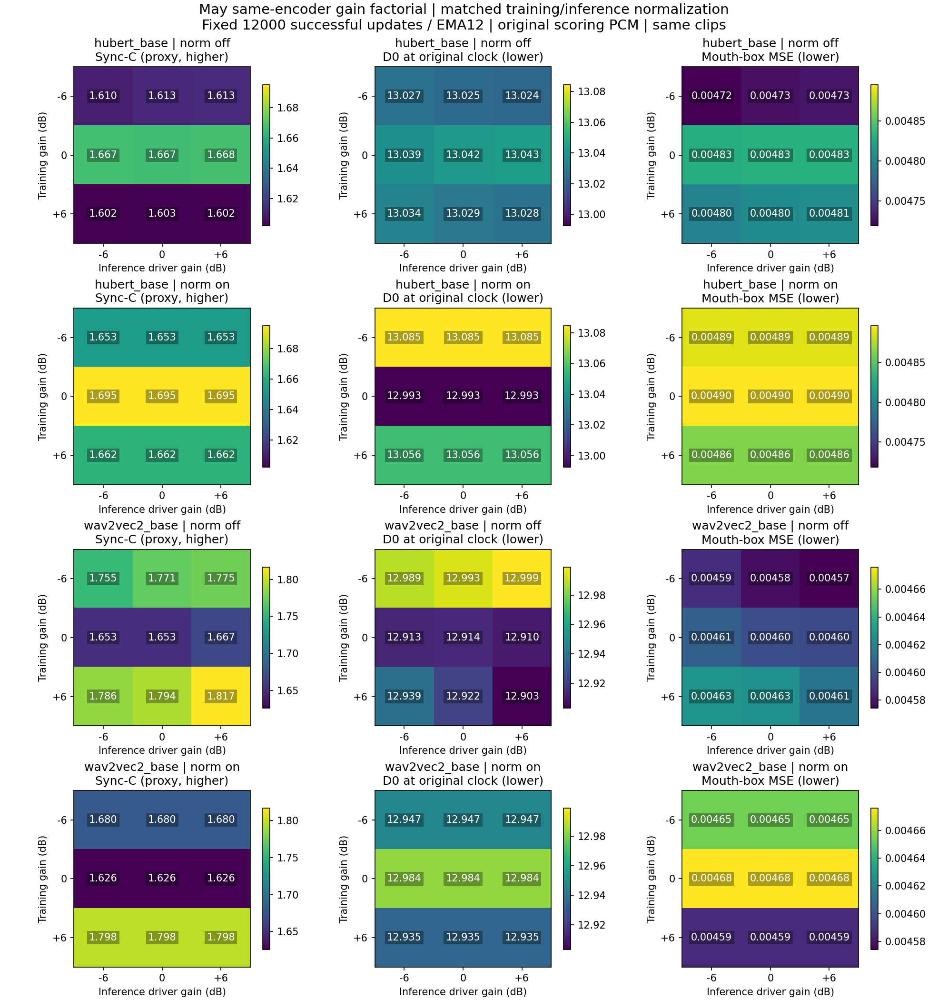
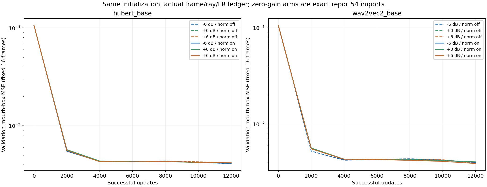
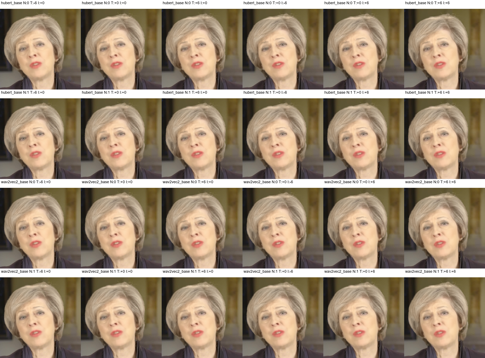

# 55-may-gain-normalization-factorial

✅ 已完成：八新模型各12000成功FP32更新、0skip，复用四个已资格训练0dB模型；72条件/144矩阵，新增24000帧与96矩阵全数值/像素/PCM/ROI/时钟独立QA及实际图检通过。固定同encoder权重切norm，单May/单seed/短预算，不作总体或感知结论；Patrick仍暂停。

## 结果解读

本批结果：输入归一化使固定生成器对±6dB推理音量的Sync-C响应降至约2×10⁻⁵；关闭时HuBERT最高约0.004、wav2vec2最高约0.031。稳健性没有转化为一致的质量改善：固定推理0dB、匹配norm流程on/on−off/off的六组配对点估计中，五组嘴部MSE上升1.21%–3.42%，一组下降0.84%，C与D0方向混合。训练音量没有跨encoder一致单调规律。单May、单训练seed、12000步预算下，不能判定归一化普遍有害/有益或选定最佳训练音量。

本次真正新增8个模型，共96000次成功FP32更新、0skip；报告54四个训练0dB模型的原件按SHA导入，无重训/重渲染/重评分。训练完成不等于充分收敛，全部采用预先固定12000步/EMA12，未按测试分数选择模型。

### 固定生成器：推理音量响应

下面每个范围都先固定同一完整生成器checkpoint，再跨−6/0/+6dB推理驱动取极差；表中取该encoder六个生成器的最大范围。归一化开启与关闭在同一个checkpoint内交叉，因此这部分不依赖重新训练两个模型。

| encoder | inference norm | 最大C极差 | 最大嘴部MSE极差/0dB (%) |
|---|---|---:|---:|
| hubert_base | False | 0.00430536 | 0.225073 |
| hubert_base | True | 0.00001955 | 0.000000 |
| wav2vec2_base | False | 0.03083706 | 0.469732 |
| wav2vec2_base | True | 0.00001860 | 0.000005 |

“对音量不敏感”是响应特性，不自动等于口型更准。所有分数仍使用同一原PCM16音频；C必须连同原时钟D0及嘴部像素误差阅读。

### 不同训练音量：固定推理0dB

训练与推理采用相同norm。范围覆盖训练−6/0/+6三组，嘴部误差相对同norm训练0dB原模型。

| encoder | matched norm | C范围 | D0范围 | mouth MSE相对0dB范围 (%) |
|---|---|---|---|---|
| hubert_base | False | 1.603–1.667 | 13.025–13.042 | -2.15–+0.00 |
| hubert_base | True | 1.653–1.695 | 12.993–13.085 | -0.69–+0.00 |
| wav2vec2_base | False | 1.653–1.794 | 12.914–12.993 | -0.45–+0.59 |
| wav2vec2_base | True | 1.626–1.798 | 12.935–12.984 | -1.91–+0.00 |

即便输入norm开启，三档归一化特征也只是近似相同，实测相对L2约1e−6，并非严格逐位同。不同训练组还可能包含CUDA优化轨迹差异。只有一个训练seed，没有独立训练重复，不能把组间差异全部分配给音量或用单个条件判定归一化普遍有害/有益；不能据此选“最佳训练音量”。

### 相同训练音量：匹配norm流程on/on−off/off

这是训练和推理共同切换的流程差异，不冒称单独训练端效应；单独训练端与推理端的条件差异都在normalization_effects.csv。

| encoder | train dB | ΔC | ΔD0 | Δmouth MSE (%) |
|---|---:|---:|---:|---:|
| hubert_base | -6 | +0.040 | +0.060 | +3.42 |
| hubert_base | +0 | +0.029 | -0.049 | +1.38 |
| hubert_base | +6 | +0.059 | +0.027 | +1.21 |
| wav2vec2_base | -6 | -0.091 | -0.047 | +1.67 |
| wav2vec2_base | +0 | -0.027 | +0.069 | +1.68 |
| wav2vec2_base | +6 | +0.004 | +0.013 | -0.84 |

本次norm是各split完整音频的native输入z-score后再固定chunk，内部LN/GN与权重不变；不是RMS0.1，也不代表流式归一化。May/FP32短程结果不能解释此前Patrick/RMS0.1/FP16的密度Inf训练因果。

## 与更早May AVE实验的相同片段比较

精确复用报告54中已经独立重聚合的旧报告50 test_00/test_03两片段，不混用旧四clip均值。旧AVE为60000更新，当前为12000更新且表征/音频入口不同；仅描述参照，不能将落差归因输入归一化或排名编码器。

| AVE训练dB | 推理dB | C | D0 |
|---:|---:|---:|---:|
| +0 | -6 | 8.353 | 13.680 |
| +0 | +0 | 8.633 | 13.675 |
| +0 | +6 | 8.829 | 13.588 |
| -6 | -6 | 8.643 | 13.581 |
| -6 | +0 | 8.991 | 13.571 |
| -6 | +6 | 9.171 | 13.564 |
| +6 | -6 | 7.849 | 13.494 |
| +6 | +0 | 8.147 | 13.517 |
| +6 | +6 | 8.452 | 13.528 |

## 实际图检与执行证据

本chat已经用view_image实际检查gain_matrices.png、learning_curves.png和matched_frame_grid.png。图中文字与共同色标可读；固定帧只作工程查看，不是盲评。具体图检观察和各图SHA见visual_review.json。

原root training_failure/workflow_failure是SSH先退出导致增长日志SHA拒绝的主机观察故障，底层传输原因未证明。revision02审计前五完整state后只接管原第六PID；其自然完成后仅启动从未运行的第七/八组，0训练重放。active_controller/active_workflow及最终receipt优先于历史失败文件；冻结train/runtime/evaluate、initial与协议数学均保持。

首新render前容量门等待了F/E固定持久化预算，随后已实际放行。旧报告50的18个render、36个裁剪缓存、87个step2000..58000中间断点本地副本，在完整9云分片/643成员独立Linux全SHA读回后分批转冷存储，四个locator均在旧F根；旧三个step60000最终断点、全部矩阵/embeddings/track及报告54和本次全部cp保持本地。其他归档任务同时使用F盘，因此未将卷free差直接当清理节省量。NTFS无损压缩前后科学逻辑SHA不变；没有声称本次新F/E科学包已经云备份。

最后一组wav2vec2_base_off_trainp6媒体实际保存在E:/Datasets/tts-exp/may_encoder_gain_norm_factorial_20261019_media/，原F读取路径保留目录junction。没有搬动已有科学文件，GPU源码和协议SHA不改；media_placement_handoff_v1.json、最终readback及跨卷manifest记录逻辑/物理路径。

固定每个encoder权重，只切native输入z-score；−6/0/+6训练gain与−6/0/+6推理driver gain完整交叉。2encoder×2train norm×3train gain×2inference norm×3driver gain=72格，144个10秒clip/矩阵。0gain四组来自报告54原件，8新组各12000成功FP32更新，不做零gain重放。

本次问题是训练音量和推理音量的作用是否被归一化改变；跨encoder或旧AVE60k差异仍不能归因归一化。归一化开启不是RMS0.1，而是同HF输入零均值/单位方差。单May、单seed、短预算，两clip相关，无人类感知端点；训练volume组的微小差别可能包含CUDA优化轨迹差异，不能作总体因果结论。

## 主矩阵：训练与推理归一化一致

| encoder | norm | train dB | driver dB | C | Dmin | D0 | B | mouth MSE | offsets |
|---|---|---:|---:|---:|---:|---:|---:|---:|---|
| hubert_base | False | -6 | -6 | 1.610 | 11.932 | 13.027 | 13.543 | 0.004719 | -2,-3 |
| hubert_base | False | -6 | +0 | 1.613 | 11.930 | 13.025 | 13.543 | 0.004726 | -2,-3 |
| hubert_base | False | -6 | +6 | 1.613 | 11.929 | 13.024 | 13.542 | 0.004729 | -2,-3 |
| hubert_base | False | +0 | -6 | 1.667 | 11.884 | 13.039 | 13.551 | 0.004829 | -2,-3 |
| hubert_base | False | +0 | +0 | 1.667 | 11.887 | 13.042 | 13.554 | 0.004830 | -2,-3 |
| hubert_base | False | +0 | +6 | 1.668 | 11.887 | 13.043 | 13.555 | 0.004830 | -2,-3 |
| hubert_base | False | +6 | -6 | 1.602 | 11.897 | 13.034 | 13.500 | 0.004797 | -2,-3 |
| hubert_base | False | +6 | +0 | 1.603 | 11.892 | 13.029 | 13.494 | 0.004804 | -2,-3 |
| hubert_base | False | +6 | +6 | 1.602 | 11.890 | 13.028 | 13.493 | 0.004807 | -2,-3 |
| hubert_base | True | -6 | -6 | 1.653 | 11.905 | 13.085 | 13.558 | 0.004887 | -2,-3 |
| hubert_base | True | -6 | +0 | 1.653 | 11.905 | 13.085 | 13.558 | 0.004887 | -2,-3 |
| hubert_base | True | -6 | +6 | 1.653 | 11.905 | 13.085 | 13.558 | 0.004887 | -2,-3 |
| hubert_base | True | +0 | -6 | 1.695 | 11.806 | 12.993 | 13.501 | 0.004896 | -2,-3 |
| hubert_base | True | +0 | +0 | 1.695 | 11.806 | 12.993 | 13.501 | 0.004896 | -2,-3 |
| hubert_base | True | +0 | +6 | 1.695 | 11.806 | 12.993 | 13.501 | 0.004896 | -2,-3 |
| hubert_base | True | +6 | -6 | 1.662 | 11.906 | 13.056 | 13.568 | 0.004862 | -2,-3 |
| hubert_base | True | +6 | +0 | 1.662 | 11.906 | 13.056 | 13.568 | 0.004862 | -2,-3 |
| hubert_base | True | +6 | +6 | 1.662 | 11.906 | 13.056 | 13.568 | 0.004862 | -2,-3 |
| wav2vec2_base | False | -6 | -6 | 1.755 | 11.677 | 12.989 | 13.431 | 0.004587 | -2,-3 |
| wav2vec2_base | False | -6 | +0 | 1.771 | 11.674 | 12.993 | 13.445 | 0.004578 | -2,-3 |
| wav2vec2_base | False | -6 | +6 | 1.775 | 11.682 | 12.999 | 13.457 | 0.004574 | -2,-3 |
| wav2vec2_base | False | +0 | -6 | 1.653 | 11.761 | 12.913 | 13.414 | 0.004605 | -2,-3 |
| wav2vec2_base | False | +0 | +0 | 1.653 | 11.763 | 12.914 | 13.416 | 0.004599 | -2,-3 |
| wav2vec2_base | False | +0 | +6 | 1.667 | 11.758 | 12.910 | 13.425 | 0.004597 | -2,-3 |
| wav2vec2_base | False | +6 | -6 | 1.786 | 11.647 | 12.939 | 13.433 | 0.004627 | -2,-3 |
| wav2vec2_base | False | +6 | +0 | 1.794 | 11.636 | 12.922 | 13.430 | 0.004626 | -2,-3 |
| wav2vec2_base | False | +6 | +6 | 1.817 | 11.606 | 12.903 | 13.423 | 0.004613 | -2,-3 |
| wav2vec2_base | True | -6 | -6 | 1.680 | 11.772 | 12.947 | 13.452 | 0.004654 | -2,-3 |
| wav2vec2_base | True | -6 | +0 | 1.680 | 11.772 | 12.947 | 13.452 | 0.004654 | -2,-3 |
| wav2vec2_base | True | -6 | +6 | 1.680 | 11.772 | 12.947 | 13.452 | 0.004654 | -2,-3 |
| wav2vec2_base | True | +0 | -6 | 1.626 | 11.842 | 12.984 | 13.468 | 0.004676 | -2,-3 |
| wav2vec2_base | True | +0 | +0 | 1.626 | 11.842 | 12.984 | 13.468 | 0.004676 | -2,-3 |
| wav2vec2_base | True | +0 | +6 | 1.626 | 11.842 | 12.984 | 13.468 | 0.004676 | -2,-3 |
| wav2vec2_base | True | +6 | -6 | 1.798 | 11.667 | 12.935 | 13.465 | 0.004587 | -2,-3 |
| wav2vec2_base | True | +6 | +0 | 1.798 | 11.667 | 12.935 | 13.465 | 0.004587 | -2,-3 |
| wav2vec2_base | True | +6 | +6 | 1.798 | 11.667 | 12.935 | 13.465 | 0.004587 | -2,-3 |

## 固定推理0dB的训练音量差异

相对相同norm的训练0dB模型。ΔC正仅代表评价器置信度增加；ΔD0或mouth MSE正代表对应误差增加。

| encoder | norm | train dB−0 | ΔC | ΔD0 | Δmouth MSE |
|---|---|---:|---:|---:|---:|
| hubert_base | True | -6 | -0.042 | +0.092 | -0.000009 |
| hubert_base | True | +6 | -0.033 | +0.064 | -0.000034 |
| hubert_base | False | -6 | -0.054 | -0.017 | -0.000104 |
| hubert_base | False | +6 | -0.064 | -0.013 | -0.000025 |
| wav2vec2_base | True | -6 | +0.054 | -0.037 | -0.000022 |
| wav2vec2_base | True | +6 | +0.172 | -0.049 | -0.000089 |
| wav2vec2_base | False | -6 | +0.118 | +0.079 | -0.000021 |
| wav2vec2_base | False | +6 | +0.141 | +0.008 | +0.000027 |

## 增益敏感性

| encoder | norm | fixed train dB | C range across driver gains | mouth MSE range |
|---|---|---:|---:|---:|
| hubert_base | False | -6 | 0.002784 | 0.00001064 |
| hubert_base | False | +0 | 0.001015 | 0.00000042 |
| hubert_base | False | +6 | 0.000603 | 0.00000952 |
| hubert_base | True | -6 | 0.000005 | 0.00000000 |
| hubert_base | True | +0 | 0.000004 | 0.00000000 |
| hubert_base | True | +6 | 0.000010 | 0.00000000 |
| wav2vec2_base | False | -6 | 0.020559 | 0.00001323 |
| wav2vec2_base | False | +0 | 0.014245 | 0.00000832 |
| wav2vec2_base | False | +6 | 0.030837 | 0.00001378 |
| wav2vec2_base | True | -6 | 0.000007 | 0.00000000 |
| wav2vec2_base | True | +0 | 0.000008 | 0.00000000 |
| wav2vec2_base | True | +6 | 0.000008 | 0.00000000 |

## 控制、复用和边界

训练与推理norm失配的全部72格在cells.csv；训练gain−0差异在training_gain_effects.csv，固定两个gain时的归一化效应在normalization_effects.csv。所有条件等权两clip，不按test选择训练音量、剂量或checkpoint。

每组共同完整随机initial、12000成功更新、原AdamW/60k LR前缀、EMA12；65536 rays/FP16/RMS0.1的Patrick实验不在此协议。原May AVE60k九格见报告50，不能与此处改变了特征/预算的数字作纯归一化因果差。

独立新消费QA：24000帧RGB/PCM/ROI/selected float/量化界，96矩阵，729120距离，float64重算最大误差3.89e-06；另报告54原48矩阵/12000帧保持原独立QA并全成员SHA导入。

大文件跨F/E两个持久卷保存，各arm逐成员新鲜SHA核验。为了空间，只有旧报告50云整包9分片/643成员实际独立Linux fresh读回通过后才迁移固定18个旧render副本，原SHA/归档member/locator留存；旧PNG/JSON/score/最终cp保持。新产物尚不声称云备份。

实际三图检查已通过，详见结果解读和visual_review.json；固定帧是工程观看，非人类盲评。

证据入口：protocol.json、parent_full_member_import_review.json、feature_independent_review.json、qualification_independent_review.json、training_independent_review.json、postprocess_complete.json、media_clock_review.json、analysis/qa.json及跨卷最终manifest。

## Observations
- [status] concluded
- [result] 完整72格训练gain×推理gain×norm交叉已执行并独立核验，0gain原件不重放。
- [limitation] 单训练seed的不同gain模型存在优化轨迹随机性；编码器内模块对照不外推整体编码器优劣、感知或旧Patrick RMS因果。

## Relations
- follows [[54-may-encoder-normalization-pilot]]
- relates_to [[50-synctalk-may-gain-training-pilot]]
- supports [[May训练音量与推理音量的同权重归一化交叉对照]]
- relates_to [[研究主线与证据地图]]
