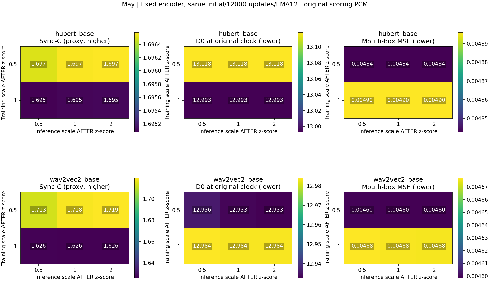
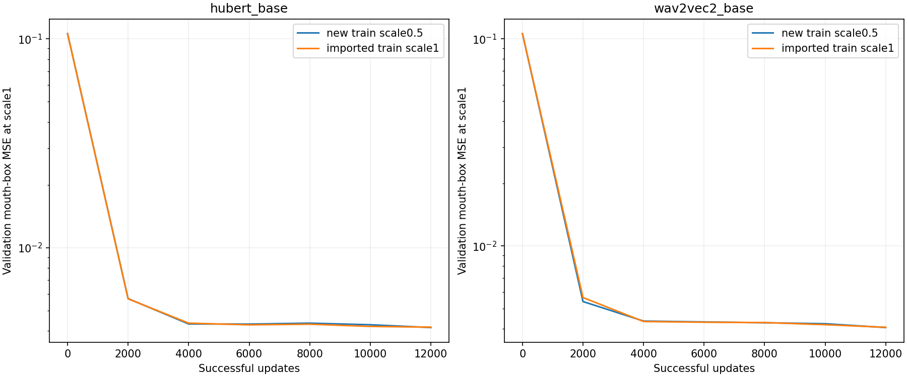
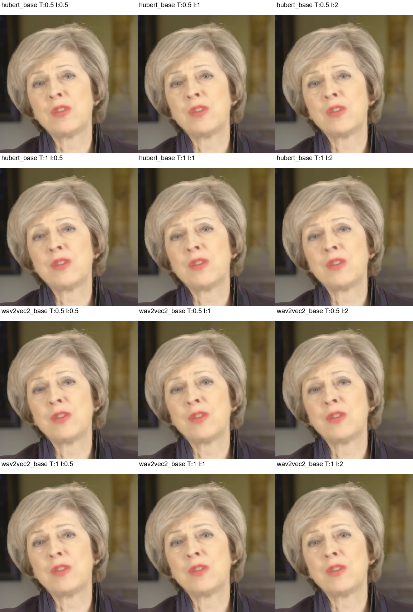

# 56-may-postnorm-scale

✅ 已完成：两个低尺度模型各12000成功FP32更新/0skip，两个标准训练模型原件复用；12条件/24矩阵，新增20视频/5000帧及151900距离独立QA、实际三图检查与断电后freshSHA复核通过。wav2vec2低训练/高推理相对标准C+0.093、D0−0.051、嘴部MSE−1.66%；固定低训练后再调高驱动额外仅约+0.001。HuBERT C近不变且D0恶化，单May/seed不判普遍或感知收益。

## 结果解读

两新低尺度模型各完成12000成功FP32更新、0skip。12条件/24矩阵完整：20新增矩阵及5000帧经像素/原PCM/GT ROI/crop/selectedfloat/时钟/float64距离独立QA，另4标准矩阵按父758成员全SHA原件导入；不是新训练了四个模型。所有比较用同一原自然PCM评分。

**本批不支持“低尺度训练＋高尺度驱动会普遍更强”。** wav2vec2这一次低尺度训练组在标准驱动下C已从1.626升至1.718，换成2倍驱动后为1.719：主要可见差异在两个训练模型之间，高驱动额外仅约0.001。标准训练组把推理尺度1提高到2时C略降（约0.000164），因此也不是高驱动统一提升。只有单May/单训练seed，不能把一次训练组差异推广为稳定收益。

HuBERT低训练/高驱动相对标准/标准的C仅约+0.00149，原时钟D0反而增加约0.12581；固定低训练模型把驱动1提高至2，ΔC只有约8.58×10⁻⁶。其嘴部MSE虽小幅下降，指标方向仍不一致。

| encoder | 标准训练/标准推理 C | 低训练/标准推理 C | 低训练/高推理 C | 低/高相对标准 ΔD0 | 嘴部MSE变化 |
|---|---:|---:|---:|---:|---:|
| hubert_base | 1.695 | 1.697 | 1.697 | +0.126 | -1.09% |
| wav2vec2_base | 1.626 | 1.718 | 1.719 | -0.051 | -1.66% |

ΔD0正值为原时钟距离恶化、负值为改善；嘴部MSE百分比以标准训练/标准推理为分母。配对差异均从未四舍五入数值计算，完整精度保留在CSV/JSON。预定训练×高驱动交互C为HuBERT约2.86×10⁻⁶、wav2vec2约0.001172；没有独立训练重复，未做总体显著性或最佳尺度选择。

三张真实图已由本chat实际查看并记录SHA：同训练行的三推理列近似，验证曲线基本重合，固定帧共有模糊且不能肉眼给出可靠优劣。SyncNet、嘴部像素误差和感知同步分别解释，不把评分改善直接称为嘴型更准。

## 断电与完整性

九个实际GPU job全部自然rc0，最后score_all于2026-10-20T02:18:25Z（北京时间10:18）完成。此次Ubuntu重启发生在科学作业完成之后，旧SHM已清空。F盘持久包与所有完整断点/trace/视频/矩阵均已在重启后重新freshSHA核验，并重建151900个新距离，最大误差3.77×10⁻⁶；0新GPU调用、0optimizer更新、0全tensor重载，不恢复或重跑已完成作业。旧Patrick coarse7、旧fine/Chris/Cathy与原24full持续暂停。

同native z-score后再乘0.5/1/2，约对应RMS0.5/1/2；相对标准化内部尺度，不是原录音gain，也不是RMS0.1策略。两新低尺度模型各12000成功FP32更新/0skip，两标准模型和两个标准cell原件复用。原PCM16评分。单May/seed/短预算，不选最佳尺度或宣称感知改善。

| encoder | train scale | infer scale | C | D0 | mouth MSE | offsets |
|---|---:|---:|---:|---:|---:|---|
| hubert_base | 0.5 | 0.5 | 1.697 | 13.118 | 0.004843 | -2,-3 |
| hubert_base | 0.5 | 1 | 1.697 | 13.118 | 0.004843 | -2,-3 |
| hubert_base | 0.5 | 2 | 1.697 | 13.118 | 0.004843 | -2,-3 |
| hubert_base | 1 | 0.5 | 1.695 | 12.993 | 0.004896 | -2,-3 |
| hubert_base | 1 | 1 | 1.695 | 12.993 | 0.004896 | -2,-3 |
| hubert_base | 1 | 2 | 1.695 | 12.993 | 0.004896 | -2,-3 |
| wav2vec2_base | 0.5 | 0.5 | 1.713 | 12.936 | 0.004599 | -2,-3 |
| wav2vec2_base | 0.5 | 1 | 1.718 | 12.933 | 0.004599 | -2,-3 |
| wav2vec2_base | 0.5 | 2 | 1.719 | 12.933 | 0.004598 | -2,-3 |
| wav2vec2_base | 1 | 0.5 | 1.626 | 12.984 | 0.004677 | -2,-3 |
| wav2vec2_base | 1 | 1 | 1.626 | 12.984 | 0.004676 | -2,-3 |
| wav2vec2_base | 1 | 2 | 1.626 | 12.984 | 0.004676 | -2,-3 |

## 预定配对差异

正ΔC仅表示评分置信度变大；正ΔD0/ΔMSE为对应误差增加。

| encoder | contrast | ΔC | ΔD0 | Δmouth MSE |
|---|---|---:|---:|---:|
| hubert_base | low_train_high_infer_minus_standard | +0.001 | +0.126 | -0.000053 |
| hubert_base | low_train_minus_standard_given_infer_0.5 | +0.001 | +0.126 | -0.000053 |
| hubert_base | low_train_minus_standard_given_infer_1 | +0.001 | +0.126 | -0.000053 |
| hubert_base | low_train_minus_standard_given_infer_2 | +0.001 | +0.126 | -0.000053 |
| hubert_base | high_infer_minus_standard_given_train_0.5 | +0.000 | -0.000 | +0.000000 |
| hubert_base | high_infer_minus_standard_given_train_1 | +0.000 | +0.000 | +0.000000 |
| hubert_base | training_by_high_inference_interaction | +0.000 | -0.000 | +0.000000 |
| wav2vec2_base | low_train_high_infer_minus_standard | +0.093 | -0.051 | -0.000078 |
| wav2vec2_base | low_train_minus_standard_given_infer_0.5 | +0.087 | -0.048 | -0.000078 |
| wav2vec2_base | low_train_minus_standard_given_infer_1 | +0.092 | -0.050 | -0.000077 |
| wav2vec2_base | low_train_minus_standard_given_infer_2 | +0.094 | -0.051 | -0.000077 |
| wav2vec2_base | high_infer_minus_standard_given_train_0.5 | +0.001 | -0.001 | -0.000000 |
| wav2vec2_base | high_infer_minus_standard_given_train_1 | -0.000 | -0.000 | -0.000000 |
| wav2vec2_base | training_by_high_inference_interaction | +0.001 | -0.001 | +0.000000 |

报告55的gain是在native标准化之前施加，norm开启后被基本抵消；本次在标准化之后直接缩放，不能把两种干预混作同一个dose。旧AVE60k与当前表征/预算不同，不作纯尺度因果比较。训练组只有一个随机seed，即使实际采样相同，也不能排除优化轨迹差异；SyncNet和像素误差不等于人类感知。

所有新5000帧/20矩阵的RGB/原PCM/ROI/crop/selectedfloat/时钟和float64距离重建见qa.json；另4旧矩阵按完整父SHA与原QA导入。真实图检已完成（visual_review.json）；Basic Memory正式发布与最终封存由final_delivery_receipt绑定。

## Observations
- [status] concluded
- [result] 低训练/高驱动在wav2vec2本次较好，但高驱动额外收益很小；HuBERT指标混合，不支持普遍协同收益。
- [limitation] 单May/单seed/12000步/两相关clip，非感知或最佳尺度结论。

## Relations
- follows [[55-may-gain-normalization-factorial]]
- follows [[54-may-encoder-normalization-pilot]]
- supports [[May归一化后低尺度训练与高尺度驱动对照]]
- relates_to [[研究主线与证据地图]]
