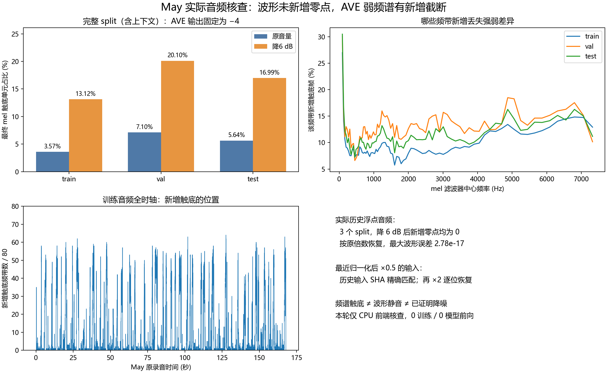
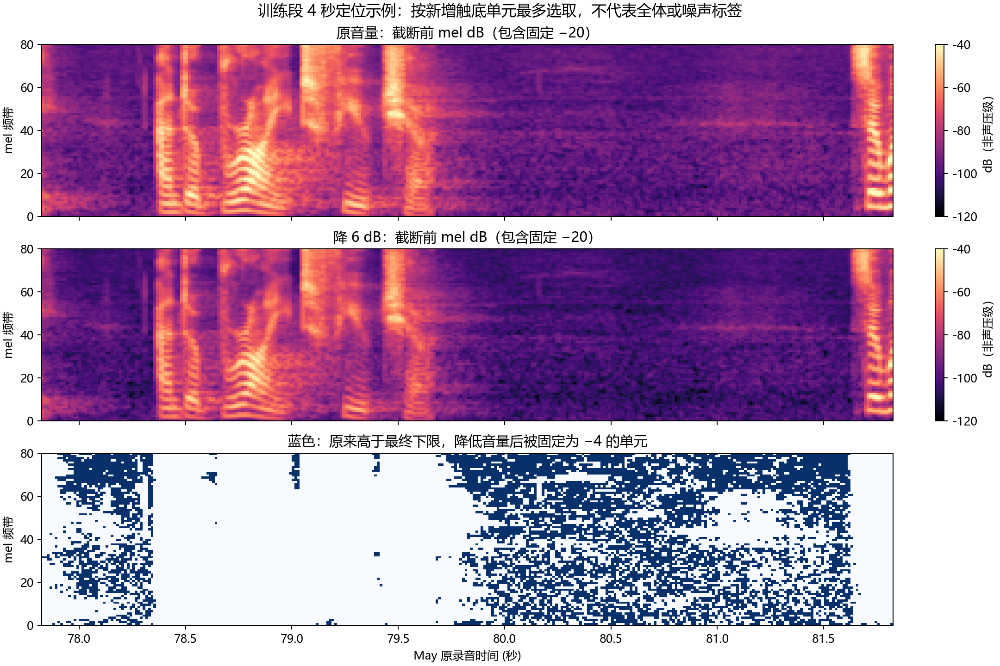

# 57-may-waveform-floor-audit

✅ 2026-10-20 已完成。只运行 CPU 波形与 AVE 前端核查；0 新训练、0 编码器/生成器前向、0 SyncNet 评分。

## 问题与结论

检验 May 低音量训练的评分变化是否可能来自“降低音量把弱噪声量化成零，之后放大也无法恢复”。重放报告50实际数据与处理路径，并对报告56标准化后缩放的输入做历史 SHA 对照。

**实际历史浮点路径没有新增波形零点，基本排除该数据上由新增静音段导致的解释。AVE 前端存在另一种实测机制：降6 dB让更多弱 mel 单元触及固定下限，单元内的强弱差异被压平。新增截断尚未被确认是噪声，也未证明导致训练或 Sync-C 收益。**

最近报告56采用标准化后 float32×0.5，不经过 AVE log-mel 前端；其14个历史输入 SHA 全部复现，乘0.5后再乘2逐位恢复。不能用本次 AVE 截断直接解释那轮 wav2vec2 的训练差异。

## 素材与历史身份

使用 F:/Datasets/tts-exp/synctalk_gain_training_20261017 的 source/May/aud.wav 和9份 arms/{train,val,test}/{gain_m6,gain_0,gain_p6}/aud.wav。原母版双声道PCM16/16kHz，两声道逐样本相同，取channel0；原文件SHA `ff6f87f85a89d992d42cdf45372947b1366dbde50fa451dbc67ecea677b8fd1a`。源PCM SHA与历史manifest一致。

固定split完整音频（包含监督范围外的前端上下文）：train源0–168秒/2688000采样，val170–194秒/384000采样，test196–242秒/736000采样。对应监督区间分别为1–167、171–193、197–241秒。本报告的频谱分母是完整split的80×T矩阵，不是独立训练样本数，也不按AVE重叠窗口重复计数。

每份实际WAV的SHA同时核对原数据manifest与features_attempt03/provider_qualification.json，复用历史prepare.py的write_double函数生成新文件，9份重放WAV均与原件**字节相同**。因此不只是在新随机音频上验证理论。报告50的protocol/data_protocol绑定及源PCM身份通过。

AVE使用报告50运行时源码快照runtime_sources_snapshot.tar.gz，归档SHA核对原delivery_manifest，utils.py SHA核对源码inventory。AST提取的8个音频函数与原provider资格记录的逐函数SHA一致，未修改函数实现。固定官方commit `43079fb3f349675f6cb33031bb07262f7566cdd5`；仅提取音频函数以避开渲染器依赖。

## 核查1：波形有没有新增零点

| split | 原有零点 | 降6 dB后零点 | 新增零点 | float32读取后新增零点 |
|---|---:|---:|---:|---:|
| train | 12033 | 12033 | 0 | 0 |
| val | 2071 | 2071 | 0 | 0 |
| test | 3696 | 3696 | 0 | 0 |

0/+6 dB的其余6份历史WAV也均未新增零点。DOUBLE存储读回严格等于原PCM转float64后乘10^(dB/20)，不存在重新量化到整数PCM。降6 dB后最小非零绝对幅度约1.5295021e−5，远非float32下溢量级。

降6 dB再按原增益倒数恢复，DOUBLE最大绝对波形误差三个split均为2.776e−17，属于浮点舍入；先按官方librosa路径读成float32再恢复，最大绝对误差不超过1.487e−8。没有非零信号不可逆变成0，未产生新的静音段。原有最长连续零段仍保留，train为1643采样/约102.7ms，不能误认为干预新增。

作为**非历史处理的量化诊断**，另用soundfile/subtype=PCM_16保存相同−6 dB波形，train/val/test分别新增10039/2097/3577个零采样点；恢复后最大绝对误差约6.089e−5。−12 dB额外诊断也保存于waveform.csv。它说明核查能检出量化归零，不表示历史实验发生过该处理；零采样点增加也不等于整段静音或成功去噪。

报告56的两个编码器各7个输入条件，按原完整split z-score公式和后乘0.5/1/2逐项重建，14/14 processor SHA与native SHA精确相同，全部逆缩放逐位恢复，新增零点0。这项核查没有重跑编码器。

## 核查2：AVE哪些频谱信息触及下限

原版前端：float32波形→预加重0.97→800点Hann/STFT，hop200、center补零→80维mel，55–7600Hz→`S=20log10(max(m,1e−5))−20`→`F=clip(0.08S+4,−4,4)`。

这里有两个不同下限：

- log的amplitude floor：原mel幅度约1e−5。
- 最终输出−4的下限：原mel幅度≤1e−4，即S≤−100。**它更早生效，不可只数log floor。** 这里的mel幅度与dB是前端数值，不能当作校准声压级或原波形dBFS。

降6 dB的g=0.5011872336。因此原先位于 `(1e−4, 1e−4/g] ≈ (1e−4,1.9952623e−4]` 的mel单元，会从可分辨的值变成同一个−4。实测新增触底单元原幅度全部位于此带内。上下两臂都不触底的单元，映射变化符合−0.48，最大偏差5.128e−6；没有上界截断。

| split | 全部mel单元 | 原音量触底 | 降6 dB触底 | 新增触底（占全体） |
|---|---:|---:|---:|---:|
| train | 1075280 | 38439 (3.575%) | 141067 (13.119%) | 102628 (9.544%) |
| val | 153680 | 10910 (7.099%) | 30885 (20.097%) | 19975 (12.998%) |
| test | 294480 | 16600 (5.637%) | 50033 (16.990%) | 33433 (11.353%) |

单独log floor的原→低计数为train905→1236（新增331），val0→11，test0→8。这些计数与上表不同，不能相加当作两份独立损失；它们有重叠且都被最终下限覆盖。

### 时间和频带位置

按原波形50ms局部RMS，在每个split内部划分最低20%、中间60%、最高20%的时间帧。这只是能量分层，没有VAD或音素/噪声真值：

| split | 新增触底中位于最低能量20%的比例 | 最低20%内部的单元新增触底率 | 最高20%内部的单元新增触底率 |
|---|---:|---:|---:|
| train | 85.764% | 40.916% | 0.608% |
| val | 80.025% | 51.899% | 0.540% |
| test | 75.647% | 42.895% | 0.504% |

新增截断主要落在低能量时段，但各split中高能量帧也存在。三个split新增触底最多的单一频带均为band0，中心约90.95Hz（滤波支持55–126.89Hz）；train另较多见于中心6.55/6.80/7.06kHz附近。中心≥4kHz频带占所有新增触底计数的28.211%/23.880%/25.496%，并非仅有高频被抑制。各频带滤波宽度不同，计数不能直接解释为每Hz损失或噪声能量。

完整定位表：spectral_by_time.csv记录每12.5ms的源录音时间与新增触底频带数；spectral_by_frequency.csv记录全部80带的中心/左右支持频率与计数；arrays/*_newly_lower_clipped.npy保存逐单元mask。原/低mel_amplitude、db_minus20、mapped_mel及两类floor mask均保存。

4秒定位示例按窗口新增触底总数最多确定：train原录音77.825–81.825秒、val170.3375–174.3375秒、test228.4625–232.4625秒。这是定位诊断，不是随机代表性抽样，更不是据图判定噪声。

### 放大后能不能恢复

先把低音量**波形**按原倍数恢复、再跑前端，mapped mel相对原音量的最大差仅约2.518e−6，符合float32读取舍入。弱成分仍在WAV里，重新计算时能恢复。

若在已经触底的**特征**上补回0.48，则不能反演：所有新触底单元先变成−4，再加常数只得到同一个−3.52，无法还原原来各不相同的值。train新触底单元的该恢复误差均值约0.236映射单位。本项是前端不可逆压平，不是实际重新训练或提出可用增强方法。

## 解释边界与下一步

历史文件量化归零解释被当前实际数据排除；AVE弱频谱截断机制得到直接数值证据。它可能同时涉及背景噪声、弱辅音、呼吸声或语音谱谷。目前没有干净语音参考、音素标注、噪声分离或训练因果对照，因此不能写成有效降噪、训练收益来源或解释了Sync-C提高的比例。

若继续研究AVE收益，下一步可在同音量下单独控制这些**已识别的触底单元**，与不发生新增截断的纯尺度改变做配对训练。该下一步未执行。本轮没有占用Ubuntu或调用GPU，也未触碰另一chat的TTS训练。

## 验证与复现

四项CPU单元测试通过：已有/新增零点区分、小幅float32二倍逆变换、log floor与最终clip区分、拒绝时间轴变化。独立verify.py不导入主audit或官方函数，而用显式800采样Hann分帧、补零和scipy rFFT重算9条件mel；全部与保存mel逐值一致（最大误差0），新触底mask及逐时间/频带CSV重算一致，9个历史文件fresh SHA与14个标准化后输入SHA复核通过。两张PNG均实际打开检查。

本地CPU为Python3.12，NumPy1.26.4、SciPy1.15.2、librosa0.11.0、soundfile0.14.0；四个包版本与历史训练环境一致，Python/OS不同已记录。未声称复现了CUDA编码或训练。精确来源与环境见results.json、sources/和independent_qa.json。

运行入口：scripts/experiments/may_waveform_floor_audit_20261020/{audit,verify,plot}.py，测试tests/experiments/test_may_waveform_floor_audit_20261020.py。audit.py需要--repo、--data、--parent、--postnorm、--output；可用--deps给隔离依赖目录。Windows本轮运行时见OUT/execution_receipt.json，所有输入输出使用绝对路径。

科学产物根：F:/Datasets/tts-exp/may_waveform_floor_audit_20261020_v1。全部科学成员的SHA见delivery_manifest.json；final_receipt.json提供fresh读回结果。该包为本机持久存储，未声称百度云备份。

## 图

## Observations

- [status] concluded
- [result] 实际9份历史DOUBLE WAV逐字节重放、无新增波形零点；14个报告56输入SHA精确复现且逆缩放逐位恢复。
- [result] AVE降6dB新增最终触底train102628/val19975/test33433单元，约全体9.544%/12.998%/11.353%；log floor与最终clip分开核查。
- [conclusion] 历史数据不支持波形被量化为零的解释；AVE前端存在弱频谱不可逆压平，但尚未证明降噪或训练收益因果。
- [limitation] 单身份现有数据的CPU处理机制核查；0新训练/encoder/TFG/SyncNet，不提供同步质量或噪声真值结论。

## Relations

- follows [[50-synctalk-may-gain-training-pilot]]
- follows [[56-may-postnorm-scale]]
- uses [[47-synctalk-amplitude-frontend]]
- relates_to [[研究主线与证据地图]]
