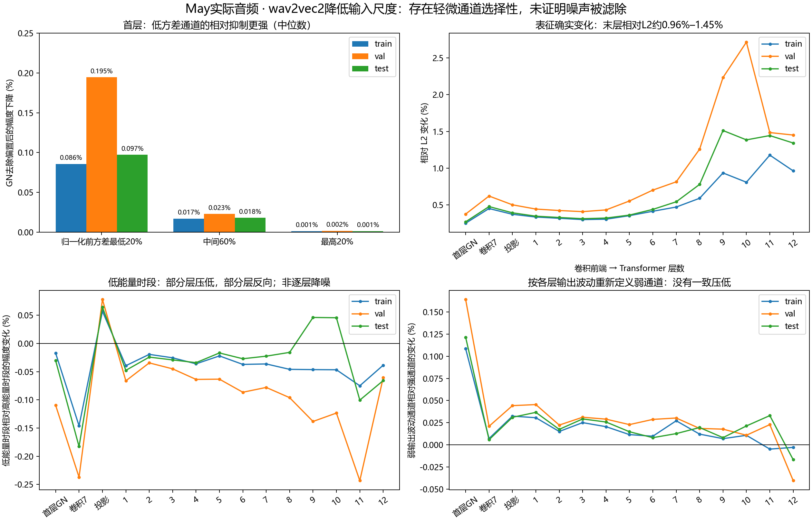

# 59-wav2vec2-weak-signal-layer-audit

✅ 2026-10-20 完成。May实际完整train/val/test、14个原分块、44次冻结wav2vec2前向，0训练/TFG/SyncNet。独立CPU核查364个层配对、11648对原始采样向量和243712行通道矩统计通过；28个末层分块与原报告56缓存逐值相同。

## 结论

**降低输入尺度确实会在首层GroupNorm轻微地相对压低“归一化前方差较低的通道”，但没有看到“低能量时段/弱响应通道沿网络持续单调地被滤除”。** 这是一项通道尺度选择性，不是已识别的噪声消除，不能据此认定原低尺度训练的Sync-C提升由降噪造成。

第一层无偏置卷积仅把全部响应乘0.5，没有选择性；GroupNorm的固定epsilon引入依赖通道方差的轻微相对衰减。将该层epsilon同步乘0.25后，14个分块从GroupNorm起的所有后续完整记录点与标准尺度逐值一致。这把报告58两片段的epsilon定位扩展到了报告56的全部May音频，但不替代下游训练因果对照。

## 输入与固定处理

使用 `F:/Datasets/tts-exp/synctalk_gain_training_20261017/arms/{train,val,test}/gain_0/aud.wav`，原报告56同一实际音频与全段标准化公式：float32 `z=(x-mean(x))/sqrt(var(x)+1e-7)`，随后乘1或0.5，无再次标准化。三个split分别含168/24/46秒（包括前端上下文）；不切出“效果好”的时间段。

标准/低尺度完整波形SHA分别与报告56processor/native SHA精确匹配。编码分块严格为hop320000采样、最大长度320080，与原20秒分块一致；train9块、val2块、test3块，共14。上下文末尾重叠80采样是原分块约定，不另改时钟或拼接方式。

模型facebook/wav2vec2-base，revision `0b5b8e868dd84f03fd87d01f9c4ff0f080fecfe8`，权重SHA `3249fe98bfc62fcbc26067f724716a6ec49d12c4728a2af1df659013905dff21`，config和preprocessor配置同SHA。冻结eval/inference_mode，FP32/eager、TF32关闭。只用本机RTX4060，不访问Ubuntu。44前向=每块标准/低尺度/补偿三档42次+首train/test标准重复2次；实际CUDA峰值reserved826277888 bytes。运行前后完整state_dict SHA相同，未创建优化器。

复用报告58的Capture钩子，源SHA与其启动前协议一致；旧诊断manifest、协议、完成/QA及两个首块原末层SHA重新核对。没有覆盖旧实验或重复旧60次扫描。

## “弱”有三个不同定义

1. **低能量时段**：完整标准尺度波形的50ms局部RMS，在最终CNN帧中心取q20/q80阈值，再固定用于全部层/条件。CNN按感受野中心贴标签；Transformer有全块上下文，标签不表示只依赖该处声音。
2. **首层GN低方差通道**：每个标准尺度编码块内，首层线性卷积输出按时间计算方差，最低20%/中间60%/最高20%。它是GroupNorm分母实际使用的方差。
3. **各层弱响应通道**：每层/每块标准输出按时间去均值后的方差，同样q20/q80分层。它不同于GN前方差；学习到的gamma/beta会改变通道的实际响应。

所有标签只由标准条件计算，没有按低尺度结果重新挑选。没有干净语音/噪声分离或音素真值，以上定义都不等于噪声。通道不是频率格，不把一个隐层通道直接叫高频噪声或某个音素。

## 首层：有轻微的通道选择性

对首层卷积通道z，均值mu、方差v、正输入尺度a及学习到的gamma/beta：

`GN(a*z) = gamma*(z-mu)/sqrt(v+epsilon/a²)+beta`。

去除beta后，相对标准输入的幅度倍率为 `r=sqrt((v+epsilon)/(v+epsilon/a²))`。本次a=0.5、epsilon=1e-5，分母等价于v+4e-5。v较小的通道r更低，但这是对同一通道整块时间响应的近似统一缩放，不是逐时刻将弱样本置零的门。

| split | GN前低方差20%通道的幅度下降中位数 | 中间60% | 高方差20% |
|---|---:|---:|---:|
| train | 0.085657% | 0.017124% | 0.001329% |
| val | 0.194546% | 0.023083% | 0.001825% |
| test | 0.097338% | 0.018117% | 0.001435% |

分组在每个20秒块内确定，再把通道-块成员的倍率合并取中位数；不是多个独立说话人的统计推断。个别通道-块衰减最大为train1.930%、val3.472%、test1.948%，因此不能用中位数概括全部通道。但这里仍没有证明哪一通道表示噪声。

实际通道倍率与独立方差公式最大差2.014e−7；整块时间响应经同一解析通道倍率拟合，最大坐标误差1.421e−5（float32）。这支持“依赖整块通道方差的轻微衰减”，不是AVE式频谱硬下限。

## 沿网络传播：不是统一的弱信号压低

下表为原/低两条件的所有坐标相对L2变化%，不是衰减百分比。首层纯卷积50%差异仅是0.5倍整体缩放，不能叫选择性抑制。

| 层 | train | val | test |
|---|---:|---:|---:|
| 首层GroupNorm | 0.252355 | 0.376833 | 0.271656 |
| 第7个卷积块 | 0.451981 | 0.621777 | 0.478549 |
| 投影线性层 | 0.373578 | 0.502562 | 0.393874 |
| Transformer 4 | 0.306944 | 0.433367 | 0.322554 |
| Transformer 8 | 0.591499 | 1.259248 | 0.780057 |
| Transformer 9 | 0.935751 | 2.233717 | 1.512573 |
| Transformer 12 | 0.963750 | 1.450986 | 1.342619 |

上表是完整编码输出；历史两帧配对缓存每split舍去最后一个编码帧。严格按原缓存保留支持重算末层L2为0.963824%/1.450763%/1.342999%，与原数据逐值一致，微小差异来自这一个尾帧，不是重放漂移。相对L2不是范数衰减，更不是删除了相同比例的噪声。

### 低能量时段有没有被额外压低

定义每组幅度倍率rho=sqrt(sum(low_output²)/sum(standard_output²))，再比较最低能量20%与最高20%的rho。负值表示低能量组相对压低，公式是 `(rho_low/rho_high-1)*100%`，排除纯整体等比例变化。

| 层 | train | val | test |
|---|---:|---:|---:|
| 首层线性卷积 | 0.0000% | 0.0000% | 0.0000% |
| 首层GroupNorm | -0.0173% | -0.1098% | -0.0306% |
| 第7个卷积块 | -0.1461% | -0.2371% | -0.1829% |
| 投影线性层 | +0.0570% | +0.0778% | +0.0642% |
| Transformer 12 | -0.0386% | -0.0608% | -0.0659% |

这说明部分层确有轻微相对压低，但投影线性层反向，test在Transformer9/10也反向，不是逐层单调滤除。末层虽然低能量组平均略低，不能据此认定其改变的是噪声；低能量语音、谱谷、停顿及上下文都会混在该标签里。

### 按各层实际输出波动定义弱通道

结论也不统一：在首层GN，train弱输出波动通道的去均值RMS倍率0.999856，而强输出波动通道为0.998773，弱输出通道反而衰减更少。这与上面的GN前方差结果不矛盾，因为它们是不同标签，gamma等会改变实际输出波动。第7卷积/投影和部分Transformer层也出现弱通道相对增强；直到末层部分比较转为轻微相对压低。详见channel_summary.csv。

末层所有输出的总体范数倍率约train0.999850、val0.999738、test0.999529，幅度变化很小。相对“最佳拟合的一个整体缩放”计算，剩余坐标/方向变化占总差平方约99.958%/99.936%/99.825%。这只是表示空间的代数分解，不是噪声/语音分离；说明末层主要并非一个整体幅度降低。

## epsilon对照

只将首层GroupNorm的epsilon从1e-5改为2.5e-6，同时输入乘0.5，其他设置不动。14/14分块从GroupNorm起全部25个完整记录点与标准尺度逐值一致，完整末层独立读回和采样向量也一致。原始卷积层仍是精确0.5倍，符合数学预期。

该结果把首层的epsilon尺度失配识别为本批编码响应的入口；不表示改epsilon能改善生成，也不表示训练Sync-C差异已获解释。这里没有用改变epsilon的编码器重新训练或生成视频。

## 质量与可复现性

4项CPU单元测试通过：整体0.5倍与选择性改变区分、仿射偏置下去均值通道倍率、方向旋转不误称衰减、拒绝支持形状不一致。独立analyze.py不导入producer，复核364层配对、11648对原始采样向量、243712行通道矩；逐时间/通道能量守恒、声学标签与原波形RMS、分层倍率及GN公式均通过，倍率重建差0。28个标准/低尺度分块末层全部与历史报告56缓存逐值相同；两个原报告58首块桥接和两次默认重复逐值相同。权重前后SHA不变，0失败前向。

全层指标基于所有坐标的float64矩，不是32采样点估计；采样向量用于额外独立核验。每块26个记录点含单独保存的末层端点，它与Transformer12重复，不是26个独立网络层。保留每层完整逐时间矩、逐通道矩、声学标签/源采样位置、每块GN方差及实际/解析倍率、各条件完整末层和样本向量。跨块统计按对应坐标能量合并，GN中位数另按通道-块成员计算；两种聚合不混用。

代码：scripts/experiments/wav2vec2_weak_signal_20261020/{run,analyze,plot}.py；测试tests/experiments/test_wav2vec2_weak_signal_20261020.py；命令与固定根路径见同目录README.md。前向协议和run.py启动前冻结；分析和绘图源单独保存。科学根F:/Datasets/tts-exp/wav2vec2_weak_signal_20261020_v1，completion.json/independent_qa.json为实际完成与独立复核入口，最终delivery_manifest/final_receipt绑定全部成员。本机持久保存，无云备份声明。

本轮仅单May、同一冻结checkpoint和现有音频的机制核查。多个时间帧/通道/分块不是新增独立身份，不做总体p值。不能从弱通道选择性外推背景噪声被删除、普遍降噪效果、口型质量或原训练收益因果。

## 图

## Observations

- [status] concluded
- [result] 44冻结前向/14实际May块，0训练/TFG/SyncNet；28默认末层块与报告56原缓存逐值一致。
- [result] 首层GN按预方差定义的弱通道中位衰减train0.085657%/val0.194546%/test0.097338%，较高方差通道更强；epsilon平方补偿后全部后续层精确恢复。
- [conclusion] 确认轻微的通道尺度选择性；低能量时段和弱输出响应通道没有统一单调的沿层抑制，不足以认定降噪或解释训练涨分。
- [limitation] 无独立噪声/语音真值、无下游训练因果对照、无新同步质量结论。

## Relations

- follows [[58-encoder-layer-epsilon-diagnostic]]
- follows [[57-may-waveform-floor-audit]]
- uses [[56-may-postnorm-scale]]
- relates_to [[研究主线与证据地图]]
