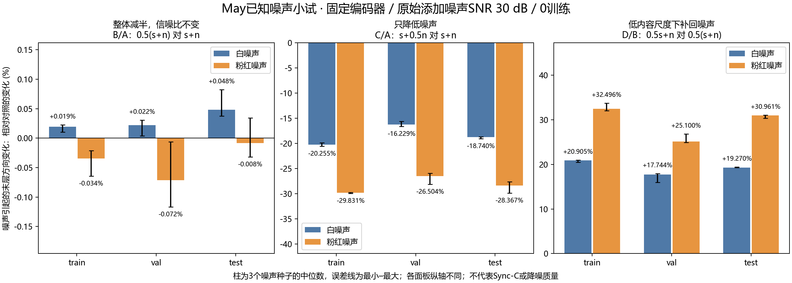
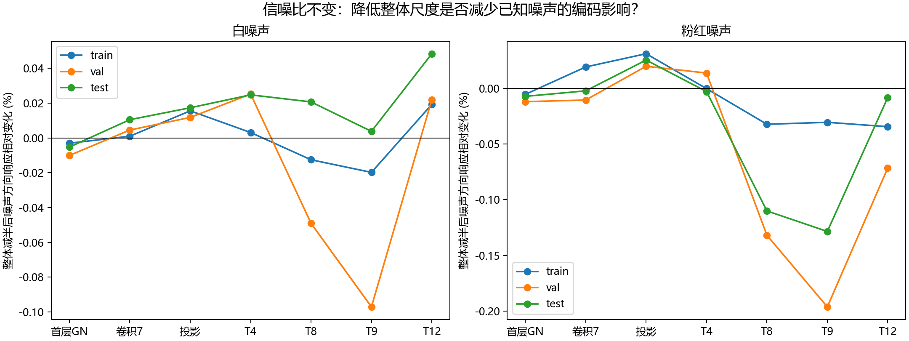

# 61-may-known-noise-encoder-pilot

✅ 2026-10-20完成。实际May全train/val/test、14原分块、两类已知合成噪声×3固定种子，449次冻结wav2vec2前向；0训练/TFG/SyncNet。

## 问题与结论

用户假设：低音量适合训练，是否因为模型收到更小的噪声？本轮先不训练，而把“整体减半”和“仅降低已知噪声”拆开，测量冻结编码器受到添加噪声的扰动。

**本批没有出现明显的“整体减半就减少噪声编码影响”。** 信噪比不变的B/A末层方向扰动变化在18个split×噪声类型×种子条件中，最大绝对相对变化为0.1165%；方向并非全部一致。只将添加噪声减半时，扰动减少15.625%–29.948%；在低内容尺度下补回噪声时，扰动增加15.942%–33.757%。这支持编码器对实际添加噪声强度有响应，但不支持把整体波形缩放直接当成等效降噪。

以上仅为编码器扰动指标，不是训练收益、Sync-C或感知质量。本轮不能判定原低尺度训练收益不存在，也不能外推到所有噪声/SNR/编码器。

## 固定输入与噪声

使用报告56/59同一实际May音频，train/val/test完整长度168/24/46秒（含前端上下文），同一全段float32标准化，再进入原320000采样hop、320080最大块长。原数据/标准化输入/低尺度输入SHA与报告59精确相同。

模型facebook/wav2vec2-base，revision `0b5b8e868dd84f03fd87d01f9c4ff0f080fecfe8`，权重SHA `3249fe98bfc62fcbc26067f724716a6ec49d12c4728a2af1df659013905dff21`。eval/inference_mode、FP32/eager、TF32关闭；同一权重、原GN epsilon默认1e-5，不训练模型或生成器。仅本机RTX4060，无Ubuntu调用。

噪声由固定随机数生成，**没有使用降噪器，也没有把May残差猜成噪声**：

- 白噪声：PCG64固定seed的标准高斯序列，去均值、单位RMS。
- 粉红噪声：同一随机序列经FFT，在非DC频率施加1/sqrt(f)幅度权重、DC置0，逆变换后去均值并归一化RMS。未额外带限，最低非零频率由split长度决定，包含低频成分；它是有限长度合成谱形，不代表所有实际环境噪声。
- 每种3种子20261020/20261021/20261022，val/test种子分别加100000/200000，避免跨split复用同一噪声片段；白/粉红使用配对底层随机序列，不把两类当独立现实采样。
- 每split将已知n的RMS定为标准May内容RMS的10^(-30/20)，即添加噪声SNR30dB。该SNR是**相对含原有噪声的May内容**，不是干净语音真实SNR；局部安静时段可能更低。

完整18份噪声数组、算法参数及SHA在noise/和protocol.json。它们与内容同样本数/采样率，不改变时钟；所有混合为float32，不再标准化、不clip/limiter、不转PCM16。

## 四组与匹配参照

令s为标准化May内容，n为已知添加噪声；s不能称已知干净语音。

| 组 | 编码器输入 | 无添加噪声的参照 | 添加噪声SNR |
|---|---|---|---:|
| A | s+n | s | 30dB |
| B | 0.5(s+n) | 0.5s | 30dB |
| C | s+0.5n | s | 36.0206dB |
| D | 0.5s+n | 0.5s | 23.9794dB |

每个类型/种子/分块四组使用完全相同的n，确保B只是A的精确0.5倍，C只改添加噪声，D在低内容尺度补回添加噪声。两个无添加噪声参照每块各跑一次，共28次；都与报告59保存的完整末层逐值相同。

前向数：14块×(6噪声实例×四组+6个epsilon诊断+2参照)+1个A重复=449。protocol.json在任何编码前向前冻结。训练、val、test仅用于覆盖既有音频，没有用结果挑时段或调SNR。

## 指标

记录首层GN、第7卷积块、投影、Transformer4/8/9/12共7个记录点。对于每个噪声输入E(as+bn)，始终与同内容尺度的E(as)比较，不能把B直接减E(s)造成尺度混淆。

主指标为逐帧向量单位化后的欧氏距离RMS：`sqrt(mean(||unit(E(as+bn))-unit(E(as))||²))`。这样整体输出范数改变本身不算方向扰动。次指标是相对L2：`||E(as+bn)-E(as)||/||E(as)||`。由于编码器非线性，差值叫“添加已知噪声引起的变化”，不能叫已从特征中分离出的纯噪声分量。

主对照是B/A、C/A、D/B三种**扰动指标的比值**，不是输入波形幅度比。全部时刻的分块平方和按帧数/相应能量合并，不简单平均分块比例。低/中/高能量分层复用报告59的原May50ms RMS固定阈值，独立作为补充。

## 实测主结果

下表是3个噪声种子的末层主指标比值中位数转换成变化百分比；负号为已知噪声方向扰动减小，正号为增大。

| split | 类型 | 整体减半 B/A−1 | 只减噪声 C/A−1 | 低内容尺度补回噪声 D/B−1 |
|---|---|---:|---:|---:|
| train | 白噪声 | +0.0193% | -20.255% | +20.905% |
| train | 粉红噪声 | -0.0345% | -29.831% | +32.496% |
| val | 白噪声 | +0.0220% | -16.229% | +17.744% |
| val | 粉红噪声 | -0.0716% | -26.504% | +25.100% |
| test | 白噪声 | +0.0484% | -18.740% | +19.270% |
| test | 粉红噪声 | -0.0084% | -28.367% | +30.961% |

18个B/A值有8个小于1、10个大于1，不能概括为全部噪声响应降低。逐种子范围和全部7记录点见summary.csv/contrasts.csv/aggregate.csv，图中的误差线是3种子的最小–最大，不是置信区间，不做总体显著性。

C/A和D/B提供正向灵敏度对照：实际单独改变添加噪声，编码扰动会有可测变化。B/A却远小于这些变化，因此本次未支持“只要整体调小，即明显减少编码器中的已知噪声影响”。这仍不检验生成器训练对这些差异是否敏感，也不排除原录音的其他噪声类型、训练优化或特征工作点机制。

## epsilon诊断

每个噪声实例/分块额外跑B的输入，但首层GN epsilon改为2.5e-6，与A的默认epsilon1e-5比较。84/84条件的全部7个完整记录点逐值一致，完整末层和原始采样向量独立读回也精确。无添加噪声时的同一补偿已由报告59所有14块验证。

因此，本轮A/B残留编码差异仍来自首层epsilon与整体正尺度的关系，并未出现额外的已识别噪声滤除机制。该改epsilon只是诊断，不作为部署或提升训练质量建议。

## 验证与边界

独立CPU消费者不导入producer：18份已知噪声完整重建逐值一致，SNR符合30dB，449个混合输入SHA全部重建一致；检查2352个层配对和75264对原始采样向量、逐时间/通道矩能量守恒、声学分层和全部扰动指标。指标重建最大差0.000e+00。A重复全部记录点精确；84个epsilon对照全量精确；模型前后完整state_dict SHA保持。

4项单测通过：四组独立操纵、噪声种子/RMS可复现、单位方向指标不误计整体特征放大、拒绝形状变化且不clip标准化波形。所有完整末层、每层全帧/通道矩及32原始采样向量、输入/噪声SHA保留。全帧指标不依赖32点采样估计。

沿用报告59的完整编码输出支持，每split包含历史两帧配对缓存舍去的一个尾帧；本轮不生成下游TFG特征缓存或视频。3种子、2种合成噪声、单SNR、单身份都是机制小试范围，不冒称真实环境噪声或跨人结论。May固有噪声仍未分离；无训练Sync-C、无新感知判断。

代码scripts/experiments/may_known_noise_20261020/{run,analyze,plot}.py，测试tests/experiments/test_may_known_noise_20261020.py，重放命令见同目录README.md。持久根F:/Datasets/tts-exp/may_known_noise_20261020_v1；completion.json/independent_qa.json是实际完成及独立复核证据，最终delivery_manifest/final_receipt绑定全部科学成员。只声明本机持久保存，不声明云备份；没有修改旧科学根或Ubuntu任务。

## 图

## Observations

- [status] concluded
- [result] 449冻结前向/18已知噪声数组/四组，0训练/TFG/SyncNet；449输入SHA和全部指标独立复核通过。
- [result] 整体减半的末层噪声方向扰动相对变化最大绝对值0.1165%，单独噪声减半则减少15.625%–29.948%。
- [conclusion] 本批未支持整体降低音量等效明显减小噪声编码影响；已知添加噪声强度操纵有效，但训练因果仍未检验。
- [limitation] 单May/单30dB/两合成谱形/3噪声种子；May不是干净语音真值，编码扰动不是降噪质量或Sync-C。

## Relations

- follows [[59-wav2vec2-weak-signal-layer-audit]]
- uses [[56-may-postnorm-scale]]
- relates_to [[研究主线与证据地图]]
