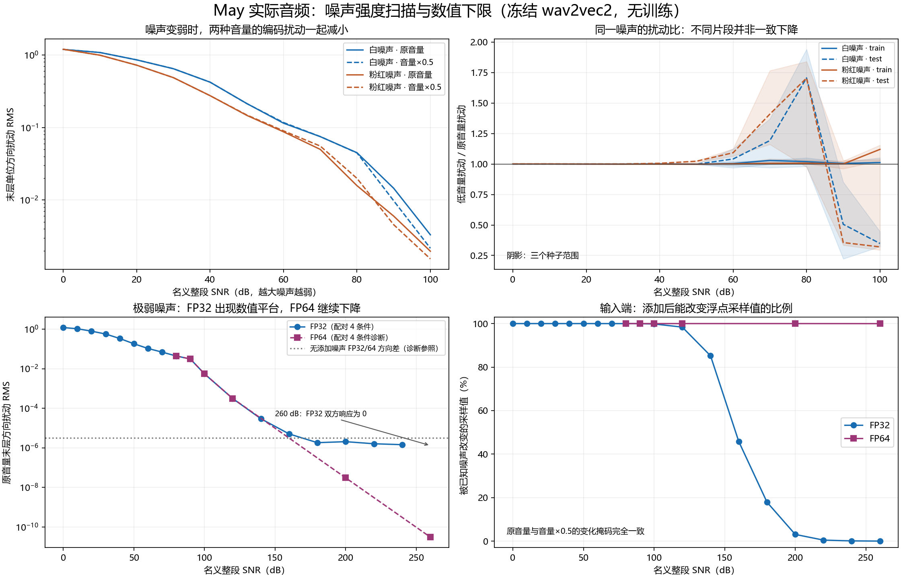
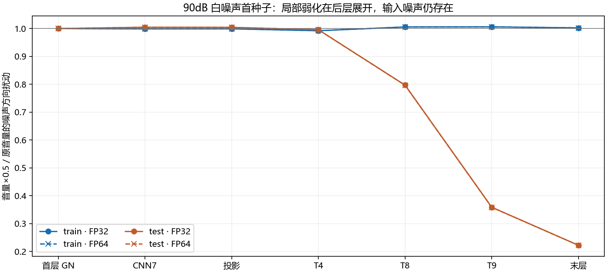

# 63-may-known-noise-strength-scan

✅ CONCLUDED / SUCCEEDED。2026-10-20；实际May train/test各首20.005秒、白/粉红噪声×3种子×19档、7层、566次冻结编码前向（主扫描538+观察后双精度追查28）。0训练/TFG/SyncNet。

## 问题与结论

用户问：降低整体音量时，已知噪声是否会弱到某档后被额外压平？在报告61的30dB单强度结果上，本轮扫描噪声剂量，并把FP32数值平台与模型响应区分。

**出现了片段和剂量依赖的弱化，也出现增强；未找到低音量独有的稳定硬截断点。** 0–100dB的末层噪声方向扰动比B/A范围0.222141–1.940826。test的部分弱白噪声档明显减小，train并不沿相同趋势，test其他档也可增大。不能继续把30dB单档的“基本保留”概括到全部弱剂量。极弱档必须结合精度诊断；FP32响应平台或归零不能直接解释成低音量选择性消噪。预设连续三档、所有两段×3种子、可分辨扰动下降≥20%的候选数为0。

完整范围仅为本批两段May、两谱形、三合成实例的描述性结果。没有训练质量、Sync-C或感知结论；未达到操作阈值不排除细微/局部效应，也不证明所有真实噪声都不被抑制。

## 固定实验

复用报告61同一May原音频和全split float32标准化，再各取train/test前320080采样（16kHz、20.005秒）；不是重新标准化该前缀。原May含未知本底噪声，s不能称纯净语音。

使用61封存的整split 30dB噪声n30，白噪声为固定PCG64高斯序列去均值/定RMS；粉红噪声对相同序列施加FFT幅度1/sqrt(f)、DC置零、去均值/定RMS，未额外带限。种子20261020/21/22；test生成种子原已加200000。每剂量仍是同一噪声实例，只乘10^((30−q)/20)。因此q为名义整split添加噪声SNR；prefix实际SNR另记waveform_audit.json，不能把q直接当本段精确值或干净语音真实SNR。

FP32全扫描q=0,10,…,100,120,140,…,260dB；越大噪声越弱。每条件A=s+n_q、B=0.5(s+n_q)，各自比较E(s)、E(0.5s)。不重新normalize、不clip/limiter、不转整型、不改变时长。FP64在120/200/260dB使用每谱形首种子、两段音频；原标准化s32和封存n30先转float64再缩放相加，原FP32模型权重精确扩展到double，改善运算精度而不增加原权重有效位。

facebook/wav2vec2-base，revision0b5b8e868dd84f03fd87d01f9c4ff0f080fecfe8，权重SHA3249fe98bfc62fcbc26067f724716a6ec49d12c4728a2af1df659013905dff21；eval/inference_mode、eager、TF32off、RTX4060。GN默认epsilon1e-5。噪声数据、原split SHA、权重和producer代码SHA都写入前向前冻结protocol。

主扫描前向538=456个FP32噪声条件+4个FP32参照+2个重复+48个epsilon控制+24个FP64噪声条件+4个FP64参照。观察到test弱剂量变化后，保留主协议，另立transition_fp64探索性协议，固定80/90/100dB、每谱形首种子、两段、FP64，再运行24个噪声条件+4个参照共28前向；总566。不是预先指定的确认性追查，也未据此选择训练条件。新4个参照与主FP64七层全部逐值相同。记录firstGN、cnn7、projection、Transformer4/8/9/12（last）七处；wav2vec2隐藏维不是可直接命名的声学频率bin。

## 指标、可分辨规则与数值边界

主指标sqrt(mean(||unit(E(as+an))−unit(E(as))||²))，a=1或0.5；使用float64逐坐标直接相减，避免2−2cos在极弱变化处的消减。次指标相对L2，另存每层完整逐帧矩、64帧原值、完整末层、参照七层原值和输出逐坐标/逐帧精确未变比例。该差值是已知添加噪声的干预响应，非分离出来的纯噪声特征。

FP32可分辨的保守操作规则：两音量的噪声方向扰动都超过对应无添加噪声FP32-vs-FP64方向差10倍。这种跨精度差异是诊断参照，不是严格误差上界。同精度重复严格一致也不能证明无限数值分辨率。末层可分辨的FP32条件150个；原始比值全保留，不以过滤删除不利结果。

候选明显额外抑制预设：同一噪声谱形内，连续三个网格SNR、全部两段×三种子均可分辨且B/A≤0.8。它只用于识别可复现的大幅变化，不能把不满足它写成数学等效或通用无效。

## 剂量结果

下表A是原音量末层扰动的跨本批条件中位数；比值列为B/A的最小/中位/最大。FP64仅4条件，FP32每档12条件，不能把两者当相同覆盖量。极弱档响应为零时没有可定义比值。

| 精度 | 名义SNR dB | A扰动中位 | B/A最小 / 中位 / 最大 | FP32操作可分辨数或FP64数 | 输入采样被改变比例范围 |
|---|---:|---:|---|---:|---|
| fp32 | 0 | 1.19766 | 1.000272 / 1.000342 / 1.000405 | 12/12 | 100.00000–100.00000% |
| fp32 | 10 | 1.04896 | 1.000241 / 1.000355 / 1.000568 | 12/12 | 100.00000–100.00000% |
| fp32 | 20 | 0.790833 | 0.999499 / 1.000288 / 1.000577 | 12/12 | 99.99969–100.00000% |
| fp32 | 30 | 0.571307 | 0.998976 / 1.000175 / 1.001367 | 12/12 | 99.99969–100.00000% |
| fp32 | 40 | 0.335761 | 0.997979 / 1.001422 / 1.006885 | 12/12 | 99.99906–100.00000% |
| fp32 | 50 | 0.182151 | 0.995762 / 0.999465 / 1.025478 | 12/12 | 99.99875–100.00000% |
| fp32 | 60 | 0.103507 | 0.968862 / 1.012423 / 1.124637 | 12/12 | 99.99781–99.99938% |
| fp32 | 70 | 0.0676153 | 0.970241 / 1.037046 / 1.765610 | 12/12 | 99.99313–99.99688% |
| fp32 | 80 | 0.0288782 | 0.975417 / 1.026321 / 1.940826 | 12/12 | 99.97844–99.98532% |
| fp32 | 90 | 0.00785823 | 0.222141 / 0.981368 / 1.030432 | 12/12 | 99.94064–99.95626% |
| fp32 | 100 | 0.00277201 | 0.294566 / 1.010301 / 1.154948 | 12/12 | 99.81036–99.84223% |
| fp32 | 120 | 0.000309302 | 0.274890 / 1.003621 / 1.309094 | 12/12 | 98.16421–98.53662% |
| fp32 | 140 | 2.86185e-05 | 0.263446 / 0.983496 / 1.382237 | 6/12 | 83.44195–86.68145% |
| fp32 | 160 | 4.84276e-06 | 0.298996 / 0.777249 / 2.139184 | 0/12 | 41.44745–49.12741% |
| fp32 | 180 | 1.84557e-06 | 0.583576 / 1.109019 / 1.813170 | 0/12 | 14.74475–20.22057% |
| fp32 | 200 | 2.03849e-06 | 0.483675 / 1.002254 / 2.416167 | 0/12 | 2.61841–3.26387% |
| fp32 | 220 | 1.60589e-06 | 0.374528 / 0.998990 / 2.208368 | 0/12 | 0.36553–0.54486% |
| fp32 | 240 | 1.36965e-06 | 0.851471 / 0.967293 / 1.860427 | 0/12 | 0.03905–0.15590% |
| fp32 | 260 | 0 | 未定义 / 未定义 / 未定义 | 0/12 | 0.00000–0.00000% |
| fp64 | 120 | 0.000312115 | 0.363667 / 1.139247 / 1.306063 | 4/4 | 100.00000–100.00000% |
| fp64 | 200 | 3.03226e-08 | 0.367910 / 1.137227 / 1.315922 | 4/4 | 100.00000–100.00000% |
| fp64 | 260 | 3.03276e-11 | 0.367837 / 1.137169 / 1.315720 | 4/4 | 99.96970–99.97407% |
| fp64_transition | 80 | 0.0438363 | 0.975396 / 1.006779 / 1.050680 | 4/4 | 100.00000–100.00000% |
| fp64_transition | 90 | 0.030976 | 0.222045 / 1.001426 / 1.030038 | 4/4 | 100.00000–100.00000% |
| fp64_transition | 100 | 0.00549048 | 0.323041 / 1.023737 / 1.156359 | 4/4 | 100.00000–100.00000% |

七层0–100dB、符合各层数值规则的全部条件比值范围：

| 记录点 | 条件数 | B/A范围 |
|---|---:|---:|
| first_gn | 132 | 0.999616–1.000044 |
| cnn7 | 132 | 0.998223–1.004669 |
| projection | 132 | 0.998514–1.004229 |
| transformer4 | 132 | 0.986966–1.003977 |
| transformer8 | 132 | 0.649120–1.305134 |
| transformer9 | 132 | 0.358214–1.846284 |
| last | 132 | 0.222141–1.940826 |

## 弱噪声局部效应的双精度追查

以下是90dB白噪声首种子的末层示例，完整80/90/100dB追查在表中fp64_transition行，覆盖量每档4条件：

| 片段 | 精度 | A扰动 | B扰动 | B/A |
|---|---|---:|---:|---:|
| train | fp32 | 0.045987729 | 0.046087524 | 1.002170 |
| train | fp64_transition | 0.045987694 | 0.046087498 | 1.002170 |
| test | fp32 | 0.016325585 | 0.003626586 | 0.222141 |
| test | fp64_transition | 0.016330502 | 0.0036261104 | 0.222045 |

双精度下test该示例的末层扰动仍减少77.795%，train同档比值为1.002170。因此这项局部弱化并非单靠FP32误差即可解释。该示例的FP32首GN扰动比接近1，明显差异主要在后部Transformer展开。应将它描述成特定输入附近的噪声敏感度变化，而非已识别频谱成分被门限删除；不能因没有通用阈值就否认示例中的实际扰动减小。

继续到FP64的200/260dB，test白噪声比值分别0.367910/0.367837，train白噪声分别1.315922/1.315720；两者噪声响应都保持非零，且SNR增加60dB时响应约随添加幅度下降1000倍。该极弱区更接近各自非零的小扰动敏感度，而不是逐步落入低音量独有的零响应。

260dB时FP32中12个条件的添加噪声都在与内容相加时完全舍入掉：A=s且B=0.5s，所以两个音量都零响应；这不是把原May波形削成静音。FP64同档约99.97%的采样仍被微小噪声改变，模型输出响应也非零。这直接区分了输入相加精度下限与低音量选择性压平。

FP64三个极弱剂量的完整末层已知噪声响应和对应FP32响应差异见precision_diagnostics.json；不能把FP32中的异常比值按噪声压平机制直接解释。FP64改善了运算精度，但没有无限精度真值，本轮也未做FP128或任意精度参照；表中FP64数只表示诊断覆盖条件数。各层精确帧配对见exact_frame_pairs.json，可区分双方不变与仅一方浮点结果不变。

## 控制与独立核验

- 输入层面252组噪声剂量/精度配对均满足：变化采样掩码相同，且B−0.5s严格等于0.5(A−s)。没有低音量独有的输入截断。输入浮点相加对过弱n会舍入，原音量和0.5缩放在本范围内同时受到影响。
- 旧报告61的4个无添加噪声参照和24个30dB末层完整输出均逐值一致，历史源及成员SHA鲜核通过。
- 48个FP32 epsilon控制：B的首GN epsilon改为2.5e-6时七层全部逐值恢复A输出。GN是连续归一化，epsilon改变相对增益，并非显式噪声门；隐藏通道不等于已标记噪声。
- 两个FP32无添加噪声重复七层严格一致；原权重经double/float诊断往返后state SHA未变。
- 独立重建566次输入hash、全部225792个原值层/帧样本对、504000个完整末层帧对；每层存储矩与行指标重算通过，28旧run桥接及48补偿raw读回通过。4个CPU指标/剂量/舍入测试通过。
- 首次v1因Windows相对路径分隔符与旧manifest POSIX键不一致，在模型加载与前向前失败；保留failure.json，修正索引后使用全新v2根运行。不是科学控制失败或选择性丢弃剂量结果。

## 产物与限制

持久根`F:/Datasets/tts-exp/may_noise_strength_20261020_v2`；protocol/completion/independent_qa/summary/ratios/stage_summary/waveform_audit/precision_diagnostics/exact_frame_pairs及完整末层、逐帧矩、样本原值均保留。源码scripts/experiments/may_noise_strength_20261020/及tests/experiments/test_may_noise_strength_20261020.py，README含复现入口。最终文件清单与fresh SHA读回见delivery_manifest/final_receipt；本轮仅本地持久交付，没有声称云端备份。

这是一轮固定前缀机制筛查，未覆盖报告61全14块或更多真实环境噪声，未校准感知可听阈值。名义SNR极高档用于暴露数值下限，不代表实际录音常见条件。原May未知噪声和添加噪声不能混称；结果不能直接解释低音量训练为何提高Sync-C。

## Observations

- [result] 19档已知噪声扫描完成；未发现满足预设规则的低音量独有额外压平阈值。
- [decision] 对极弱噪声的FP32平台/归零使用双精度与输入加法审计，避免把精度下限写成去噪机制。
- [limitation] 仅冻结编码器、两May前缀、两合成谱形、三种子，无训练/Sync-C/感知结论。

## Relations

- extends [[61-may-known-noise-encoder-pilot]]
- relates_to [[59-wav2vec2-weak-signal-layer-audit]]
- relates_to [[研究主线与证据地图]]
