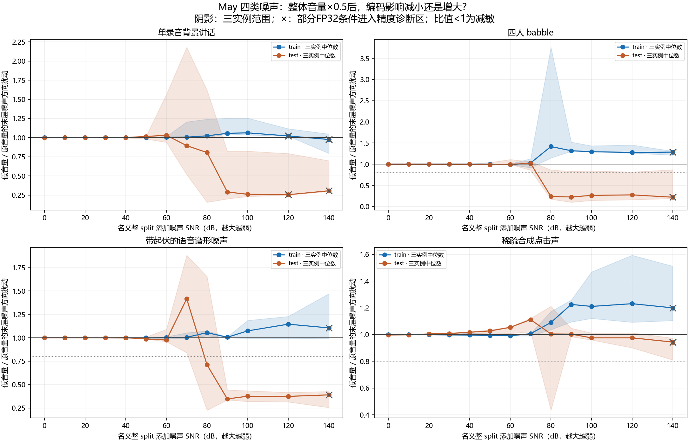
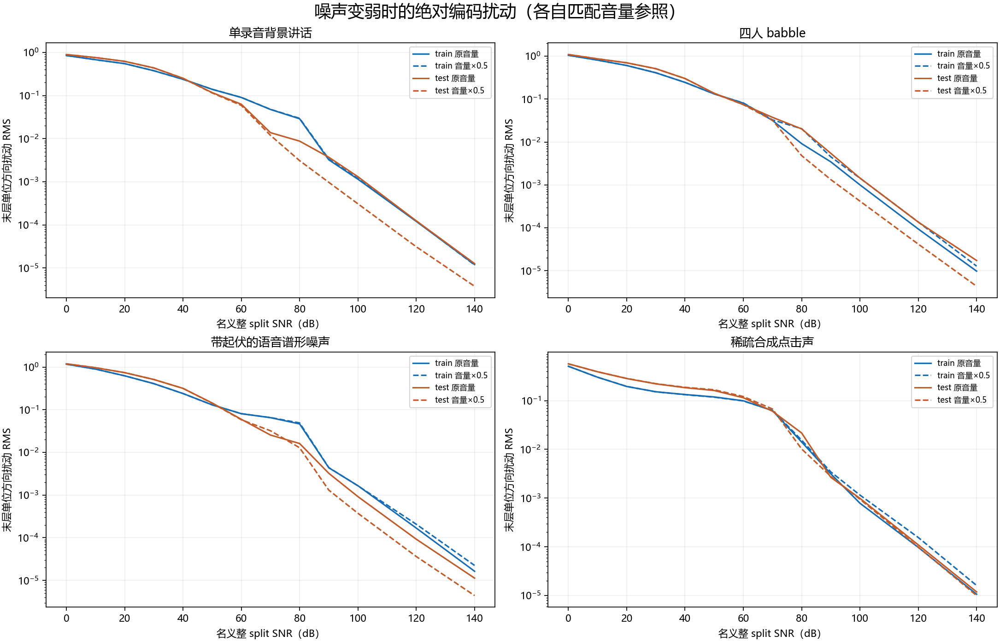
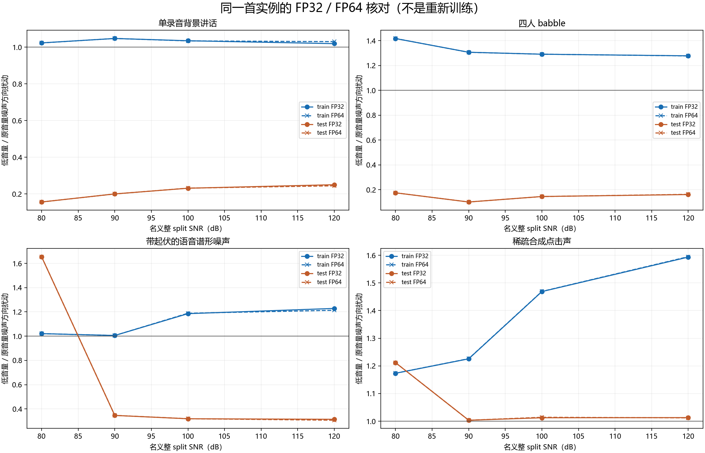

# 65-may-four-noise-scale-scan

✅ CONCLUDED / SUCCEEDED，2026-10-20。四类噪声×3固定实例×两May前缀×13档FP32，另首实例四弱档FP64核查，746个科学前向条件及34次恢复桥接；0训练/TFG/SyncNet。

## 问题与解释范围

用户要求沿用之前May实际音频，扫描单人背景讲话、多人babble、带起伏语音谱形噪声和点击声，判断整体音量降低后哪些已知干扰的编码影响减小。本轮延续报告63同权重/处理/前缀，主比较是匹配参照的编码扰动比B/A；不能把结果叫“对训练有害的噪声已被去除”。本轮没有运行训练，不能根据编码扰动大小确定训练损失或Sync-C因果。

以预定网格100dB弱添加噪声档为例，下表是三个实例的末层方向扰动比中位数换算的变化百分比：

| 干扰类型 | train前缀 | test前缀 |
|---|---:|---:|
| 单录音背景讲话 | +6.26% | -73.96% |
| 四人babble | +29.51% | -73.58% |
| 带起伏语音谱形噪声 | +7.37% | -62.41% |
| 稀疏合成点击声 | +21.06% | -2.45% |

背景讲话、babble和起伏语音谱形在该test前缀的弱剂量有明显减敏，点击声没有同等稳定幅度；train前缀的中位方向相反。应以完整剂量/实例曲线判断条件依赖，不能给某类噪声贴通用“可被低音量消除”的标签。100dB属于非常弱的合成添加量，其SNR定义不等于原May本底噪声的真实SNR。

## 本批减敏条件

小于1表示噪声引起的末层单位方向扰动减小；大于1表示增大。0.8代表减少20%。下列只是预设描述阈值，不是检验显著性或通用硬截断。

- 单录音背景讲话：train三实例均减小≥20%的名义SNR档为[]；test为[]；两片段全部六实例均满足的档为[]。
- 四人babble：train三实例均减小≥20%的名义SNR档为[]；test为[]；两片段全部六实例均满足的档为[]。
- 带起伏语音谱形噪声：train三实例均减小≥20%的名义SNR档为[]；test为[90, 100, 120]；两片段全部六实例均满足的档为[]。
- 稀疏合成点击声：train三实例均减小≥20%的名义SNR档为[]；test为[]；两片段全部六实例均满足的档为[]。

三实例不等于三次训练重复，也不保证是独立现实样本：背景讲话实例来自三名说话人，babble共用四录音但裁切不同；合成谱形和点击使用三个固定seed。两May前缀是同一目标人物的两个时段，不作跨身份/总体结论。

## 主结果：FP32三实例中位数

每个单元是该片段/噪声/剂量下三个实例B/A中位数；完整min/max、每实例、相对L2和数值标记在summary/ratios.json。更大SNR表示更弱添加噪声。

| 噪声 | May片段 | 30dB | 80dB | 90dB | 100dB | 120dB |
|---|---|---:|---:|---:|---:|---:|
| 单录音背景讲话 | train | 1.000 | 1.024 | 1.056 | 1.063 | 1.022 |
| 单录音背景讲话 | test | 1.000 | 0.805 | 0.290 | 0.260 | 0.255 |
| 四人babble | train | 1.001 | 1.417 | 1.318 | 1.295 | 1.278 |
| 四人babble | test | 1.000 | 0.239 | 0.226 | 0.264 | 0.276 |
| 带起伏语音谱形噪声 | train | 0.999 | 1.055 | 1.006 | 1.074 | 1.145 |
| 带起伏语音谱形噪声 | test | 1.000 | 0.711 | 0.347 | 0.376 | 0.374 |
| 稀疏合成点击声 | train | 0.998 | 1.090 | 1.226 | 1.211 | 1.231 |
| 稀疏合成点击声 | test | 1.008 | 1.005 | 1.004 | 0.975 | 0.976 |

采用各记录点自己的数值诊断阈值；图中×表示该三实例组有部分FP32条件未超过参照差异10倍，不能将其异常比值解释成选择性压平。所有原始比值保留，没有按是否减敏筛除条件。可分辨末层条件中方向指标与相对L2的增减方向一致270/286；相对L2为不同指标，不能把二者混为绝对噪声能量。

## 双精度复核：同一首实例

FP64在80/90/100/120dB运行同一首实例，不能把其单实例值与上表三实例中位数直接作精度误差比较。four_noise_precision图的FP32/64曲线都用首实例，precision_diagnostics逐条件比较完整末层的已知干扰响应差。双精度仍有限，不是无限精度真值。

| 噪声 | May片段 | 80dB | 90dB | 100dB | 120dB |
|---|---|---:|---:|---:|---:|
| 单录音背景讲话 | train | 1.023 | 1.048 | 1.035 | 1.031 |
| 单录音背景讲话 | test | 0.156 | 0.200 | 0.232 | 0.244 |
| 四人babble | train | 1.418 | 1.307 | 1.291 | 1.278 |
| 四人babble | test | 0.176 | 0.102 | 0.146 | 0.163 |
| 带起伏语音谱形噪声 | train | 1.021 | 1.006 | 1.189 | 1.213 |
| 带起伏语音谱形噪声 | test | 1.655 | 0.347 | 0.320 | 0.307 |
| 稀疏合成点击声 | train | 1.173 | 1.226 | 1.469 | 1.595 |
| 稀疏合成点击声 | test | 1.212 | 1.003 | 1.014 | 1.012 |

## 输入、噪声和强度定义

May输入与报告63完全相同：原train/test完整split168/46秒先做历史float32 z-score，再各取首320080采样（16kHz，20.005秒）。原May含未知本底噪声，s不称干净语音。源WAV与完整标准化输入SHA、前缀逐值桥接通过。

原音量A=s+n与低音量B=0.5(s+n)，参照分别E(s)、E(0.5s)，以免把尺度自身变化混进噪声扰动。每split/类型/实例先生成完整长度的n30，RMS校准为该整split s的−30dB；每剂量n_q=n30×10^((30−q)/20)。q是名义整split SNR，不是原音频真实干净语音SNR；前缀实测SNR和局部事件支持SNR另报。

噪声只从既有其他身份本地自然录音与可控合成获得，无新网络音频下载，0其他身份训练操作：

- single_speech：固定三个实例依次使用SherrodBrown、PatrickLeahy、CathyMcMorrisRodgers的main_original.wav，固定seed裁取整split长度、去DC并单位RMS。称单录音讲话干扰；原录音未做声源分离，不能保证完全没有其他背景声。
- babble4：SherrodBrown、PatrickLeahy、DebbieDingell、CathyMcMorrisRodgers四源分别固定裁切、去DC/单位RMS，等权求和后再次去DC/定RMS；目标May不在干扰源中。
- modulated_ssn：对四源各首60秒做1024点Welch、512hop、Hann/detrend constant/density；各自总功率归一后取平均，PSD下限为峰值1e-8、DC0。高斯随机载波按sqrt(插值PSD)整形，再乘独立包络0.15+0.85×(0.5+0.5sin f1)×(0.5+0.5sin f2)，f1∈[2,5]Hz、f2∈[5,8]Hz，随机相位；不依赖目标May的发音时序。
- clicks：合成Poisson平均4事件/秒，每个32–80采样长、1.5–5kHz随机载频、随机相位/符号/幅度，Hann×指数衰减，事件内去DC、事件外严格0；保留全部事件参数。它是可控点击，不冒充真实键盘录音。

三个实例seed20261020/21/22，test随机种子加100000；同实例在所有强度和两个音量下保持同一波形。干扰源裁切可重叠，未声称独立录制泛化或纯净语音真值。语音谱形PSD仅用干扰源，不从May test拟合。

30dB名义整split档的两前缀/三实例实际范围：

| 类型 | 前缀SNR dB | 非零干扰支持占比 | crest factor | 干扰支持内SNR dB |
|---|---:|---:|---:|---:|
| 单录音背景讲话 | 27.885–29.899 | 100.000–100.000% | 8.152–11.498 | 27.885–29.899 |
| 四人babble | 28.684–29.350 | 100.000–100.000% | 5.650–9.050 | 28.684–29.350 |
| 带起伏语音谱形噪声 | 28.614–28.840 | 100.000–100.000% | 7.847–9.309 | 28.614–28.840 |
| 稀疏合成点击声 | 28.710–29.238 | 1.192–1.446% | 29.824–34.024 | 8.798–11.655 |

点击因占空比小，同全段SNR下事件峰值可能更强；表中“支持”指已知添加数组非零采样，不是VAD或发音标签。不同谱形在相同SNR下不能称感知或训练难度相同。

## 编码与指标

facebook/wav2vec2-base，revision0b5b8e868dd84f03fd87d01f9c4ff0f080fecfe8，权重SHA3249fe98bfc62fcbc26067f724716a6ec49d12c4728a2af1df659013905dff21。eval/inference_mode、FP32或同原权重转double、eager、TF32off、确定性算法、RTX4060。原首GN epsilon1e-5。

记录首GN、CNN7、projection、Transformer4/8/9/12（last）。主指标sqrt(mean(||unit(noisy)−unit(reference)||²))，用float64直接单位向量相减避免2−2cos消减；次指标||noisy−reference||/||reference||。非线性差值称已知干扰引起的响应，不是被分离出的纯噪声。编码隐藏维不直接当声学频率bin。

FP32分辨规则：两音量方向扰动都大于各自无添加噪声FP32-vs-FP64方向差10倍。它是保守操作诊断，不是严格误差上界；同精度重复完全一致也不代表无限分辨率。FP64表只表示诊断覆盖条件数，不等于通过任意精度验证。

科学条件计数678次FP32=624噪声前向+4参照+2重复+48epsilon控制；68次FP64=64噪声前向+4参照；总746。protocol在任何完整模型前向前冻结，未根据结果追加选档或训练。恢复额外34次无添加噪声桥接不计入剂量结果，已验收总前向780；原失败中未提交完整输出另保留，不静默纳入。

## 主机内存失败与等值恢复

原may_four_noise_20261020_v1在370个已提交前向后，复制首GN完整64015×512 float32输出时发生125MiB主机分配失败；保留failure、所有已提交与未提交文件。恢复准备对原失败根逐成员SHA冻结快照，原科学协议和producer源码未改写。

新v2通过同盘只读复用不可变数组和复制元数据继承370已提交结果，其余376科学条件按19个进程完成；每进程只处理一类/实例/片段。hook以256时间行分块CPU读取，同一权重、输入、epsilon、FP32/64、TF32设置、数学指标和剂量网格均保持。每个进程先两次参照桥接，全部七层完整原值流式SHA与报告63缓存相同，新增34次桥接，另4次为原计划FP64参照。测试验证流式矩/样本/原值hash与原整数组实现逐值相同。它是资源执行修复，不是调精度或筛选科学条件。失败根快照、recovery_protocol、worker_receipts和恢复桥接记录在v2持久根。

首次流式恢复job0通过，job1因全主机提交余量不足，在首参照首GN的1MiB分配处失败，0新增提交结果。resume_driver另冻结资源调度协议，每批只在可用提交空间FP32≥3GiB、FP64≥4GiB时启动，数值代码保持；用户随后释放主机内存，队列继续。相关失败和等待/退出日志保留。

为释放C盘空间，将本项目可再下载的Wav2Lip/SyncNet assets缓存30文件、490490059bytes从C:/Users/dogle/.codex/tts-exp-artifacts/gain-common-direction-20261018/assets转存F:/Datasets/tts-exp/host_cache_relocation_20261020_v1/gain_common_assets，原C路径保留junction；复制与兼容路径逐文件SHA通过后才移除旧物理副本。没有移动Python环境或科学数组，没有改冻结历史凭据。操作receipt在该F根relocation_receipt.json并随本报告源包保存；不是本轮模型权重变更。

## 控制与独立核验

- 24个完整长度已知噪声数组由独立analyze实现按裁切/随机载波/包络/事件元数据重建，全部逐值相同；4干扰源freshSHA、PSD重建及每split原源/标准化桥接通过。
- 8个无添加噪声参照七层与63完整缓存逐值相同，两个FP32重复七层严格相同。旧科学根不改写。
- 48个30/100dB epsilon控制：B输入首GN epsilon改2.5e-6，七层完整输出逐值恢复A。模型权重经double/float往返后state SHA不变。
- 746次输入SHA、308224个七层raw帧样本对、688000个完整末层帧对及所有行指标独立重建通过；采样矩不同求和实现最大绝对差5.46e-12，在预设浮点容差内。
- 344个配对的新增变化掩码相同，B−0.5s严格等于0.5(A−s)，没有低音量独有的输入删除；固定总SNR不等于自动降低相对噪声。
- 6个CPU测试通过：确定性/单位RMS、四独立录音babble、点击稀疏峰值、独立非零包络、二倍尺度差值配对，以及FP32/64跨块非连续布局流式指标/样本/hash与整数组精确等值。图已实际查看；最终源/报告/成员SHA清单与完整fresh readback见final_receipt。

## 产物与限制

本地持久根`F:/Datasets/tts-exp/may_four_noise_20261020_v2`；protocol/completion/rows/ratios/summary/findings/waveform_audit/precision_diagnostics/independent_qa、24完整噪声数组、746完整末层及七层64帧原值、逐帧矩均保留。源码scripts/experiments/may_four_noise_20261020，测试tests/experiments/test_may_four_noise_20261020.py。源音频在既有本地material目录，路径/SHA/裁切均绑定，不宣称新云备份。

当前只筛查编码响应，不因某类减敏就判它损坏训练。只有两个同身份前缀和每类三实例，未覆盖完整May14块、其他身份、更多自然噪声或独立训练seed；原May噪声真值未知。需要将特征响应与后续训练、固定自然测试音频的Sync-C/D0及视觉测量分别检验。

## Observations

- [result] 四类已知干扰、13档FP32和四弱档FP64扫描完成，所有默认条件与原始比值保留。
- [result] 本批名义100dB弱剂量，test背景讲话/babble/起伏谱形的三实例中位方向扰动明显减小，train对应中位数反向；点击声test无同等稳定减敏，不能给噪声类型通用排序。
- [decision] 将低音量减敏限定为匹配尺度参照下的编码扰动变化，不写成噪声删除、训练损害或训练收益。
- [limitation] 单May两前缀、三干扰实例、0训练/TFG/SyncNet；真实录音非声源分离真值，合成点击非真实键盘。

## Relations

- extends [[63-may-known-noise-strength-scan]]
- relates_to [[61-may-known-noise-encoder-pilot]]
- relates_to [[研究主线与证据地图]]
